# Dynamic Pricing & Price Elasticity under Endogeneity (IV + CATE)

A causal-inference engine for hospitality revenue management ("Grand Horizon Hotels"). Naive demand models read
the co-movement of room rates and bookings during unobserved demand surges (conventions, concerts) as *positive*
price elasticity. This project removes that omitted-variable bias with **instrumental variables**, estimates
**heterogeneous elasticity / CATE** by guest segment, and turns it into **optimal ADR and promo-depth** decisions,
served through **FastAPI** and **Streamlit** and verified with **Playwright** screenshots.

> All data are synthetic (a known data-generating process), so every estimate is scored against ground truth.
> Numbers below come from the committed run in `outputs/` (CPU fallback on the dev machine; the GPU paths are
> implemented but were **not exercised** here because no CUDA device was available).

## 1. Executive overview

| Finding (30,000 bookings, 25% held out) | Value |
|---|---|
| True mean price elasticity | **-1.22** |
| Naive OLS price coefficient | **+0.34** (wrong sign, bias +1.57) |
| 2SLS / IV-GMM price coefficient | -1.17 / -1.17 |
| First-stage F (robust / homoskedastic Cragg-Donald-equivalent) | 6,838 / 2,274 (partial R² 0.23) |
| Wu-Hausman endogeneity test | 4,726, p < 1e-15: OLS is inconsistent |
| Sargan over-identification | heterogeneous spec p = 0.15 (valid); see caveat below |
| Elasticity RMSE: Naive OLS vs best IV (OrthoIV) | 1.82 vs **0.15** |
| Structural demand-curve RMSE (log demand): Naive OLS vs IV models | 0.40 vs 0.05-0.08 |

**Business impact.** A naive model says "raise rates, demand goes up", so it recommends the $650 ceiling on every
night. On the custom scenario D the IV-based policy realises **+17.6 % expected net RevPAR** over that naive policy
(+6.0 % over a market-following status quo). Effects depend on the scenario; see section 6 for all four, including one
where the naive price wins during the surge.

**Honest caveats.**
- The Sargan test on the *constant-elasticity* 2SLS spec rejects (p = 0.009) at n = 22,500 because it ignores
  heterogeneity; on the heterogeneous spec actually used it does not (p = 0.15). Both are in `iv_first_stage_diagnostics.json`.
- DeepIV, DeepGMM, TARNet, DragonNet and the forest estimators are *not* better than linear/DML IV here: the DGP is
  log-linear, so simpler IV estimators are well specified. The deep models earn their keep when structure is unknown.
- CEVAE (bonus) fails (wrong-sign mean CATE). The DGP has no proxy for the latent shock inside X, which is the
  situation CEVAE assumes, so this is a mismatch, not evidence about CEVAE in general.
- Uplift RF (causalml) is trained on the noisy binary conversion outcome and mapped back to log-demand; it is the weakest causal model.
- The three instruments are valid *by construction* (independent of the latent shock U, affecting only the offered
  rate). In real data, "airline capacity" would plausibly also shift demand, and exclusion would need argument.
- Scenario headline numbers (e.g. "$540 vs $410", "+18.4 %") from the brief were **not** targets; every number shown is computed.

## 2. Architecture and causal flows

**Diagram 1: causal DAG**

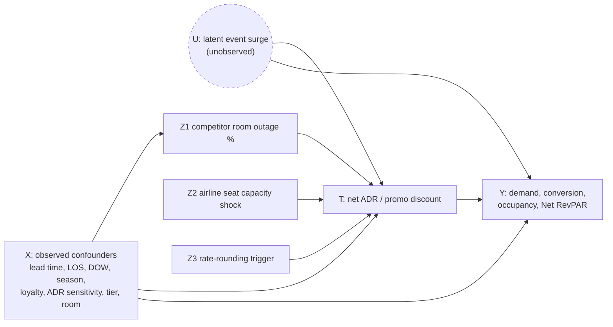

**Diagram 2: end-to-end pipeline**

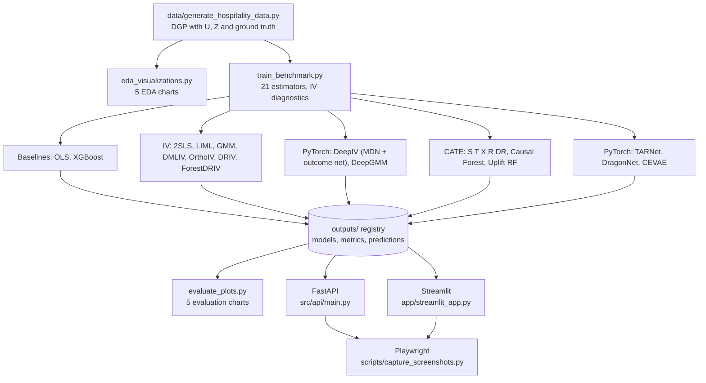

**Diagram 3: real-time RevPAR optimisation request**

```mermaid
sequenceDiagram
    participant RM as Revenue manager / CRM
    participant API as FastAPI /optimize-price
    participant REG as Model registry (joblib)
    participant OPT as revenue_optimizer
    RM->>API: POST guest profile + instruments
    API->>REG: fetch Naive OLS, 2SLS, DML-IV, DR-IV, DeepIV
    API->>OPT: compare_policies(models, profile)
    loop ADR grid $95-$650 x promo grid
        OPT->>REG: predict_log_demand(X, ln net price)
        OPT->>OPT: occupancy = E[1-exp(-D)], Net RevPAR
    end
    OPT-->>API: optimal ADR, promo %, realised lift vs naive
    API-->>RM: JSON (+ RevPAR curves, latency logged)
```

## 3. Mathematical formulation

**Structural demand (DGP).** For booking *i* with net price \(p_i\):
\(\log D_i = c(X_i) + \theta(X_i)\,\ln p_i + \gamma U_i + \varepsilon_i\), occupancy \(=1-e^{-D}\),
Net RevPAR \(=\text{occ}\cdot(p(1-d)-c_0)\). Prices follow \(\ln p_i = f(X_i) + \delta U_i + \pi^\top Z_i + \nu_i\),
so \(\operatorname{Cov}(\ln p, U)\neq 0\) and OLS is biased by \(\gamma\,\delta\,\sigma_U^2/\operatorname{Var}(\ln p\mid X)\).

**2SLS.** First stage \(\ln p = X\alpha + Z\pi + v\); second stage \(y = X\beta + \theta\,\widehat{\ln p} + e\), i.e.
\(\hat\theta = (\hat T^\top M_X \hat T)^{-1}\hat T^\top M_X y\). Heterogeneity enters through \(\ln p \times h(X)\) interactions with
instruments \(Z\times h(X)\). Diagnostics: partial F on \(\pi=0\), Wu-Hausman, Sargan-Hansen J.

**DML-IV / OrthoIV / DR-IV.** Residualise \(\tilde Y = Y-E[Y|X]\), \(\tilde T=T-E[T|X]\), \(\tilde Z=Z-E[Z|X]\) with cross-fitted
GBDTs and solve \(E[(\tilde Y-\theta(X)\tilde T)\,\tilde Z\mid X]=0\). DR-IV forms the doubly-robust pseudo-outcome
\(\theta_{pre}(X)+\frac{(\tilde Y-\theta_{pre}\tilde T)\tilde Z}{\beta(X)}\) with compliance \(\beta(X)=E[\tilde T\tilde Z|X]\), then regresses it on X.

**DeepIV.** Stage 1: mixture density network \(f_\phi(t\mid x,z)=\sum_k\pi_k\,\mathcal N(\mu_k,\sigma_k^2)\) (NLL). Stage 2:
\(\min_\psi \sum_i\big(y_i-\tfrac1M\sum_{m=1}^M h_\psi(x_i,\tilde t_{im})\big)^2,\ \tilde t_{im}\sim f_\phi(\cdot\mid x_i,z_i)\),
which targets \(E[h(X,T)\mid X,Z]\). Elasticity is \(\partial h/\partial\ln p\) by autograd.
**DeepGMM:** \(\min_g\max_f\ E[f(X,Z)\psi]-\tfrac14E[f(X,Z)^2\psi^2]\), \(\psi=Y-g(X,T)\).

**CATE learners (promo W).** S: \(\mu(x,w)\), \(\tau=\mu(x,1)-\mu(x,0)\). T: \(\mu_1-\mu_0\). X: impute
\(D^1=Y^1-\hat\mu_0(X^1)\), \(D^0=\hat\mu_1(X^0)-Y^0\), \(\tau=g(x)\hat\tau_0+(1-g(x))\hat\tau_1\). R: minimise
\(\sum[(Y-m(X))-\tau(X)(W-e(X))]^2\). DR: \(\hat\mu_1-\hat\mu_0+\frac{W(Y-\hat\mu_1)}{e}-\frac{(1-W)(Y-\hat\mu_0)}{1-e}\) regressed on X.
DragonNet adds a propensity head and targeted regularisation \(\sum(y-\hat y_w-\epsilon\,(\tfrac{w}{e}-\tfrac{1-w}{1-e}))^2\).
Because the promo changes the net price, its true effect is \(\tau(X)=\theta(X)\ln(1-d)\), so every model is scored on both
elasticity RMSE and PEHE.

## 4. Repository and `outputs/` reference

```
config/config.yaml            hyperparameters, DGP parameters, scenarios, GPU flags
data/generate_hospitality_data.py
src/utils/{gpu_utils,logger,metrics,structural,registry,plotstyle}.py
src/models/{base,baselines,iv_econometric,deep_iv_pytorch,cate_metalearners,deep_cate_pytorch}.py
src/optimization/revenue_optimizer.py
src/pipelines/{eda_visualizations,train_benchmark,evaluate_plots}.py
src/api/main.py   app/streamlit_app.py   scripts/capture_screenshots.py   tests/test_smoke.py
outputs/data/           hospitality_bookings.parquet, ground_truth_counterfactuals.parquet, dgp_summary_stats.json
outputs/models/         causal_estimators.joblib, deep_iv_stage{1_mdn,2_outcome}.pt, deep_cate_models.pt  (git-ignored: regenerate)
outputs/metrics/        iv_first_stage_diagnostics.json, benchmark_summary.{csv,json}, test_predictions.parquet, training_histories.json
outputs/logs/           data_gen, eda, train_benchmark, evaluate_plots, api_server, playwright (+ server stdout logs)
outputs/visualizations/ eda/*.png, evaluation/*.png
outputs/screenshots/    api/*.png, streamlit/*.png
```

GPU handling lives in `src/utils/gpu_utils.py`: CUDA detection, VRAM logging, version-aware XGBoost params
(`gpu_hist` on 1.x, `device="cuda"` on 2.x), CatBoost `task_type="GPU"`, PyTorch `.to(device)`; all fall back to CPU.

## 5. Quickstart

```bash
pip install -r requirements.txt && python -m playwright install chromium
bash run_all.sh            # or: make all   (data -> EDA -> train -> evaluate -> screenshots; ~8 min on CPU)
make test                  # fast smoke tests
make api                   # http://127.0.0.1:8000/docs
make ui                    # http://127.0.0.1:8501
```

Environment notes (found while building on Python 3.9.7): `econml` needs a version compatible with your scikit-learn
(0.17.1 here with sklearn 1.6); an old `numba` breaks `import econml`; an old `dask` breaks `import lightgbm` with recent pandas
(a shim in `gpu_utils.py` works around it); `causalml.inference.meta` does not run with scikit-learn 1.6 (cross-check is skipped with a warning);
Python 3.9.7 cannot install Streamlit newer than 1.12, which the app is written to support. The brief's `econml.iv.nnet.DeepIV`
(Keras) was not used; DeepIV is implemented in PyTorch.

## 6. Results

### Benchmark (held-out 7,500 bookings)

| Model | Family | Elasticity RMSE | PEHE | AUUC (oracle) |
|---|---|---|---|---|
| OrthoIV | IV | 0.154 | 0.025 | 0.990 |
| DML-IV | IV | 0.208 | 0.034 | 0.988 |
| DR-IV (LinearDRIV) | IV | 0.211 | 0.034 | 0.977 |
| IV-GMM / 2SLS | IV | 0.233 / 0.241 | 0.038 / 0.039 | 0.992 / 0.991 |
| DeepIV (PyTorch) | Deep IV | 0.269 | 0.044 | 0.984 |
| DragonNet / TARNet | Deep CATE | 0.279 / 0.322 | 0.045 / 0.052 | 0.960 / 0.946 |
| Causal Forest DML | Forest | 0.298 | 0.048 | 0.935 |
| DeepGMM | Deep IV | 0.330 | 0.054 | 0.933 |
| S / R / X / T / DR learners | Meta | 0.37 to 0.48 | 0.060 to 0.078 | 0.89 to 0.91 |
| Uplift RF | Forest | 1.073 | 0.174 | 0.088 |
| Naive XGBoost / Naive OLS | Naive | 1.616 / 1.821 | 0.263 / 0.296 | 0.920 / 0.015 |
| CEVAE (bonus) | Deep CATE | 2.458 | 0.399 | 0.716 |

Meta-learners estimate the *promo* effect (a 15 % price cut), so their implied elasticity \(\tau/\ln 0.85\) amplifies noise about 6x;
PEHE is the fairer column for them. Single-seed results; differences among the top IV models are within noise.

### Scenarios (DeepIV vs Naive OLS, realised RevPAR averaged over the unobserved shock)

| Scenario | True ε | Naive OLS ε / ADR | DeepIV ε / ADR / promo | True optimal ADR | Realised RevPAR lift vs naive |
|---|---|---|---|---|---|
| A Convention surge | -1.72 | +0.34 / $650 | -1.34 / $424 / 0 % | $452 | +5.2 % (but **-7.7 %** if this exact surge occurs) |
| B Shoulder season, leisure | -2.81 | +0.34 / $650 | -2.38 / $300 rack / 10 % | $246 | +155 % |
| B Shoulder season, corporate | -0.32 | +0.34 / $650 | -0.45 / $650 / 0 % | $650 (grid cap) | 0 % |
| C Airline -25 % seats | -2.17 | +0.34 / $650 | -1.85 / $387 / 0 % | $387 | +20.4 % (+7.9 % vs status quo) |
| D Custom (defaults) | -1.87 | +0.34 / $650 | -1.74 / $302 / 0 % | $349 | +17.6 % (+6.0 % vs status quo) |

Scenario A is the instructive one: when the surge actually materialises, charging $650 is profitable, but only because of
the shock the naive model cannot see; the same model also charges $650 on ordinary nights, where it loses. The instrument in
scenario C moves the *market* rate but not structural demand, so the optimal price is unchanged while a market-following manager under-prices.

### Gallery

**EDA**

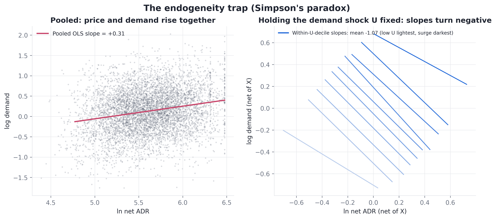
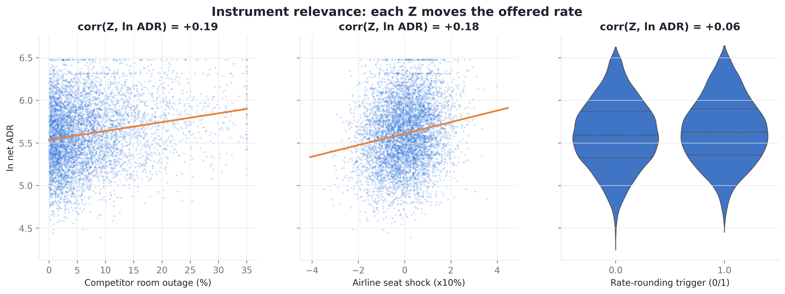
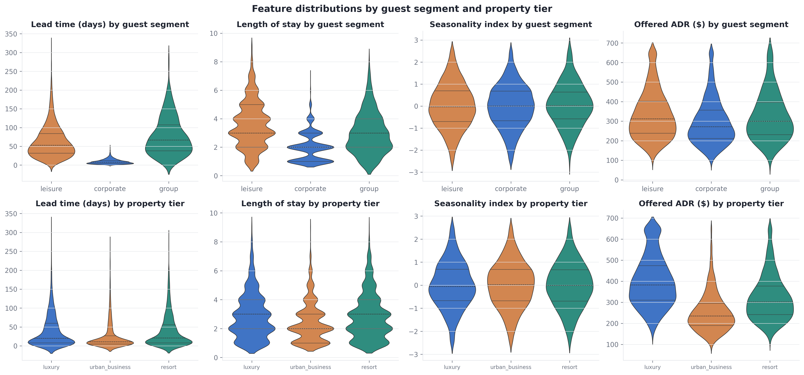
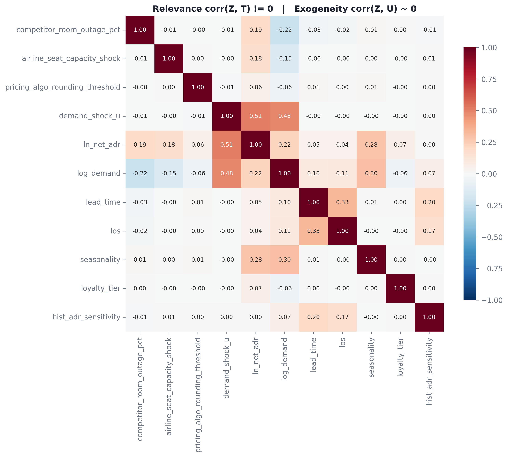
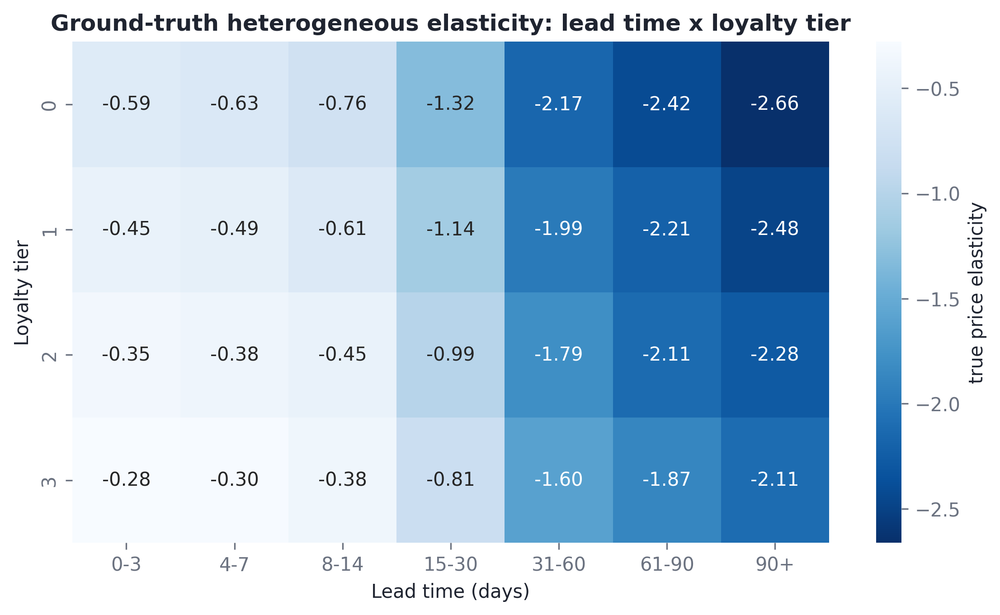

**Training and causal evaluation**

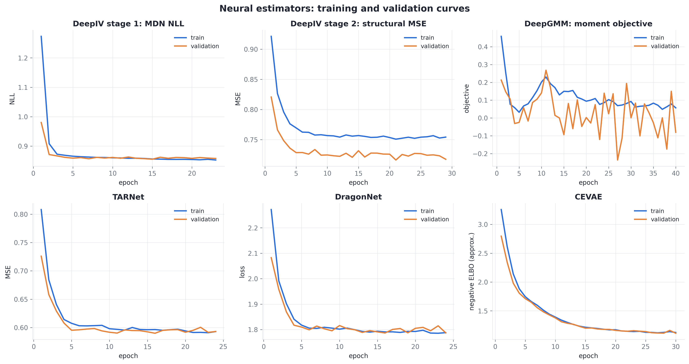
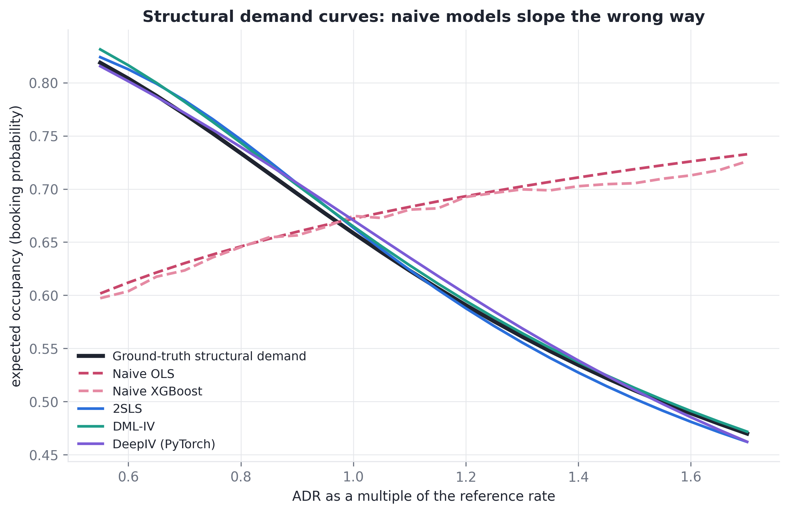
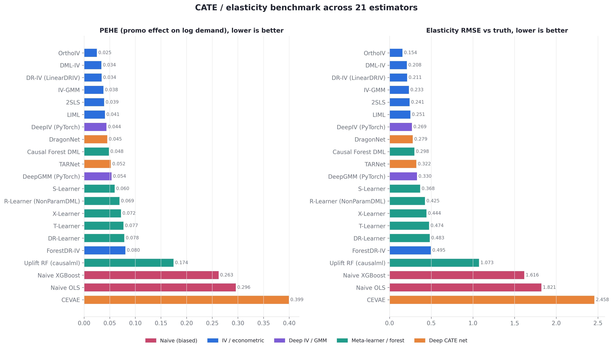
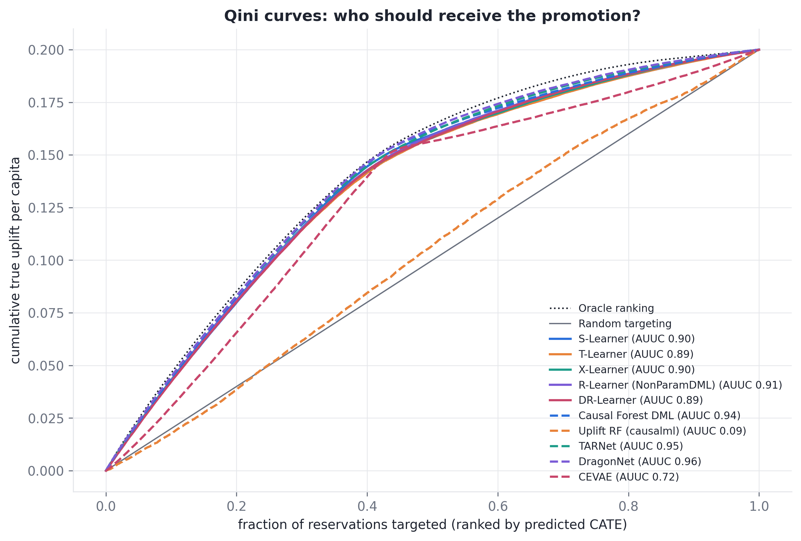
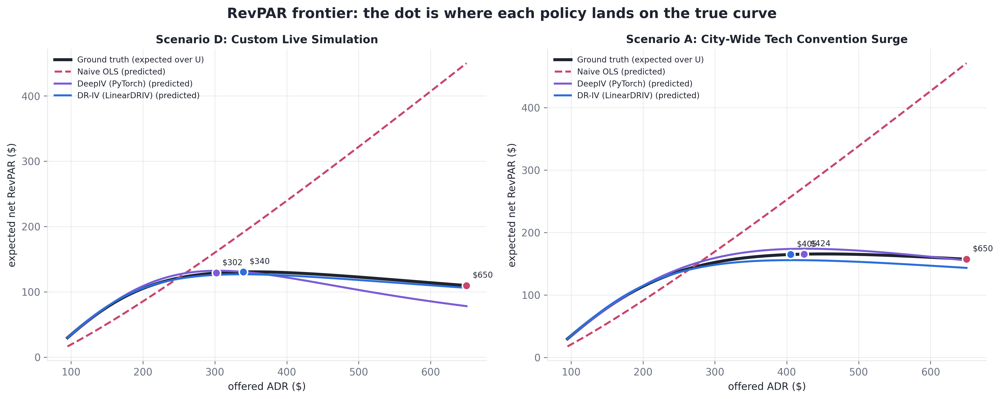

**FastAPI Swagger UI**

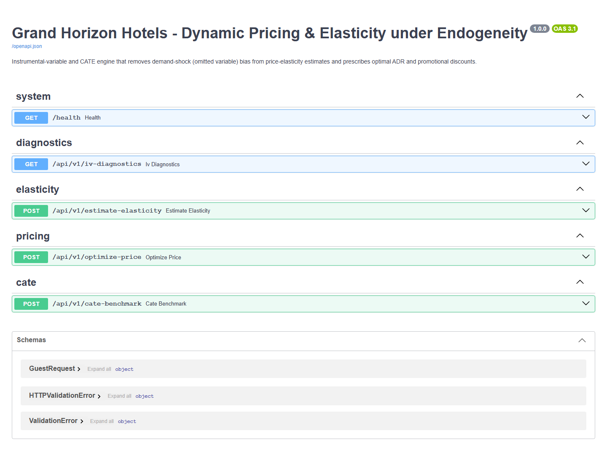
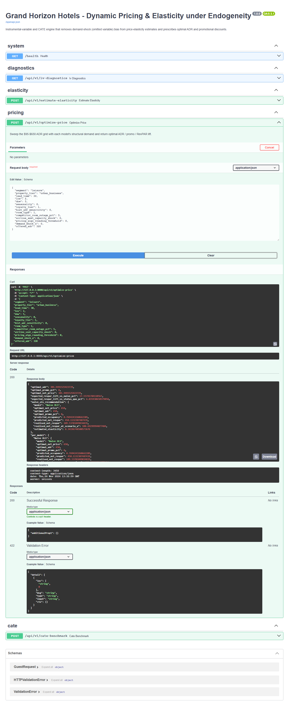
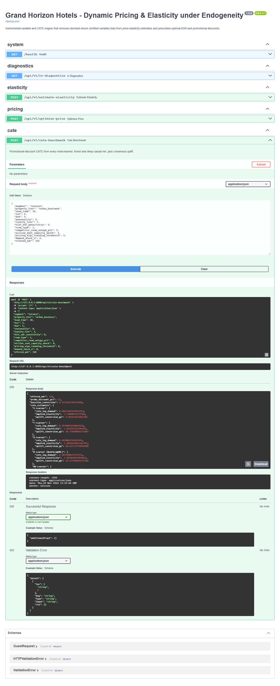

**Streamlit dashboard**

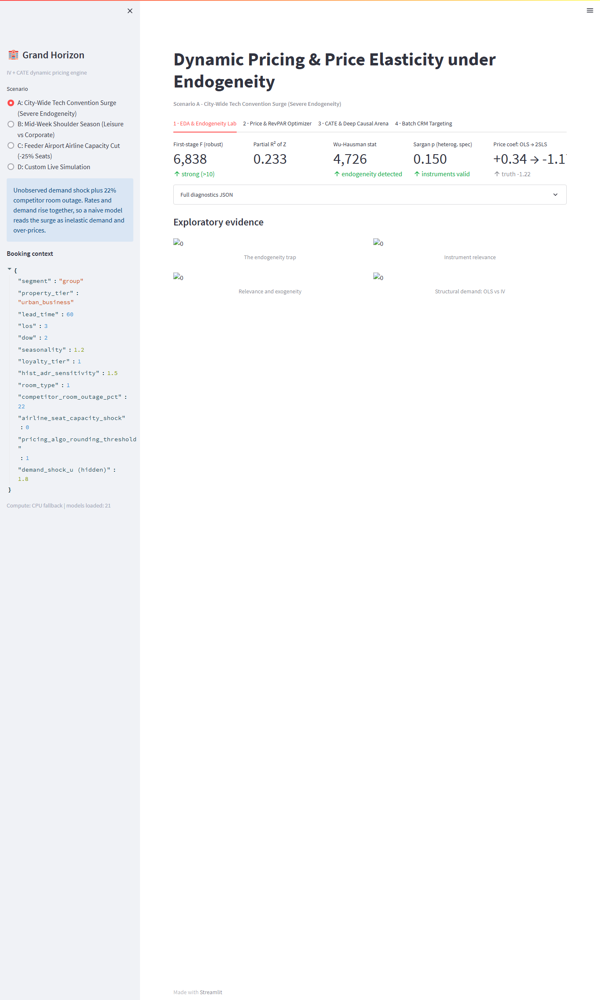
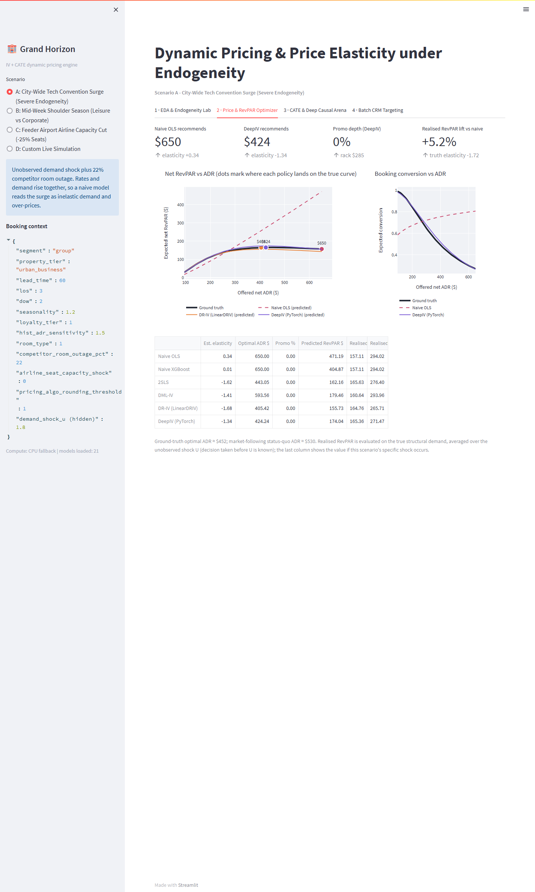
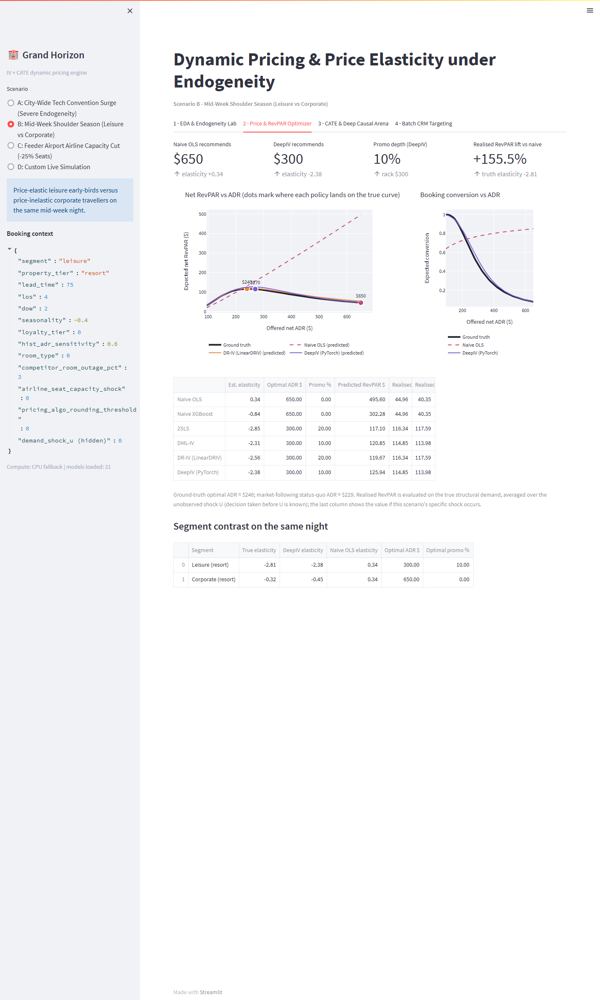
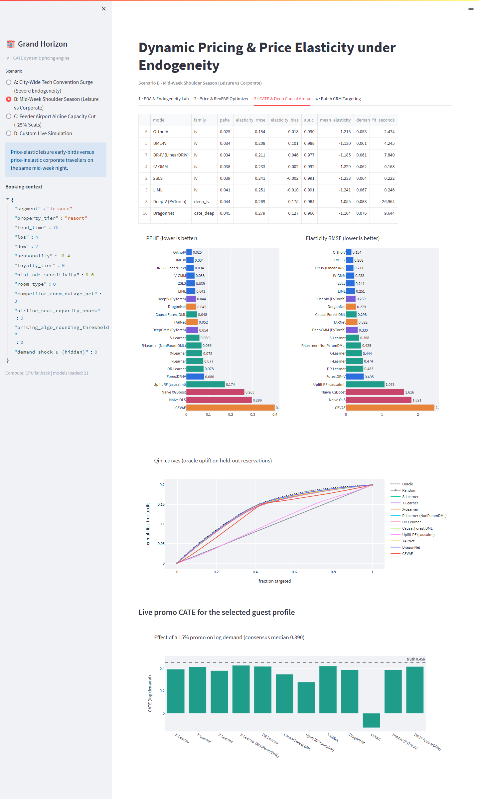
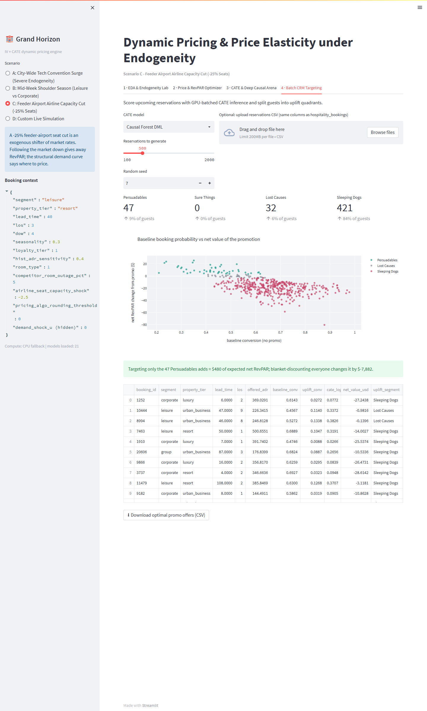
