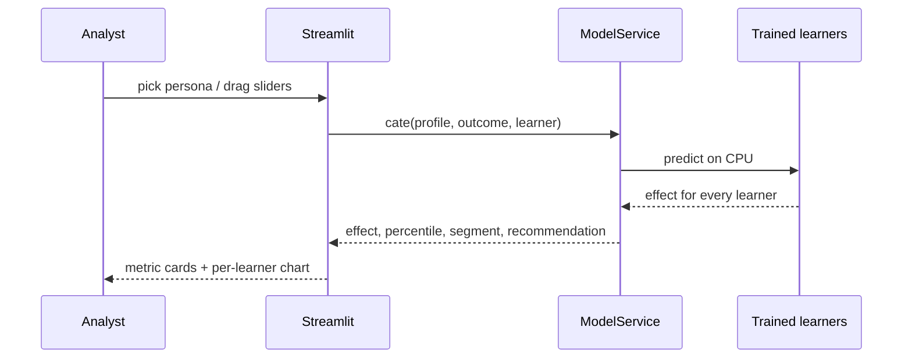
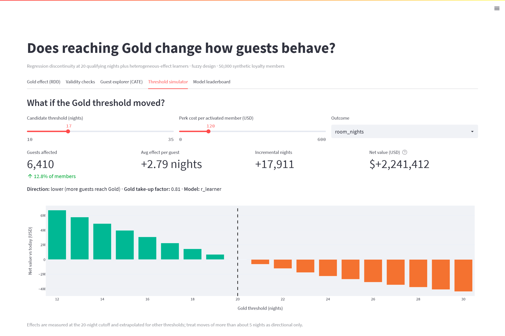

# Loyalty Tier RDD + CATE Engine

Does reaching **Gold status at 20 qualifying nights** *cause* guests to stay, spend and book direct more next year, or do
high-tier guests simply spend more anyway? This repository answers that with

1. **Regression discontinuity (RDD)**, sharp and fuzzy, for the causal effect for guests right at the threshold;
2. **12 kernel-weighted CATE learners** (the 11 algorithm families) for *which* guests respond most;
3. a **FastAPI** service and a **Streamlit** dashboard on top of the trained models.

All data are synthetic, generated with a known truth (+3.4 room nights, +$420 ancillary spend, +0.11 direct-booking
share at the cutoff, with strong heterogeneity), so every estimate in this README can be checked against reality.

## Results at a glance

50,000 members, fuzzy design (12% reach Gold below 20 nights through co-brand card fast-tracks or status matches,
94% at or above 20), one full training run (`make train`, 11.5 minutes on an RTX 3090).

| Outcome | Fuzzy RDD estimate (95% CI) | Known truth |
|---|---|---|
| Next-year room nights | **+3.67** nights (3.36 to 3.98) | +3.40 |
| Next-year ancillary spend | **+$424** ($387 to $462) | +$420 |
| Next-year direct-booking ratio | **+0.109** (0.100 to 0.117) | +0.110 |

Honest note: the room-nights estimate is about 1.7 standard errors above the truth. It matches `linearmodels` and
`rdrobust` exactly (so it is not an implementation error), the sharp-design estimate is 3.36, and a sweep over bandwidths
gives 3.5 to 3.7. I read it as sampling noise plus a small local-polynomial bias, not as something to hide.

**Validity checks all pass:** density continuity at the cutoff (McCrary-style p = 0.26; the same test on data with simulated
gaming rejects at p < 0.001), all 10 covariates balanced (smallest Holm-adjusted p = 0.29), all four placebo cutoffs null,
donut hole (dropping 19 and 20 nights) gives 3.60.

**Who responds most (room nights, out-of-fold, correlation with the true individual effect):**

| Learner | Corr. | RMSE | AUUC over random | Avg. effect (truth 3.40) |
|---|---|---|---|---|
| R-Learner | 0.905 | 0.466 | 0.288 | 3.41 |
| DR-Learner | 0.897 | 0.483 | 0.284 | 3.42 |
| X-Learner | 0.909 | 0.485 | 0.291 | 3.43 |
| T-Learner | 0.895 | 0.502 | 0.279 | 3.44 |
| NonParamDML | 0.894 | 0.509 | 0.286 | 3.43 |
| TARNet | 0.884 | 0.516 | 0.276 | 3.41 |
| CausalForestDML | 0.907 | 0.517 | 0.281 | 3.42 |
| DragonNet | 0.881 | 0.520 | 0.277 | 3.39 |
| S-Learner | 0.881 | 0.523 | 0.286 | 3.42 |
| DMLIV (fuzzy IV) | 0.847 | 0.710 | 0.262 | 3.48 |
| LinearDML | 0.685 | 0.852 | 0.246 | 3.44 |
| Orthogonal Forest (distilled) | 0.413 | 1.041 | 0.121 | 3.18 |

Ten of the twelve learners are within a few hundredths of each other, so the ranking at the top is not meaningful.
Corporate road warriors respond least (about +1.4 nights), mid-priced leisure and bleisure guests most (about +4 to +5).
LinearDML is weak by construction (the true effect is bell-shaped in ADR and business share, and a linear CATE cannot
represent that). The orthogonal forest is weak because econml's implementation is too slow to predict on thousands of rows,
so it is fitted on a 3,000-row subsample and distilled (see Design decisions).


## Architecture

```mermaid
flowchart LR
    G[synthetic_generator<br/>sharp / fuzzy panel] --> R[rdd_estimators<br/>local poly, 2SLS, IK/CCT]
    R --> V[validity suite<br/>McCrary, balance,<br/>placebo, donut]
    G --> W[CateData<br/>window |R-c|<=h,<br/>kernel weights,<br/>slope adjustment]
    W --> L[12 CATE learners<br/>XGBoost / CatBoost GPU,<br/>econml, PyTorch CUDA]
    L --> O[Optuna tuning<br/>validation R-loss]
    O --> CV[out-of-fold evaluation<br/>AUUC, Qini, Uplift@K,<br/>policy value]
    R --> A[(outputs/<br/>models, metrics,<br/>plots, logs)]
    V --> A
    CV --> A
    A --> S[ModelService]
    S --> API[FastAPI<br/>/predict/late /predict/cate<br/>/simulate/threshold]
    S --> UI[Streamlit dashboard<br/>5 tabs, 5 personas]
```



## Quick start

```bash
make setup          # venv (default C:/venvs/loyalty), CUDA torch, dependencies, Playwright Chromium
make train          # data -> RDD + diagnostics -> 12 tuned learners -> artifacts in outputs/
make serve          # FastAPI on :8000  (Swagger UI at /docs)
make app            # Streamlit on :8501
make test           # 52 tests
make verify-ui      # launches both servers and saves screenshots to outputs/screenshots
make all            # setup, train, test, verify-ui
```

Useful options: `python -m src.models.trainer --quick` (12k guests, 2 Optuna trials, no ORF, a few minutes),
`--learners s_learner,tarnet`, `--regime sharp`. Everything else is in `configs/config.yaml` (cutoff, bandwidth grid,
kernels, GPU flags, Optuna trials, learner list).

**Environment.** Python 3.9.7, an NVIDIA GPU (developed on an RTX 3090 with CUDA 12.6 wheels), and a **short venv path**:
a venv inside a deep folder fails to install torch on Windows because of the 260-character path limit.
Without a GPU everything falls back to CPU automatically (`src/utils/device.py`).

## What is in the box

| Path | Purpose |
|---|---|
| `src/data/synthetic_generator.py` | 50k-member panel with a known effect; `manipulation=True` adds bunching just above 20 nights |
| `src/models/rdd_estimators.py` | local polynomial (p=1,2; triangular/Epanechnikov/uniform), fuzzy 2SLS, IK and CCT bandwidths, sensitivity sweep, McCrary test, balance, placebo, donut |
| `src/models/cate_learners.py` | the 12 learners plus the Optuna tuner |
| `src/models/trainer.py` | end-to-end run, out-of-fold evaluation, artifact persistence, GPU telemetry |
| `src/evaluation/causal_metrics.py` | LATE tables, AUUC, Qini, Uplift@K, policy value, PEHE, R-loss |
| `src/evaluation/visualizer.py` | 8 charts at 300 DPI in `outputs/plots/` |
| `src/api/` | FastAPI app, Pydantic v2 schemas, shared `ModelService` |
| `src/ui/app.py` | Streamlit dashboard |
| `scripts/capture_screenshots.py` | Playwright capture of the API docs and every dashboard tab |
| `tests/test_causal_pipeline.py` | 52 tests: RDD recovery, validity tests, all learners, metrics, API |

### The 12 learners

| # | Learner | Implementation |
|---|---|---|
| 1 | S-Learner | GPU XGBoost or LightGBM with T-by-X interaction terms |
| 2 | T-Learner | separate GPU XGBoost or CatBoost models per arm |
| 3 | X-Learner | imputed effects blended by a propensity model |
| 4 | R-Learner | Robinson residual-on-residual, cross-fitted nuisances |
| 5 | DR-Learner | AIPW pseudo-outcomes, 3-fold cross-fitting |
| 6 | LinearDML, NonParamDML | econml with GPU XGBoost nuisance models |
| 7 | CausalForestDML | econml honest forest, GPU nuisances |
| 8 | Orthogonal Forest | econml `DMLOrthoForest`, distilled (see below) |
| 9 | DMLIV | econml `NonParamDMLIV`: eligibility `1(R>=c)` instruments Gold attainment |
| 10 | TARNet | PyTorch CUDA, shared representation, two outcome heads, kernel-weighted loss |
| 11 | DragonNet | PyTorch CUDA, adds a propensity head and targeted regularization |

## Design decisions worth knowing

- **Running variable.** The learners work on a window |R - 20| <= 10 with triangular kernel weights. Before fitting, each
  side's linear trend in R is removed from the outcome (the jump at the cutoff is kept), and R itself is not an effect
  modifier. Without this a sharp design has no overlap and the trend in R biases every learner. Consequence: CATEs are
  local to guests near 20 nights, and extrapolating them far from the cutoff is not valid.
- **The fuzzy IV learner** (DMLIV) estimates an effect for compliers; the other learners estimate the effect of actually
  holding Gold. In this synthetic design these coincide because the effect does not depend on compliance type given X.
- **Tuning** minimises the Robinson R-loss on a held-out split, so it needs no ground truth. Trial 0 always uses the default
  parameters, so tuning cannot do worse than the untuned model. Ground-truth metrics (correlation, RMSE) are for reporting only.
- **Orthogonal forest** costs about 0.25 s per predicted row in econml, so it is fitted on 3,000 rows, evaluated on 400
  reference points, and distilled into a small XGBoost surrogate. It is not Optuna-tuned. It is the weakest learner; drop it
  from `configs/config.yaml` if you do not need it.
- **Threshold simulator.** Effects are measured at 20 nights; moving the cutoff by more than about 5 nights is extrapolation
  and the API says so in `warnings`. Under the fuzzy design the simulator multiplies by the Gold take-up jump (0.81).
- **McCrary test.** A first version of the density test rejected a true null 37% to 100% of the time (curvature plus
  unstable residual variances). It now uses a quadratic fit with Poisson variance and rejects about 7% of clean datasets
  over 30 seeds, close to the nominal 5%. Estimates at h=3 with a quadratic fit are `NaN` because only two usable whole-night
  values exist per side.

## Screenshots

FastAPI (`/docs`), executed against the trained models:


Dashboard, guest explorer (leisure family vs corporate road warrior personas):

| | |
|---|---|
|  |  |

Threshold simulator:



More in `outputs/screenshots/` (Swagger overview, LATE and simulate calls, RDD, validity checks, leaderboard) and
`outputs/plots/` (density test, bandwidth sensitivity, falsification, leaderboard, segments, uplift and Qini, loss curves).

## API

| Endpoint | What it does |
|---|---|
| `GET /health` | status, cutoff, regime, trained outcomes, best learner, GPU info |
| `POST /predict/late` | RDD effect at the cutoff for any outcome, kernel, bandwidth (4 to 20), order, sharp or fuzzy |
| `POST /predict/cate` | individual effect for a guest profile, with percentile, segment, recommendation and every learner's estimate |
| `POST /simulate/threshold` | guests affected, incremental nights, revenue and net value for a candidate threshold (8 to 40 nights) |
| `GET /leaderboard` | out-of-fold learner metrics |

Request validation is domain-aware (ADR 30 to 2000 USD, shares in [0,1], known regions and age bands, an implausible
first-year profile is rejected). Invalid input returns 422, unknown learners 404, missing models 503.

## Known limitations and platform notes

- **Synthetic data only.** The estimates are validated against a known truth; real loyalty data will violate assumptions
  (manipulation, sorting, noisy tier credit) that the diagnostics are there to catch.
- **One outcome has CATE models.** By default learners are trained for room nights; add the other two outcomes under
  `cate.outcomes` in the config (the RDD covers all three).
- **LightGBM runs on CPU** (the pip wheel has no GPU build). The cuml/cupy path from the spec is not wired in.
- **Serving runs on CPU.** XGBoost 2.x with CUDA aborts the process (exit code 0xC0000409) when a short-lived thread that
  predicted on the GPU exits; this killed the Streamlit server and the pytest process until inference was moved to CPU
  (`to_cpu_inference` in `src/api/service.py`; `LOYALTY_GPU_INFERENCE=1` opts out). Training still uses the GPU.
  The test client is deliberately never torn down and `tests/conftest.py` has a `hard_exit` backstop for the same reason.
- **Streamlit 1.12 and plotly<6.** Python 3.9.7 is excluded by newer Streamlit releases. The dashboard therefore uses
  Streamlit 1.12 (no nested columns, `experimental_singleton`) with `altair<5`, `protobuf<4` and `plotly<6`
  (plotly 6+ emits binary arrays that this Streamlit cannot render).
