# Loyalty Tier RDD + CATE Engine

Does reaching **Gold status at 20 qualifying nights** *cause* guests to stay, spend and book direct more next year, or do
high-tier guests simply spend more anyway? This repository answers that with

1. **Regression discontinuity (RDD)**, sharp and fuzzy, for the causal effect for guests right at the threshold;
2. **12 kernel-weighted CATE learners** (the 11 algorithm families) for *which* guests respond most;
3. a **FastAPI** service and a **Streamlit** dashboard on top of the trained models.

All data are synthetic, generated with a known truth (+3.4 room nights, +$420 ancillary spend, +0.11 direct-booking
share at the cutoff, with strong heterogeneity), so every estimate in this README can be checked against reality.

## Results at a glance

50,000 members, fuzzy design (12% reach Gold below 20 nights through co-brand card fast-tracks or status matches,
94% at or above 20), one full training run (`make train`, 11.5 minutes on an RTX 3090).

| Outcome | Fuzzy RDD estimate (95% CI) | Known truth |
|---|---|---|
| Next-year room nights | **+3.67** nights (3.36 to 3.98) | +3.40 |
| Next-year ancillary spend | **+$424** ($387 to $462) | +$420 |
| Next-year direct-booking ratio | **+0.109** (0.100 to 0.117) | +0.110 |

Honest note: the room-nights estimate is about 1.7 standard errors above the truth. It matches `linearmodels` and
`rdrobust` exactly (so it is not an implementation error), the sharp-design estimate is 3.36, and a sweep over bandwidths
gives 3.5 to 3.7. I read it as sampling noise plus a small local-polynomial bias, not as something to hide.

**Validity checks all pass:** density continuity at the cutoff (McCrary-style p = 0.26; the same test on data with simulated
gaming rejects at p < 0.001), all 10 covariates balanced (smallest Holm-adjusted p = 0.29), all four placebo cutoffs null,
donut hole (dropping 19 and 20 nights) gives 3.60.

**Who responds most (room nights, out-of-fold, correlation with the true individual effect):**

| Learner | Corr. | RMSE | AUUC over random | Avg. effect (truth 3.40) |
|---|---|---|---|---|
| R-Learner | 0.905 | 0.466 | 0.288 | 3.41 |
| DR-Learner | 0.897 | 0.483 | 0.284 | 3.42 |
| X-Learner | 0.909 | 0.485 | 0.291 | 3.43 |
| T-Learner | 0.895 | 0.502 | 0.279 | 3.44 |
| NonParamDML | 0.894 | 0.509 | 0.286 | 3.43 |
| TARNet | 0.884 | 0.516 | 0.276 | 3.41 |
| CausalForestDML | 0.907 | 0.517 | 0.281 | 3.42 |
| DragonNet | 0.881 | 0.520 | 0.277 | 3.39 |
| S-Learner | 0.881 | 0.523 | 0.286 | 3.42 |
| DMLIV (fuzzy IV) | 0.847 | 0.710 | 0.262 | 3.48 |
| LinearDML | 0.685 | 0.852 | 0.246 | 3.44 |
| Orthogonal Forest (distilled) | 0.413 | 1.041 | 0.121 | 3.18 |

Ten of the twelve learners are within a few hundredths of each other, so the ranking at the top is not meaningful.
Corporate road warriors respond least (about +1.4 nights), mid-priced leisure and bleisure guests most (about +4 to +5).
LinearDML is weak by construction (the true effect is bell-shaped in ADR and business share, and a linear CATE cannot
represent that). The orthogonal forest is weak because econml's implementation is too slow to predict on thousands of rows,
so it is fitted on a 3,000-row subsample and distilled (see Design decisions).

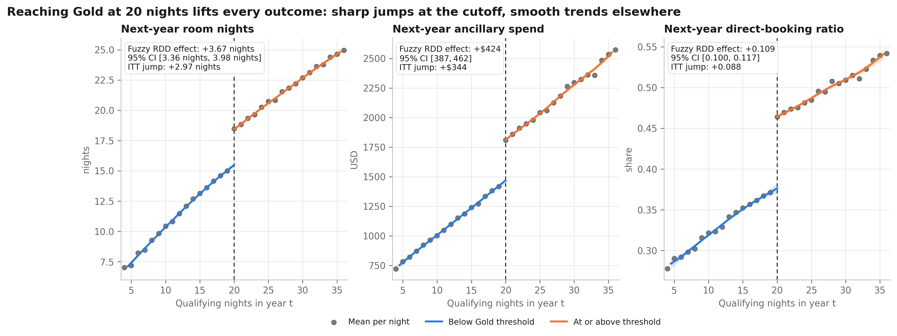

## Architecture

```mermaid
flowchart LR
    G[synthetic_generator<br/>sharp / fuzzy panel] --> R[rdd_estimators<br/>local poly, 2SLS, IK/CCT]
    R --> V[validity suite<br/>McCrary, balance,<br/>placebo, donut]
    G --> W[CateData<br/>window |R-c|<=h,<br/>kernel weights,<br/>slope adjustment]
    W --> L[12 CATE learners<br/>XGBoost / CatBoost GPU,<br/>econml, PyTorch CUDA]
    L --> O[Optuna tuning<br/>validation R-loss]
    O --> CV[out-of-fold evaluation<br/>AUUC, Qini, Uplift@K,<br/>policy value]
    R --> A[(outputs/<br/>models, metrics,<br/>plots, logs)]
    V --> A
    CV --> A
    A --> S[ModelService]
    S --> API[FastAPI<br/>/predict/late /predict/cate<br/>/simulate/threshold]
    S --> FL[flows<br/>8 worked flows,<br/>stage + flow + programme metrics]
    FL --> A
    S --> UI[Streamlit dashboard<br/>6 tabs incl. End-to-end flows,<br/>5 personas]
    A --> UI
```

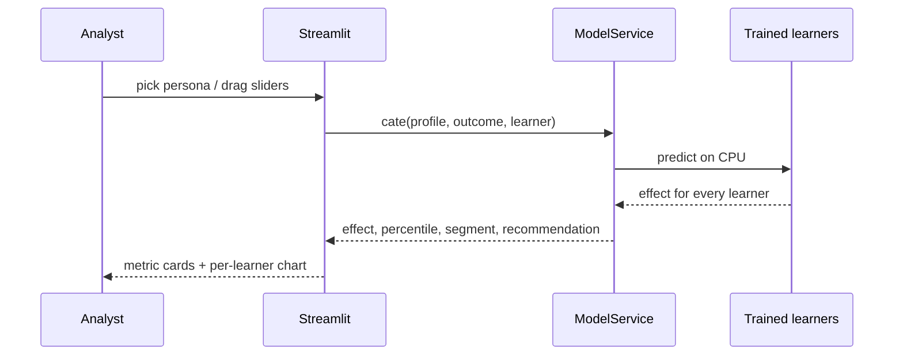

## Quick start

```bash
make setup          # venv (default C:/venvs/loyalty), CUDA torch, dependencies, Playwright Chromium
make train          # data -> RDD + diagnostics -> 12 tuned learners -> artifacts in outputs/ (also builds the flows)
make flows          # rebuild outputs/metrics/flows_report.json (8 flows + programme scorecard) from the trained models
make serve          # FastAPI on :8000  (Swagger UI at /docs)
make app            # Streamlit on :8501 (6 tabs; the last one is End-to-end flows)
make test           # pytest suite (63 tests)
make verify-ui      # launches both servers, screenshots the API, every tab and every flow stage, checks UI == API
make verify-flows   # only the flow screenshots (outputs/screenshots/flows/)
make all            # setup, train, test, verify-ui
```

Useful options: `python -m src.models.trainer --quick` (12k guests, 2 Optuna trials, no ORF, a few minutes),
`--learners s_learner,tarnet`, `--regime sharp`. Everything else is in `configs/config.yaml` (cutoff, bandwidth grid,
kernels, GPU flags, Optuna trials, learner list).

**Environment.** Python 3.9.7, an NVIDIA GPU (developed on an RTX 3090 with CUDA 12.6 wheels), and a **short venv path**:
a venv inside a deep folder fails to install torch on Windows because of the 260-character path limit.
Without a GPU everything falls back to CPU automatically (`src/utils/device.py`).

## What is in the box

| Path | Purpose |
|---|---|
| `src/data/synthetic_generator.py` | 50k-member panel with a known effect; `manipulation=True` adds bunching just above 20 nights |
| `src/models/rdd_estimators.py` | local polynomial (p=1,2; triangular/Epanechnikov/uniform), fuzzy 2SLS, IK and CCT bandwidths, sensitivity sweep, McCrary test, balance, placebo, donut |
| `src/models/cate_learners.py` | the 12 learners plus the Optuna tuner |
| `src/models/trainer.py` | end-to-end run, out-of-fold evaluation, artifact persistence, GPU telemetry |
| `src/evaluation/causal_metrics.py` | LATE tables, AUUC, Qini, Uplift@K, policy value, PEHE, R-loss |
| `src/evaluation/visualizer.py` | 8 charts at 300 DPI in `outputs/plots/` |
| `src/api/` | FastAPI app, Pydantic v2 schemas, shared `ModelService` |
| `src/flows.py` | the 8 end-to-end flows (4 types x 2 examples): stage-, flow- and programme-level metrics, UI independent |
| `src/ui/app.py`, `src/ui/flows_ui.py` | Streamlit dashboard (6 tabs) and the End-to-end flows tab |
| `scripts/capture_screenshots.py` | Playwright capture of the API docs, every tab, every flow stage, plus a UI == API check |
| `scripts/build_deck.py`, `presentation/` | the 62-slide end-to-end deck and its builder |
| `scripts/build_readme.py` | regenerates the flows section of this README from `flows_report.json` |
| `tests/test_causal_pipeline.py` | 63 tests: RDD recovery, validity tests, all learners, metrics, API, the end-to-end flows |

### The 12 learners

| # | Learner | Implementation |
|---|---|---|
| 1 | S-Learner | GPU XGBoost or LightGBM with T-by-X interaction terms |
| 2 | T-Learner | separate GPU XGBoost or CatBoost models per arm |
| 3 | X-Learner | imputed effects blended by a propensity model |
| 4 | R-Learner | Robinson residual-on-residual, cross-fitted nuisances |
| 5 | DR-Learner | AIPW pseudo-outcomes, 3-fold cross-fitting |
| 6 | LinearDML, NonParamDML | econml with GPU XGBoost nuisance models |
| 7 | CausalForestDML | econml honest forest, GPU nuisances |
| 8 | Orthogonal Forest | econml `DMLOrthoForest`, distilled (see below) |
| 9 | DMLIV | econml `NonParamDMLIV`: eligibility `1(R>=c)` instruments Gold attainment |
| 10 | TARNet | PyTorch CUDA, shared representation, two outcome heads, kernel-weighted loss |
| 11 | DragonNet | PyTorch CUDA, adds a propensity head and targeted regularization |

## End-to-end flows

<!-- FLOWS:START -->
Open the dashboard's last tab, **End-to-end flows**, pick a flow, and read it top to bottom. Four questions an analyst actually faces, two worked examples each; every stage has its own metrics and a PASS / WARN / FAIL gate, every flow ends in a verdict, and a programme scorecard rolls up all flows and all 12 models. `python -m src.flows` (or `make flows`) writes `outputs/metrics/flows_report.json`; the tab, the screenshots and this section all read that one file, and `scripts/capture_screenshots.py` checks that the numbers on screen equal the API's numbers.

Money assumptions (editable under `flows:` in `configs/config.yaml`): **40% contribution margin** on incremental revenue and **$120 perk cost** per Gold member per year. Revenue is room nights x the guest's ADR plus ancillary spend; direct-booking gains are not monetised.

| Flow | Question | Stages |
|---|---|---|
| **A. Gold effect read-out** | Does reaching Gold change behaviour, and is it worth the perks? | 6 / 6 per example |
| **B. Validity & negative control** | Can we trust the design, and can it tell 'no effect' from an effect? | 7 / 7 per example |
| **C. Guest what-if** | How much does Gold do for this particular guest? | 5 / 5 per example |
| **D. Threshold policy** | What happens to nights and money if the Gold threshold moves? | 6 / 6 per example |

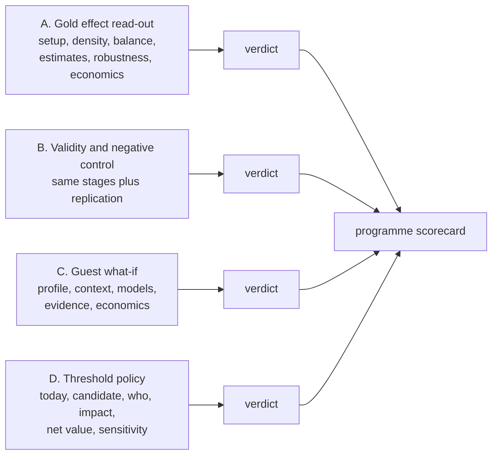

### A. Gold effect read-out

*Does reaching Gold change behaviour, and is it worth the perks?*

#### A1 - Fuzzy design (headline): GOLD PAYS OFF

*The programme as run: co-brand fast-track and status matches.* 12% of members below 20 nights already hold Gold (credit-card fast-track, status match) and 94% above it do (sync lag). Eligibility at 20 nights instruments actual Gold, so the estimate is for guests whose status follows the threshold.

**Verdict: GOLD PAYS OFF.** Valid design, a significant effect, and $291 net per member at a 40% margin.

| # | Stage | Gate | Metrics at this stage |
|---|---|---|---|
| 1 | Setup | info | Members **50,000**; Design **Fuzzy (fast-tracks)**; Gold below 20 nights **11.6%**; Gold at 20+ nights **94.1%** |
| 2 | Density | PASS | Log density ratio **+0.038**; p-value **0.264**; Density left / right **1870 / 1942**; Verdict **No bunching** |
| 3 | Balance | PASS | Balanced covariates **10 of 10**; Smallest Holm p **0.295**; Largest jump **historical_adr (2.2 SE)** |
| 4 | Estimates | info | Room nights **+3.67 (SE 0.16)**; Ancillary spend **+$424**; Direct-booking ratio **+0.109**; CIs covering truth **3 of 3** |
| 5 | Robustness | PASS | Bandwidth sweep **3.48 to 3.67**; Max deviation **1.9 SE**; Placebo cutoffs null **4 of 4**; Donut hole (19, 20 dropped) **3.60 vs 3.67** |
| 6 | Economics | PASS | Extra room revenue **$604**; Extra ancillary spend **$424**; Gross revenue **$1,028**; Contribution at 40% **$411** |

Flow-level metrics: Validity gates passed **3 of 3**; Room-night effect **+3.67**; True room-night effect **+3.40**; Mean |error| (SE) **0.7**; CIs covering truth **3 of 3**; Net per Gold member **$291**; ROI **243%**.

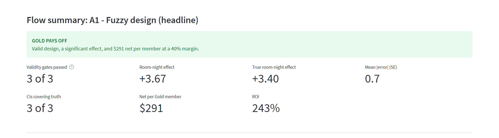

<details><summary>Screenshots of every stage</summary>


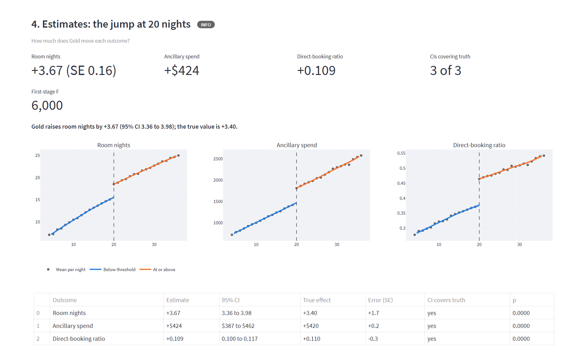

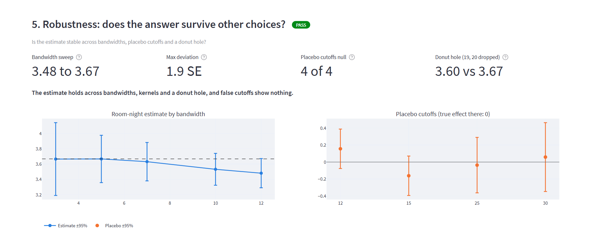


</details>

#### A2 - Sharp design: GOLD PAYS OFF

*Strict night rule: Gold if and only if 20+ nights.* The same population under a clean rule with no fast-tracks. Take-up jumps from 0% to 100%, so sharp and fuzzy RDD should agree on the effect and the sharp one should be tighter.

**Verdict: GOLD PAYS OFF.** Valid design, a significant effect, and $269 net per member at a 40% margin.

| # | Stage | Gate | Metrics at this stage |
|---|---|---|---|
| 1 | Setup | info | Members **50,000**; Design **Sharp (strict rule)**; Gold below 20 nights **0.0%**; Gold at 20+ nights **100.0%** |
| 2 | Density | PASS | Log density ratio **+0.038**; p-value **0.264**; Density left / right **1870 / 1942**; Verdict **No bunching** |
| 3 | Balance | PASS | Balanced covariates **10 of 10**; Smallest Holm p **0.337**; Largest jump **historical_adr (2.1 SE)** |
| 4 | Estimates | info | Room nights **+3.36 (SE 0.13)**; Ancillary spend **+$419**; Direct-booking ratio **+0.109**; CIs covering truth **3 of 3** |
| 5 | Robustness | PASS | Bandwidth sweep **3.22 to 3.42**; Max deviation **0.7 SE**; Placebo cutoffs null **4 of 4**; Donut hole (19, 20 dropped) **3.77 vs 3.36** |
| 6 | Economics | PASS | Extra room revenue **$553**; Extra ancillary spend **$419**; Gross revenue **$972**; Contribution at 40% **$389** |

Flow-level metrics: Validity gates passed **3 of 3**; Room-night effect **+3.36**; True room-night effect **+3.40**; Mean |error| (SE) **0.2**; CIs covering truth **3 of 3**; Net per Gold member **$269**; ROI **224%**.

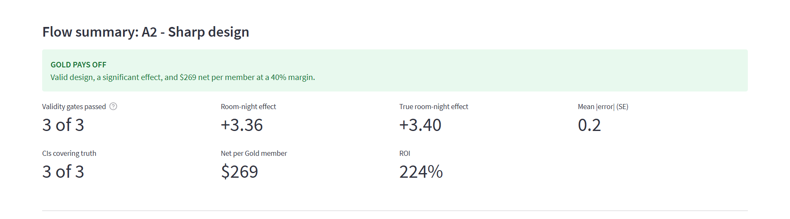

<details><summary>Screenshots of every stage</summary>

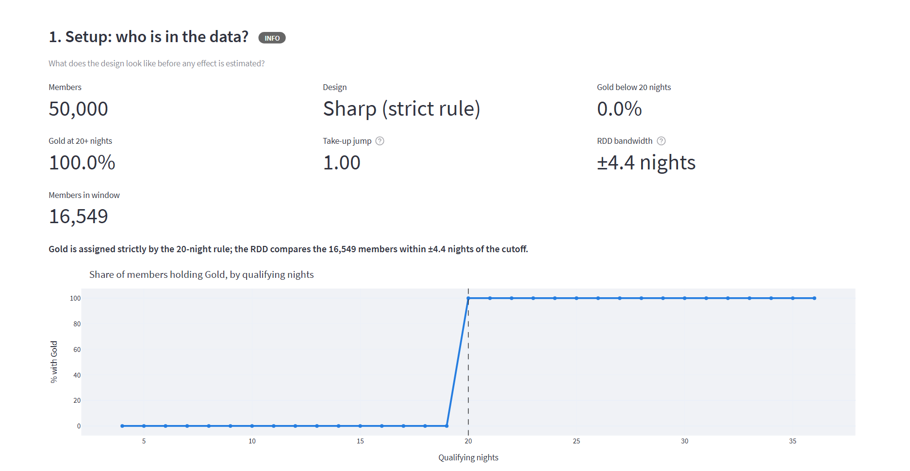

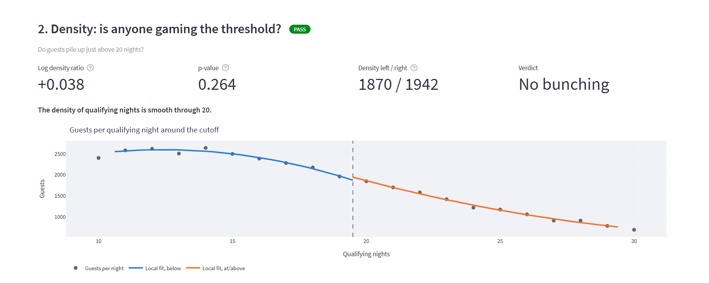


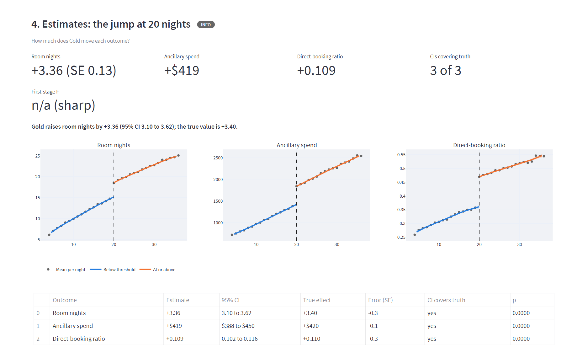

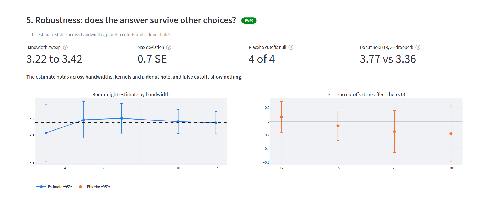

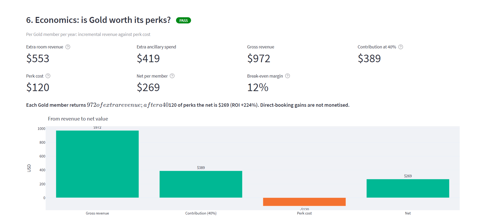

</details>

### B. Validity & negative control

*Can we trust the design, and can it tell 'no effect' from an effect?*

#### B1 - Placebo programme: FALSE POSITIVE

*Gold perks that do nothing (true effect 0).* A programme whose perks change nothing. A trustworthy design must say 'no detectable effect'; a significant jump here would be a false positive.

**Verdict: FALSE POSITIVE.** The interval excludes zero (p = 0.033) but the true effect is 0. At the 5% level about 1 in 20 placebo programmes looks like this; over 30 re-draws the rate was 3%.

| # | Stage | Gate | Metrics at this stage |
|---|---|---|---|
| 1 | Setup | info | Members **50,000**; Design **Fuzzy (fast-tracks)**; Gold below 20 nights **11.6%**; Gold at 20+ nights **94.1%** |
| 2 | Density | PASS | Log density ratio **+0.038**; p-value **0.264**; Density left / right **1870 / 1942**; Verdict **No bunching** |
| 3 | Balance | PASS | Balanced covariates **10 of 10**; Smallest Holm p **0.325**; Largest jump **historical_adr (2.1 SE)** |
| 4 | Estimates | info | Room nights **+0.34 (SE 0.16)**; Ancillary spend **+$12**; Direct-booking ratio **+0.000**; CIs covering truth **2 of 3** |
| 5 | Robustness | PASS | Bandwidth sweep **0.10 to 0.33**; Max deviation **2.5 SE**; Placebo cutoffs null **4 of 4**; Donut hole (19, 20 dropped) **0.30 vs 0.34** |
| 6 | Replication | PASS | Replications **30**; False-positive rate **3%**; Mean estimate **-0.020 nights**; Mean SE vs spread of estimates **0.160 vs 0.149** |
| 7 | Economics | WARN | Extra room revenue **$57**; Extra ancillary spend **$12**; Gross revenue **$69**; Contribution at 40% **$27** |

Flow-level metrics: Validity gates passed **3 of 3**; Room-night effect **+0.34**; True room-night effect **+0.00**; Mean |error| (SE) **0.9**; CIs covering truth **2 of 3**; Net per Gold member **-$93**; ROI **-77%**; Replication **3% false positives**.

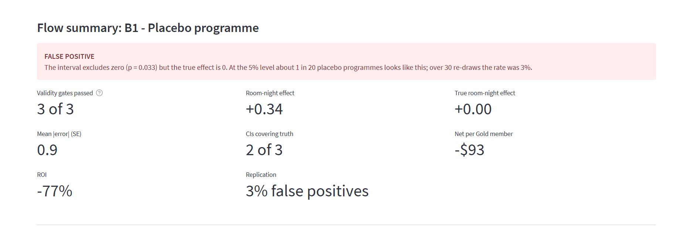

<details><summary>Screenshots of every stage</summary>

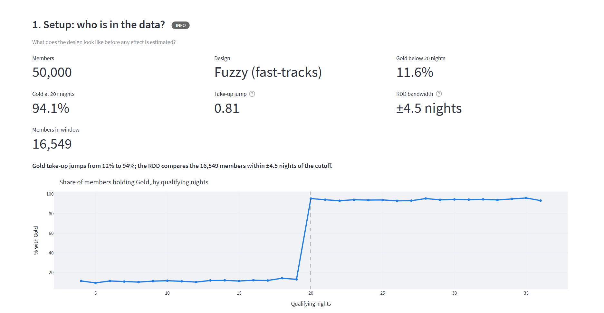


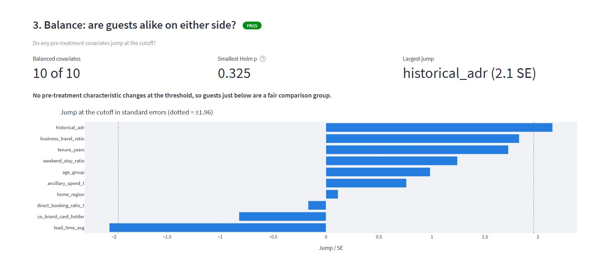

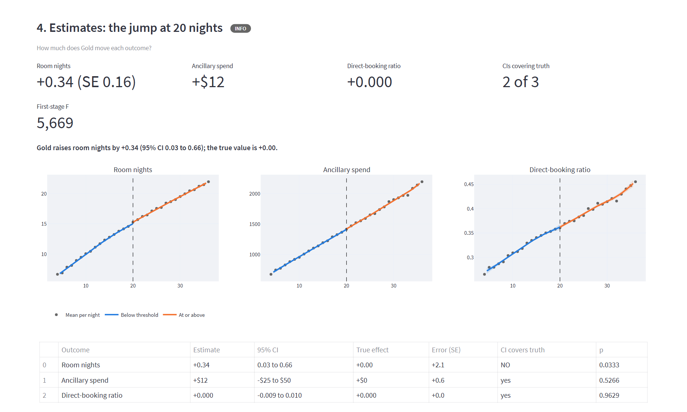

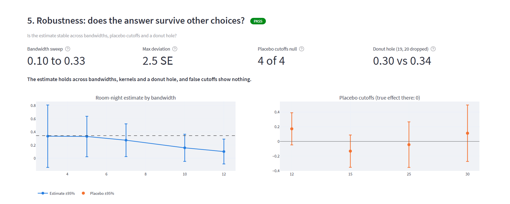

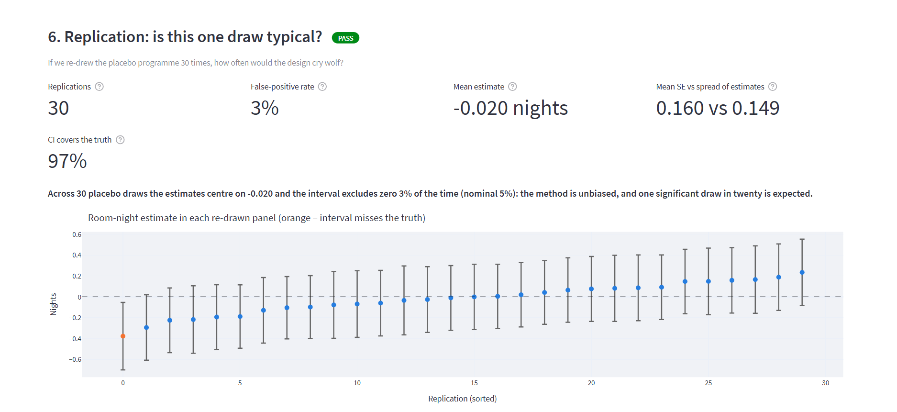

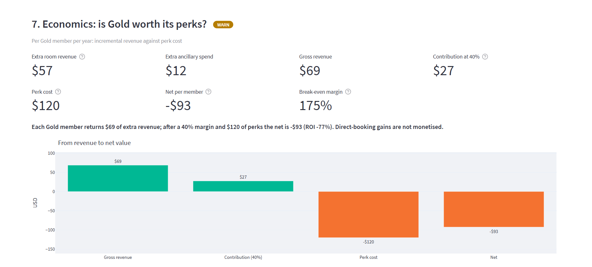

</details>

#### B2 - Gamed threshold: DO NOT TRUST THE ESTIMATE

*Members top up stays to just reach 20 nights.* 40% of guests 1 to 3 nights short buy extra stays to land at 20 or 21 nights. The guests who reach Gold are no longer comparable to those who miss it, so the density test should fire and the estimate should not be trusted.

**Verdict: DO NOT TRUST THE ESTIMATE.** The design fails a validity check (density), so the jump cannot be read as a causal effect; the density test fires in 100% of gamed re-draws and 7% of clean ones.

| # | Stage | Gate | Metrics at this stage |
|---|---|---|---|
| 1 | Setup | info | Members **50,000**; Design **Fuzzy (fast-tracks)**; Gold below 20 nights **11.5%**; Gold at 20+ nights **94.1%** |
| 2 | Density | FAIL | Log density ratio **+1.552**; p-value **0.000**; Density left / right **761 / 3592**; Verdict **BUNCHING DETECTED** |
| 3 | Balance | FAIL | Balanced covariates **9 of 10**; Smallest Holm p **0.014**; Largest jump **lead_time_avg (3.2 SE)** |
| 4 | Estimates | info | Room nights **+3.27 (SE 0.20)**; Ancillary spend **+$409**; Direct-booking ratio **+0.110**; CIs covering truth **3 of 3** |
| 5 | Robustness | PASS | Bandwidth sweep **3.18 to 3.35**; Max deviation **0.9 SE**; Placebo cutoffs null **4 of 4**; Donut hole (19, 20 dropped) **3.04 vs 3.27** |
| 6 | Replication | PASS | Replications **30**; Density test fires on gamed data **100%**; Density test fires on clean data **7%**; Mean estimate on gamed data **+3.35 nights** |
| 7 | Economics | PASS | Extra room revenue **$538**; Extra ancillary spend **$409**; Gross revenue **$947**; Contribution at 40% **$379** |

Flow-level metrics: Validity gates passed **1 of 3**; Room-night effect **+3.27**; True room-night effect **+3.40**; Mean |error| (SE) **0.4**; CIs covering truth **3 of 3**; Net per Gold member **$259**; ROI **216%**; Replication **100% detection**.

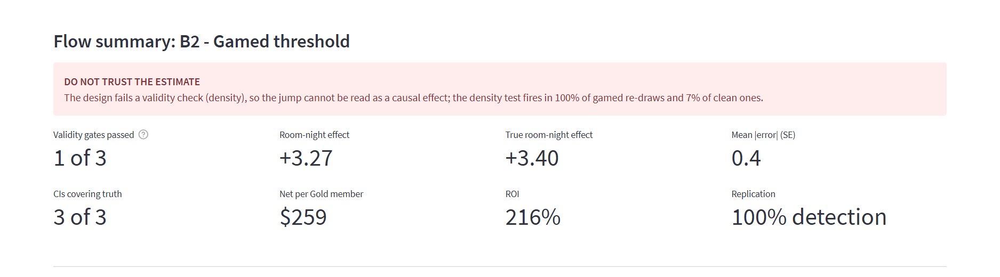

<details><summary>Screenshots of every stage</summary>

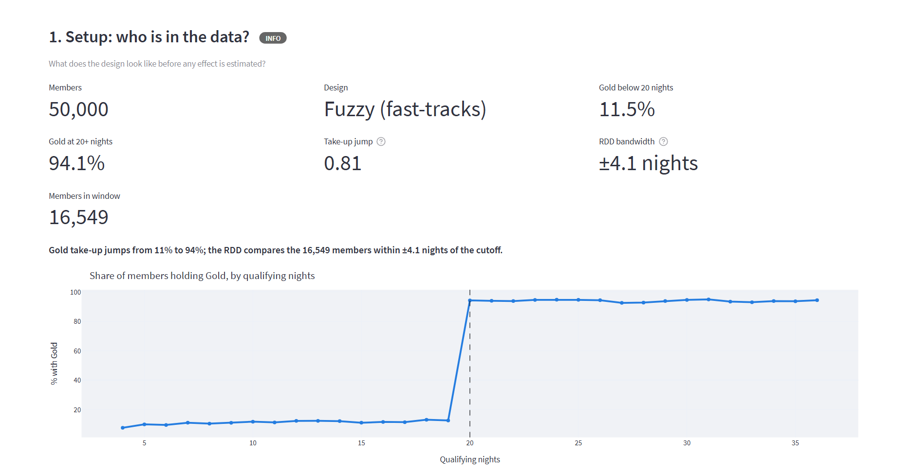

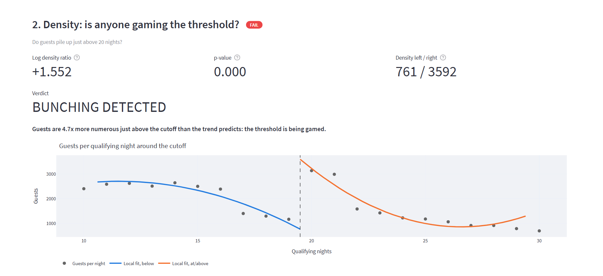

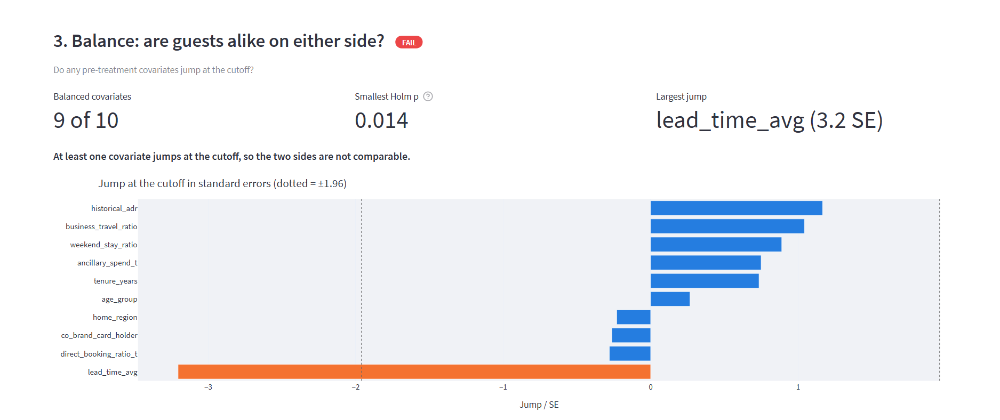

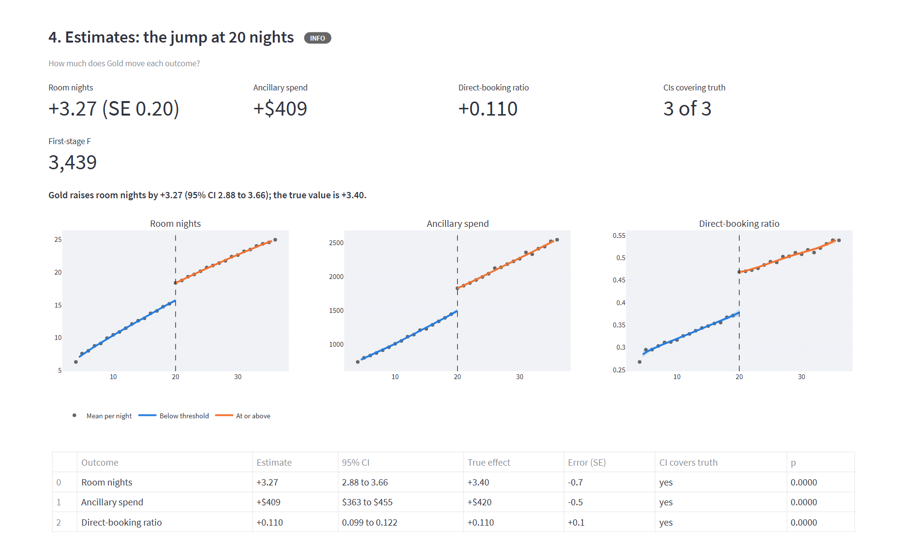


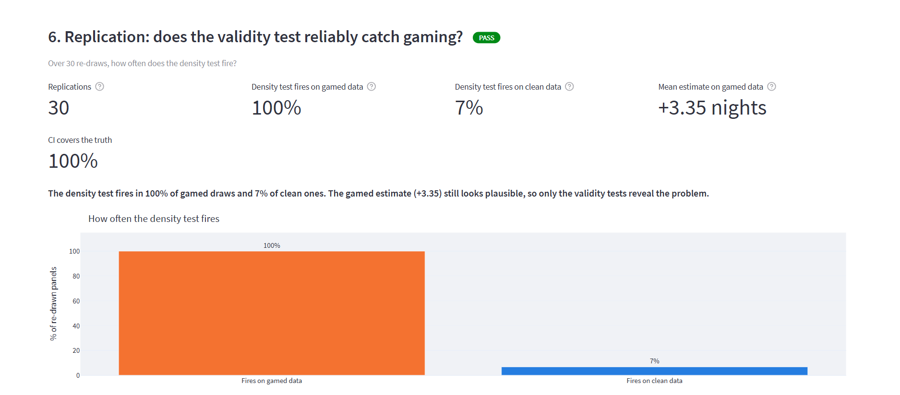


</details>

### C. Guest what-if

*How much does Gold do for this particular guest?*

#### C1 - Bleisure couple: LEAN IN

*Bleisure couple, mid-priced stays.* Mixed business and leisure, mid-tier ADR, books well ahead: the profile the generator makes most responsive.

**Verdict: LEAN IN.** Above-average responder and the perks clearly pay for themselves.

| # | Stage | Gate | Metrics at this stage |
|---|---|---|---|
| 1 | Profile | info | Segment **Bleisure traveller**; ADR **$175**; Business share **40%**; Lead time **40 days** |
| 2 | Context | info | Predicted Gold effect **+4.89 nights**; Average guest **+3.42 nights**; Percentile **96th**; 10th / 50th / 90th **2.0 / 3.5 / 4.6** |
| 3 | Models | PASS | Headline learner **+4.89 (r_learner)**; Accuracy-weighted mean **+5.00**; Learners with corr ≥ 0.85 **9 of 12**; Spread of those **±0.25 (SD)** |
| 4 | Evidence | PASS | Look-alike guests **8,073**; Estimated effect (r_learner) **+4.44 nights**; True effect (synthetic) **+4.72 nights**; Absolute error **0.27 nights** |
| 5 | Economics | PASS | Extra room nights **+4.89**; Extra room revenue **$856**; Contribution at 40% **$342**; Perk cost **$120** |

Flow-level metrics: Predicted effect **+4.89 nights**; Percentile **96th**; Learner spread **±0.25**; Look-alike error **0.27**; Net per year **$222**; ROI **185%**.

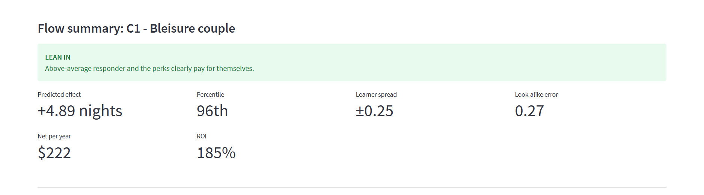

<details><summary>Screenshots of every stage</summary>

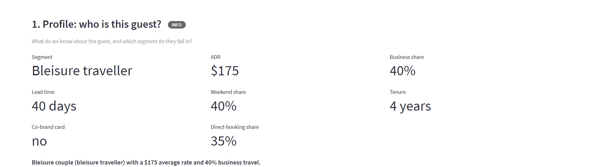


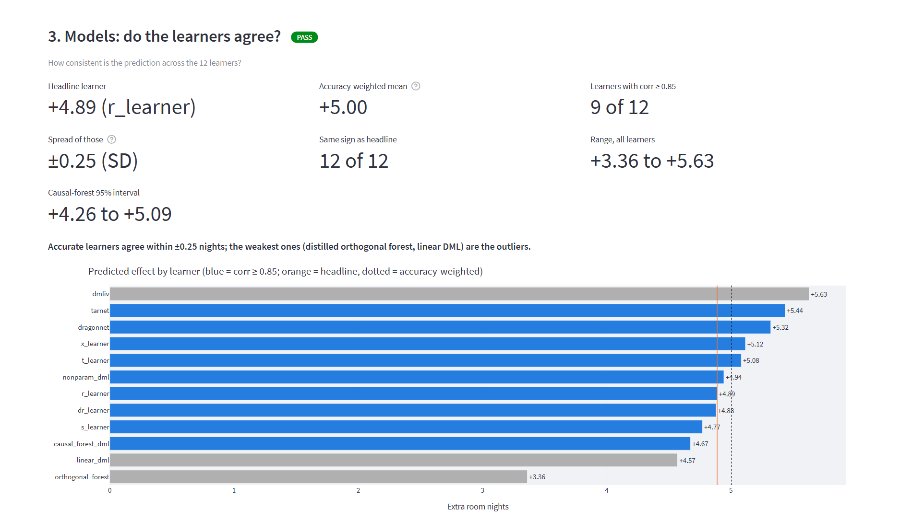

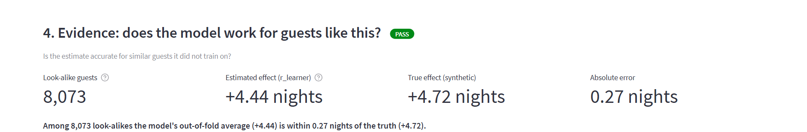

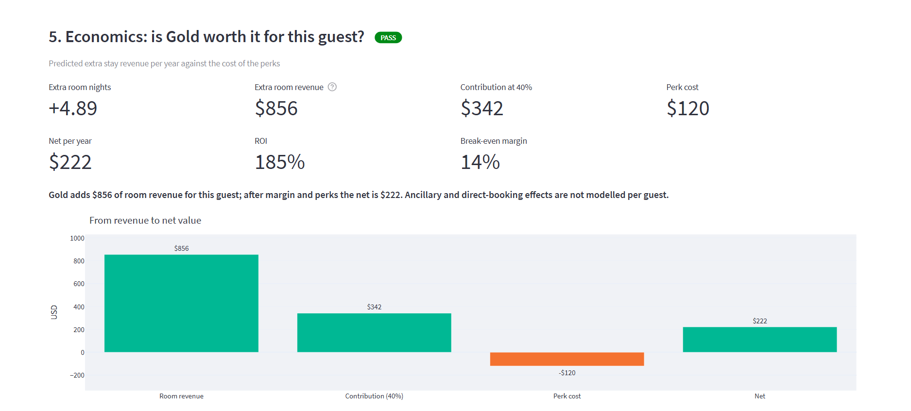

</details>

#### C2 - Corporate road warrior: BREAK-EVEN

*Corporate road warrior, last-minute bookings.* 88% business travel, 8-day lead time, rigid itinerary, co-brand card: stays are set by the employer, not by perks.

**Verdict: BREAK-EVEN.** Roughly neutral: keep the standard programme and avoid costly extras.

| # | Stage | Gate | Metrics at this stage |
|---|---|---|---|
| 1 | Profile | info | Segment **Corporate road warrior**; ADR **$210**; Business share **88%**; Lead time **8 days** |
| 2 | Context | info | Predicted Gold effect **+1.40 nights**; Average guest **+3.42 nights**; Percentile **4th**; 10th / 50th / 90th **2.0 / 3.5 / 4.6** |
| 3 | Models | PASS | Headline learner **+1.40 (r_learner)**; Accuracy-weighted mean **+1.57**; Learners with corr ≥ 0.85 **9 of 12**; Spread of those **±0.47 (SD)** |
| 4 | Evidence | PASS | Look-alike guests **269**; Estimated effect (r_learner) **+1.79 nights**; True effect (synthetic) **+1.97 nights**; Absolute error **0.18 nights** |
| 5 | Economics | WARN | Extra room nights **+1.40**; Extra room revenue **$294**; Contribution at 40% **$117**; Perk cost **$120** |

Flow-level metrics: Predicted effect **+1.40 nights**; Percentile **4th**; Learner spread **±0.47**; Look-alike error **0.18**; Net per year **-$3**; ROI **-2%**.

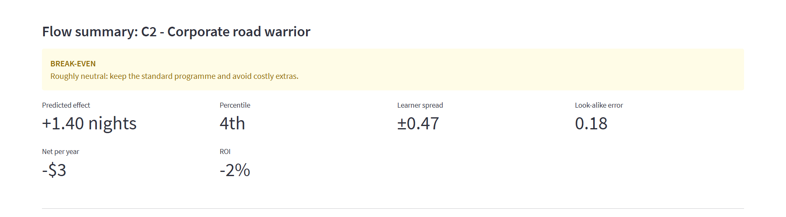

<details><summary>Screenshots of every stage</summary>

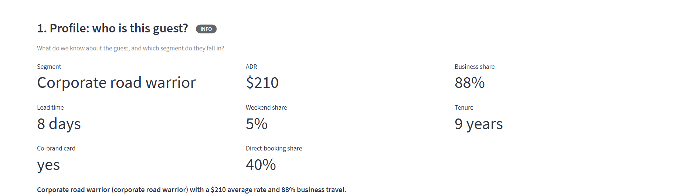

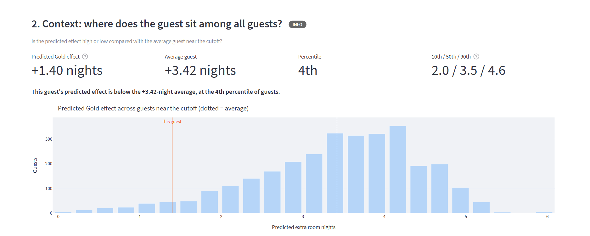

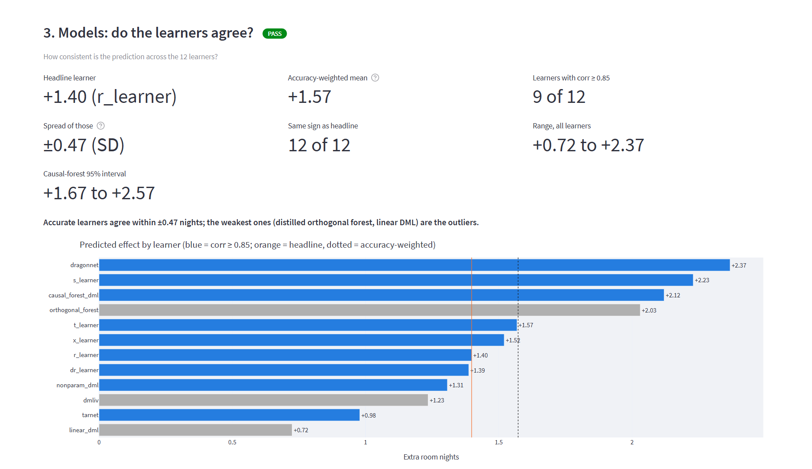

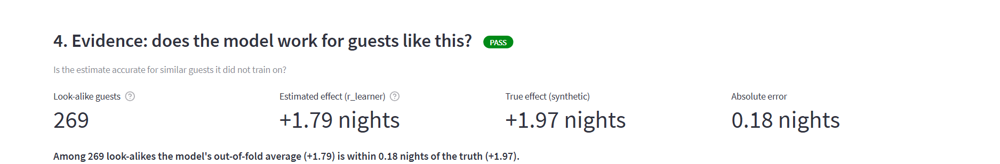

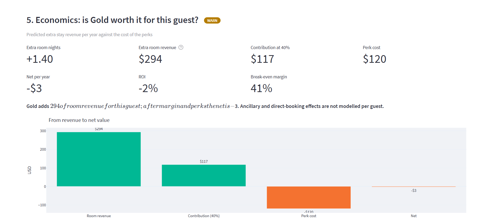

</details>

### D. Threshold policy

*What happens to nights and money if the Gold threshold moves?*

#### D1 - Lower to 17 nights: ADOPT

*Open Gold to guests with 17 to 19 nights.* Three nights below today's rule, perks cost $120 per activated member. Close enough to 20 that the RDD effect still applies.

**Verdict: ADOPT.** Worth $522,879 a year at a 40% margin and $120 perk cost.

| # | Stage | Gate | Metrics at this stage |
|---|---|---|---|
| 1 | Today | info | Members **50,000**; Eligible today (20+ nights) **18,528**; Share eligible **37.1%**; Take-up when eligible **94%** |
| 2 | Candidate | info | Candidate threshold **17 nights**; Direction **Lower: more guests reach Gold**; Guests affected **6,410**; Share of members **12.8%** |
| 3 | Who | PASS | Leisure share **45%**; Bleisure share **33%**; Corporate share **9%**; Average ADR **$163** |
| 4 | Impact | info | Incremental room nights **+17,911**; Incremental revenue **$2,864,221**; Avg per affected guest **+2.79 nights**; Model **r_learner** |
| 5 | Net value | PASS | Perk cost added **$622,809**; Net, revenue basis **$2,241,412**; Net at 40% margin **$522,879**; Break-even perk cost **$221** |
| 6 | Sensitivity | WARN | Distance from cutoff **3 nights**; Perk costs that keep the sign **2 of 4**; Net at 18 nights (closer) **$338,650**; Net at 16 nights (further) **$717,427** |

Flow-level metrics: Guests affected **6,410**; Incremental nights **+17,911**; Incremental revenue **$2,864,221**; Net at 40% margin **$522,879**; Break-even perk cost **$221**; Distance from cutoff **3 nights**.

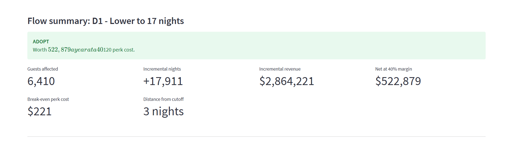

<details><summary>Screenshots of every stage</summary>


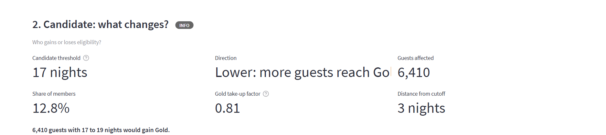

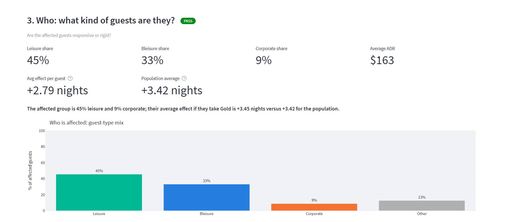

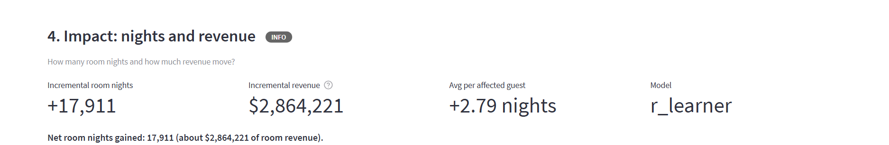

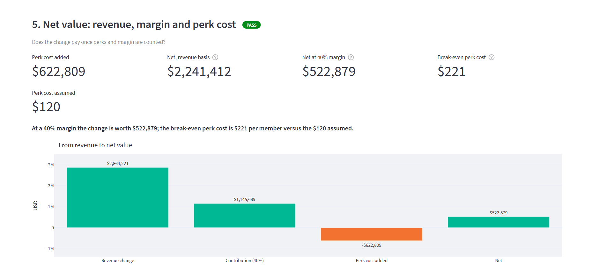

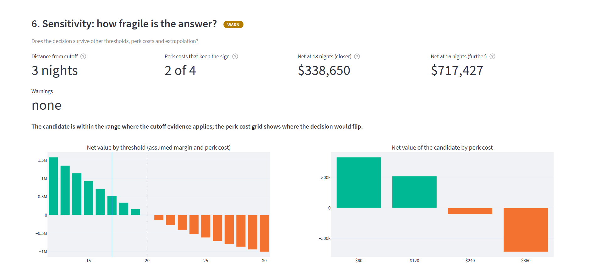

</details>

#### D2 - Raise to 24 nights: ADOPT

*Tighten Gold to 24 nights to cut perk cost.* Guests with 20 to 23 nights would lose Gold. Perks are expensive ($300 per member), so the question is whether the saving exceeds the lost stays.

**Verdict: ADOPT.** Worth $429,036 a year at a 40% margin and $300 perk cost.

| # | Stage | Gate | Metrics at this stage |
|---|---|---|---|
| 1 | Today | info | Members **50,000**; Eligible today (20+ nights) **18,528**; Share eligible **37.1%**; Take-up when eligible **94%** |
| 2 | Candidate | info | Candidate threshold **24 nights**; Direction **Raise: fewer guests reach Gold**; Guests affected **6,538**; Share of members **13.1%** |
| 3 | Who | PASS | Leisure share **43%**; Bleisure share **34%**; Corporate share **10%**; Average ADR **$166** |
| 4 | Impact | info | Incremental room nights **-17,954**; Incremental revenue **-$2,897,698**; Avg per affected guest **+2.75 nights**; Model **r_learner** |
| 5 | Net value | PASS | Perk cost saved **$1,588,115**; Net, revenue basis **-$1,309,583**; Net at 40% margin **$429,036**; Break-even perk cost **$219** |
| 6 | Sensitivity | WARN | Distance from cutoff **4 nights**; Perk costs that keep the sign **2 of 4**; Net at 23 nights (closer) **$336,846**; Net at 25 nights (further) **$510,193** |

Flow-level metrics: Guests affected **6,538**; Incremental nights **-17,954**; Incremental revenue **-$2,897,698**; Net at 40% margin **$429,036**; Break-even perk cost **$219**; Distance from cutoff **4 nights**.

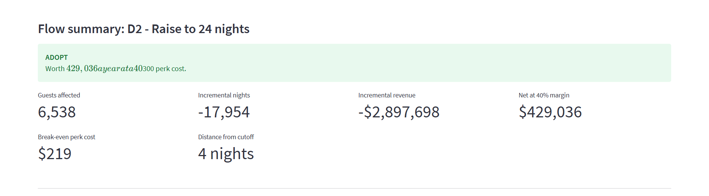

<details><summary>Screenshots of every stage</summary>

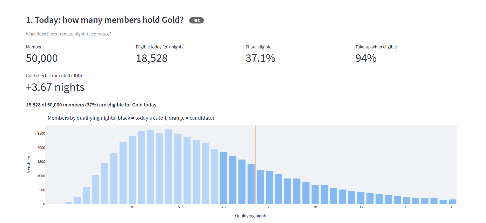

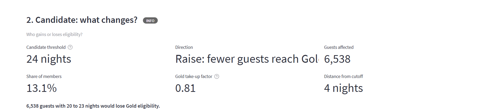

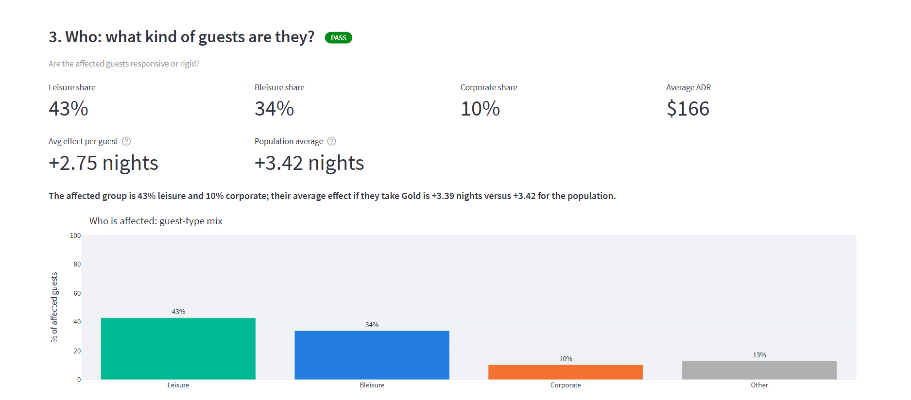

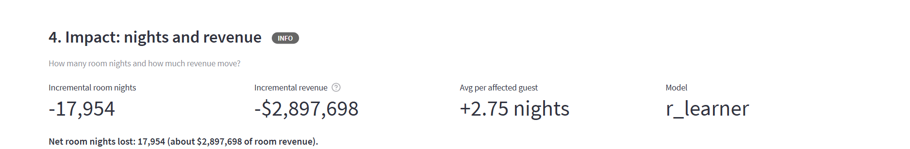

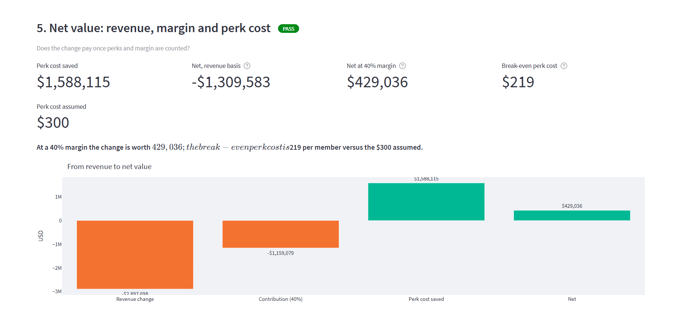

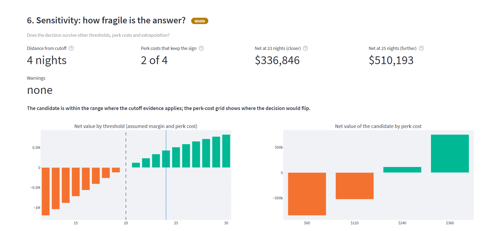

</details>

### Programme scorecard (all flows, all models)

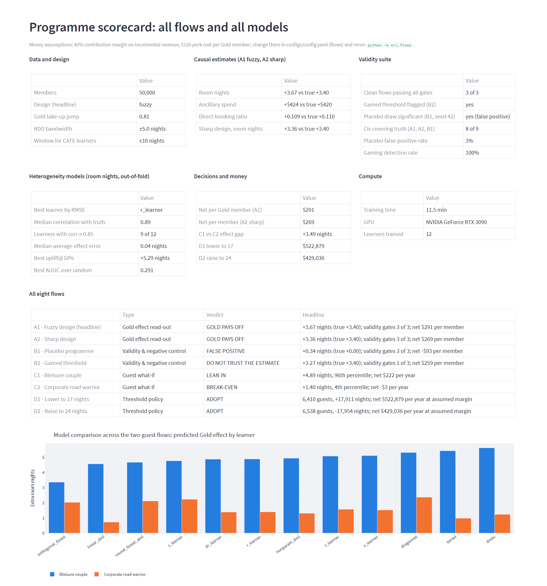

| Flow | Verdict | Headline |
|---|---|---|
| A1 - Fuzzy design (headline) | **GOLD PAYS OFF** | +3.67 nights (true +3.40); validity gates 3 of 3; net $291 per member |
| A2 - Sharp design | **GOLD PAYS OFF** | +3.36 nights (true +3.40); validity gates 3 of 3; net $269 per member |
| B1 - Placebo programme | **FALSE POSITIVE** | +0.34 nights (true +0.00); validity gates 3 of 3; net -$93 per member |
| B2 - Gamed threshold | **DO NOT TRUST THE ESTIMATE** | +3.27 nights (true +3.40); validity gates 1 of 3; net $259 per member |
| C1 - Bleisure couple | **LEAN IN** | +4.89 nights, 96th percentile; net $222 per year |
| C2 - Corporate road warrior | **BREAK-EVEN** | +1.40 nights, 4th percentile; net -$3 per year |
| D1 - Lower to 17 nights | **ADOPT** | 6,410 guests, +17,911 nights; net $522,879 per year at assumed margin |
| D2 - Raise to 24 nights | **ADOPT** | 6,538 guests, -17,954 nights; net $429,036 per year at assumed margin |

**Data and design:** Members **50,000**; Design (headline) **fuzzy**; Gold take-up jump **0.81**; RDD bandwidth **±5.0 nights**; Window for CATE learners **±10 nights**.

**Causal estimates (A1 fuzzy, A2 sharp):** Room nights **+3.67 vs true +3.40**; Ancillary spend **+$424 vs true +$420**; Direct-booking ratio **+0.109 vs true +0.110**; Sharp design, room nights **+3.36 vs true +3.40**.

**Validity suite:** Clean flows passing all gates **3 of 3**; Gamed threshold flagged (B2) **yes**; Placebo draw significant (B1, seed 42) **yes (false positive)**; CIs covering truth (A1, A2, B1) **8 of 9**; Placebo false-positive rate **3%**; Gaming detection rate **100%**.

**Heterogeneity models (room nights, out-of-fold):** Best learner by RMSE **r_learner**; Median correlation with truth **0.89**; Learners with corr ≥ 0.85 **9 of 12**; Median average-effect error **0.04 nights**; Best uplift@10% **+5.29 nights**; Best AUUC over random **0.291**.

**Decisions and money:** Net per Gold member (A1) **$291**; Net per member (A2 sharp) **$269**; C1 vs C2 effect gap **+3.49 nights**; D1 lower to 17 **$522,879**; D2 raise to 24 **$429,036**.

**Compute:** Training time **11.5 min**; GPU **NVIDIA GeForce RTX 3090**; Learners trained **12**.

How to read the two examples that look odd: **B1** is a programme whose perks do nothing, and with the default seed it produces one of the roughly 1-in-20 draws that looks significant. The flow reports that honestly as a `FALSE POSITIVE` and its replication stage shows the method is calibrated (about 5% over re-draws, standard errors match the spread of estimates). **D1** and **D2** both say ADOPT because they sit on opposite sides of the same break-even perk cost (about $220 per member): lowering the threshold pays below it, raising the threshold pays above it.

<!-- FLOWS:END -->

## Presentation

`presentation/Loyalty_Gold_RDD_Uplift_End_to_End.pptx` is a 62-slide, fully editable deck (native tables and charts, speaker notes on every content
slide). `make deck` rebuilds it from the saved metrics, plots, `flows_report.json` and the dashboard screenshots, so every number in it is the number the
dashboard shows; only the narrative and the model descriptions are written by hand in `scripts/build_deck.py`.

| Part | Slides | What it covers |
|---|---|---|
| Opening | 1-3 | Title, executive summary, storyline |
| 1. Problem, approach, uplift end-to-end flow | 4-13 | Why a discontinuity, two-layer approach, data, the 8-stage pipeline with a stage-by-stage documentation table, kernel weights and trend removal, how uplift is measured (AUUC, Qini, uplift@K, R-loss, policy value), architecture, reproducibility |
| 2. The 12 models and how they compare | 14-33 | RDD evidence and validity tests, every model explained by family with its metrics, tuning, the full leaderboard, accuracy and targeting charts, cost vs accuracy, **a model-by-flow comparison** (each model scored on the guests each flow concerns, decision agreement, cross-flow ranking), which model for which job |
| 3. Flows, stages and metrics | 34-39 | The four flow types, programme scorecard (overall metrics), all eight flows at a glance (flow-level), stage gate map (stage-level), money logic |
| 4. Scenarios as a story | 40-58 | Eight scenarios from "Monday: the VP asks whether Gold is worth it" to "Next quarter: tighten Gold to cut perk cost?", each with the stage table and verdict, then the Streamlit screenshots of the stages that matter; dashboard tour and API |
| Wrap-up and appendix | 59-62 | Five takeaways, limits and next steps, file map, glossary |

The model-by-flow comparison is the one view not on the dashboard. For each model it reports the estimated average effect against the truth for the four
populations the model-driven flows are about (look-alikes of the two guest personas, and the guests whose eligibility each threshold change affects),
plus each model's net value for the two threshold decisions. It shows that the global leaderboard winner (R-Learner) is not the winner on those populations
(T-Learner is, by a few hundredths of a night), and that all 12 models agree on the sign of both threshold decisions. It is computed by
`flows.model_flow_matrix` and stored in `flows_report.json`.

## Design decisions worth knowing

- **Running variable.** The learners work on a window |R - 20| <= 10 with triangular kernel weights. Before fitting, each
  side's linear trend in R is removed from the outcome (the jump at the cutoff is kept), and R itself is not an effect
  modifier. Without this a sharp design has no overlap and the trend in R biases every learner. Consequence: CATEs are
  local to guests near 20 nights, and extrapolating them far from the cutoff is not valid.
- **The fuzzy IV learner** (DMLIV) estimates an effect for compliers; the other learners estimate the effect of actually
  holding Gold. In this synthetic design these coincide because the effect does not depend on compliance type given X.
- **Tuning** minimises the Robinson R-loss on a held-out split, so it needs no ground truth. Trial 0 always uses the default
  parameters, so tuning cannot do worse than the untuned model. Ground-truth metrics (correlation, RMSE) are for reporting only.
- **Orthogonal forest** costs about 0.25 s per predicted row in econml, so it is fitted on 3,000 rows, evaluated on 400
  reference points, and distilled into a small XGBoost surrogate. It is not Optuna-tuned. It is the weakest learner; drop it
  from `configs/config.yaml` if you do not need it.
- **Threshold simulator.** Effects are measured at 20 nights; moving the cutoff by more than about 5 nights is extrapolation
  and the API says so in `warnings`. Under the fuzzy design the simulator multiplies by the Gold take-up jump (0.81).
- **McCrary test.** A first version of the density test rejected a true null 37% to 100% of the time (curvature plus
  unstable residual variances). It now uses a quadratic fit with Poisson variance and rejects about 7% of clean datasets
  over 30 seeds, close to the nominal 5%. Estimates at h=3 with a quadratic fit are `NaN` because only two usable whole-night
  values exist per side.

## Screenshots

FastAPI (`/docs`), executed against the trained models:


Dashboard, one screenshot per tab (the viewport is grown to the full page, so nothing is cut off):

| Tab | Screenshot |
|---|---|
| Gold effect (RDD) |  |
| Validity checks |  |
| Guest explorer: leisure family |  |
| Guest explorer: corporate road warrior |  |
| Threshold simulator |  |
| Model leaderboard |  |
| End-to-end flows |  |

Every flow stage, every flow summary and the programme scorecard are in `outputs/screenshots/flows/` (embedded in the section above);
`outputs/screenshots/capture_report.json` records that the numbers on screen equal the API's. API screenshots (Swagger overview,
LATE, CATE and threshold calls) are `01` to `04` in `outputs/screenshots/`, and the model charts are in `outputs/plots/`
(density test, bandwidth sensitivity, falsification, leaderboard, segments, uplift and Qini, loss curves).

## API

| Endpoint | What it does |
|---|---|
| `GET /health` | status, cutoff, regime, trained outcomes, best learner, GPU info |
| `POST /predict/late` | RDD effect at the cutoff for any outcome, kernel, bandwidth (4 to 20), order, sharp or fuzzy |
| `POST /predict/cate` | individual effect for a guest profile, with percentile, segment, recommendation and every learner's estimate |
| `POST /simulate/threshold` | guests affected, incremental nights, revenue and net value for a candidate threshold (8 to 40 nights) |
| `GET /leaderboard` | out-of-fold learner metrics |

Request validation is domain-aware (ADR 30 to 2000 USD, shares in [0,1], known regions and age bands, an implausible
first-year profile is rejected). Invalid input returns 422, unknown learners 404, missing models 503.

## Known limitations and platform notes

- **Synthetic data only.** The estimates are validated against a known truth; real loyalty data will violate assumptions
  (manipulation, sorting, noisy tier credit) that the diagnostics are there to catch.
- **One outcome has CATE models.** By default learners are trained for room nights; add the other two outcomes under
  `cate.outcomes` in the config (the RDD covers all three).
- **LightGBM runs on CPU** (the pip wheel has no GPU build). The cuml/cupy path from the spec is not wired in.
- **Serving runs on CPU.** XGBoost 2.x with CUDA aborts the process (exit code 0xC0000409) when a short-lived thread that
  predicted on the GPU exits; this killed the Streamlit server and the pytest process until inference was moved to CPU
  (`to_cpu_inference` in `src/api/service.py`; `LOYALTY_GPU_INFERENCE=1` opts out). Training still uses the GPU.
  The test client is deliberately never torn down and `tests/conftest.py` has a `hard_exit` backstop for the same reason.
- **Streamlit 1.12 and plotly<6.** Python 3.9.7 is excluded by newer Streamlit releases. The dashboard therefore uses
  Streamlit 1.12 (no nested columns, `experimental_singleton`) with `altair<5`, `protobuf<4` and `plotly<6`
  (plotly 6+ emits binary arrays that this Streamlit cannot render).
