# Paid Search Cannibalization vs. Incrementality Engine
**Grand Horizon Hotels & Resorts** - does bidding on our own brand terms buy bookings, or does it just rent traffic we would
have received for free while keeping OTAs (Expedia, Booking.com) off the top of the results page?

*This README is generated by `scripts/build_readme.py` from `outputs/metrics/*`. All data are synthetic with a known
data-generating process, so every estimate can be checked against ground truth.*

## Headline results (seed 42)

* Pausing branded paid search in 10 of 50 DMAs for 4 weeks cut direct bookings by **2.8 per DMA-day**
  (SDID; 95% interval -4.1 to -1.5; truth -2.5) and sent
  **1.6 per DMA-day** to OTAs (truth 1.6).
* Last-click ROAS says **5.8x**; the incremental ROAS is **2.2x**
  (truth 2.0x). Cannibalization rate **62%** (truth 66%).
* Pausing would have cost **$46,139** of net contribution margin over the 4 weeks
  across the 10 holdout DMAs (truth $-15,771), including
  $46,229 of OTA commission leakage. On average, **keep branded search**.
* **DMA-level pause lists are not reliable with this design.** Average effects are recovered well; heterogeneity is not
  (see CATE section). The best individual learner has PEHE/sd(true CATE) = 1.34
  (S-Learner), and only 0 of 9 learners beat simply predicting the average effect (ratio 1.07). Realised
  value of the model policy: $-9,371 vs always-keep $0 and an unattainable oracle of $56,202.

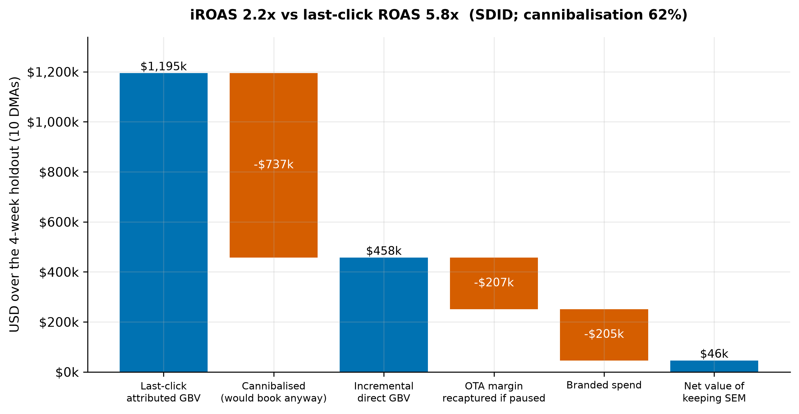

## Experiment

| item | value |
|---|---|
| DMAs | 50 (10 Tier 1 Major Hub, 20 Tier 2 Regional, 20 Tier 3 Drive-to) |
| Horizon | 20-week pre-period + 4-week intervention, daily (2026-07-20 intervention start) |
| Assignment | Stratified randomisation: 20% of each tier paused (2/4/4 = 10 holdout, 40 control) |
| OTA commission | 15-20% variable (Tier 1 20%, Tier 2 17.5%, Tier 3 15%, DMA-level noise) |
| Outcomes | Direct bookings & GBV; OTA bookings & commission; Net Contribution Margin |
| Hardware | `{"torch": "cuda", "gpu": "NVIDIA GeForce RTX 3090", "xgboost": "cuda", "catboost": "GPU", "lightgbm": "cpu", "jax": "cpu", "rapids": false}` |

`Net Contribution Margin = Direct GBV - Branded SEM spend + OTA GBV x (1 - commission rate)`. Value of branded search = -ATT(holdout).

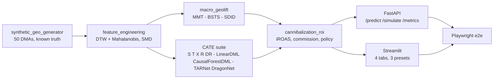

### Data-generating process (what "truth" means)
With branded paid search paused, an OTA can take the top results slot. Let `s` = last-click share of direct bookings,
`c` = cannibalization (share that would arrive via the free organic listing anyway), `q` = OTA hijack rate of those organic-bound
clickers, `v` = share of genuinely incremental bookings that re-book on an OTA.

* Direct effect of pausing: `-E0_direct * s * [(1-c) + c*q]`
* OTA effect of pausing: `+E0_direct * s * [(1-c)*v + c*q]` (hijacked bookings are *diverted*, not new)
* `c` falls with worse organic rank and OTA pressure and rises with loyalty penetration; `q` rises with OTA pressure and worse rank.
* Common latent time factors, DMA drifts, day-of-week, holidays and seasonality make the problem non-trivial.

## Macro geo-lift estimators (ATT, bookings per DMA-day)

| outcome | method | ATT per DMA-day | 95% CI low | 95% CI high | truth | covers truth | cumulative (10 DMAs x 28d) |
|---|---|---|---|---|---|---|---|
| Direct bookings | MMT | -3.25 | -6.09 | -0.92 | -2.47 | yes | -910.11 |
| Direct bookings | SDID | -2.82 | -4.09 | -1.55 | -2.47 | yes | -788.27 |
| Direct bookings | BSTS | -0.80 | -3.92 | 2.13 | -2.47 | yes | -222.70 |
| OTA bookings | MMT | 1.58 | 0.90 | 2.29 | 1.64 | yes | 442.09 |
| OTA bookings | SDID | 1.59 | 0.74 | 2.45 | 1.64 | yes | 445.81 |
| OTA bookings | BSTS | 3.30 | 1.22 | 5.42 | 1.64 | yes | 924.49 |

* **MMT** - DTW + Mahalanobis one-to-one pairing (Hungarian), ratio-adjusted counterfactual, exact sign-flip permutation p-value. Balance after matching: max |SMD| = 0.22 (all-controls: 0.60).
* **BSTS** - NumPyro NUTS: local linear trend + day-of-week + holiday + regression on control-DMA principal components, tier-reweighted control mean and flight index; forecast counterfactual with 95% credible band.
* **SDID** - ridge-regularised simplex unit weights, time weights, placebo-in-space standard error.

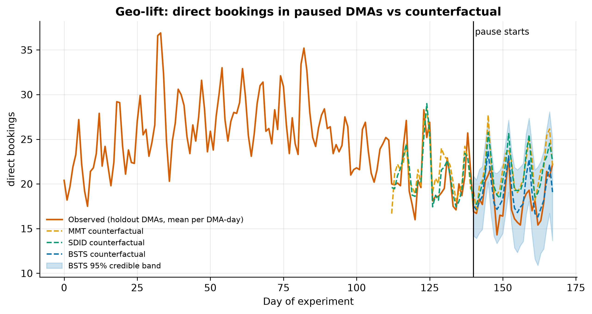
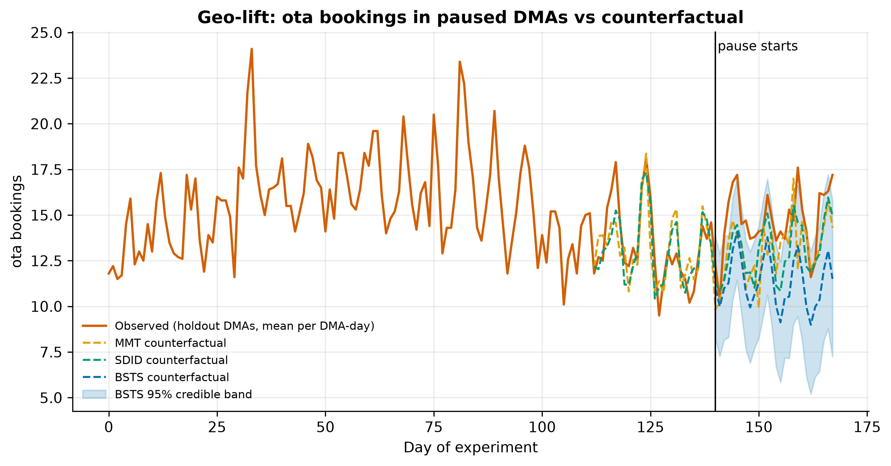
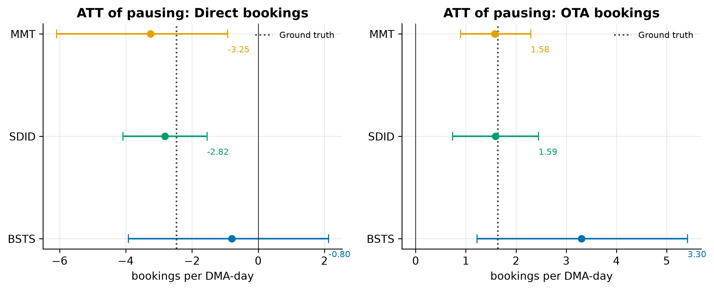

### How much to trust each estimator
Monte-Carlo over fresh draws of the *whole experiment* (new DMAs, new randomisation), direct bookings:

| method | bias | rmse | ci_coverage | n_experiments |
|---|---|---|---|---|
| BSTS | 2.12 | 2.45 | 0.60 | 5 |
| MMT | 0.04 | 0.20 | 1.00 | 10 |
| SDID | -0.22 | 0.52 | 0.90 | 10 |

BSTS is the weakest and is **biased toward zero** here (it extrapolates a 28-day forecast from ~4 PCs of controls; with only 10 treated
DMAs aggregated to one series the regression cannot absorb their idiosyncratic drift). MMT and SDID are close to unbiased. I did not tune the
BSTS priors to the headline seed.

### Refutation tests
Placebo-in-time (pretend the pause started 4 weeks early; pre-data only; truth = 0):

| outcome | method | placebo_att | ci_low | ci_high | p_value | covers_zero |
|---|---|---|---|---|---|---|
| direct_bookings | MMT | -0.950 | -1.480 | -0.415 | 0.010 | False |
| direct_bookings | SDID | -1.030 | -2.307 | 0.247 | 0.149 | True |
| direct_bookings | BSTS | -1.373 | -3.582 | 1.073 | 0.225 | True |
| ota_bookings | MMT | 0.142 | -0.269 | 0.519 | 0.531 | True |
| ota_bookings | SDID | 0.151 | -0.722 | 1.023 | 0.733 | True |
| ota_bookings | BSTS | 0.762 | -1.253 | 2.901 | 0.472 | True |

A placebo effect that excludes zero (MMT, direct bookings) flags a pre-period drift between holdout and matched controls, and the headline
MMT estimate is more negative than truth by about the same amount. Placebo-in-space (SDID on fake holdouts among controls): SDID p = 0.003.

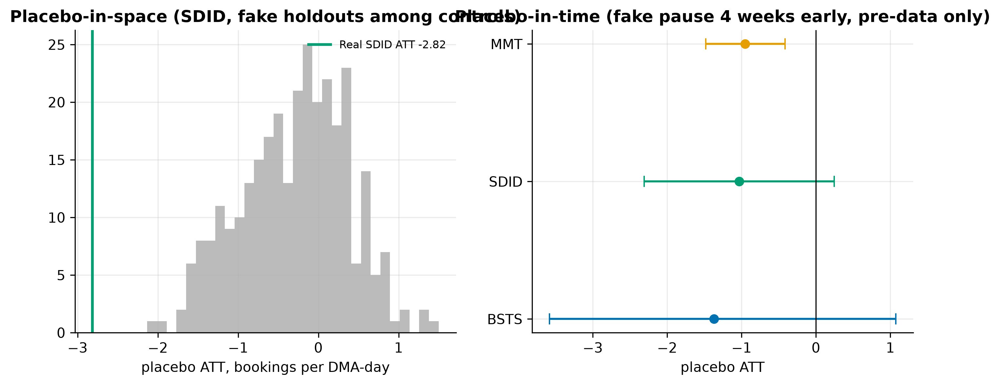
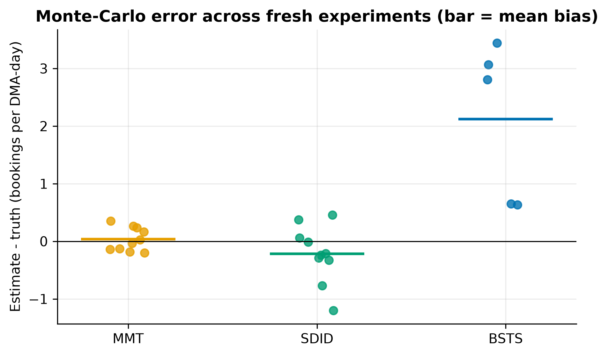
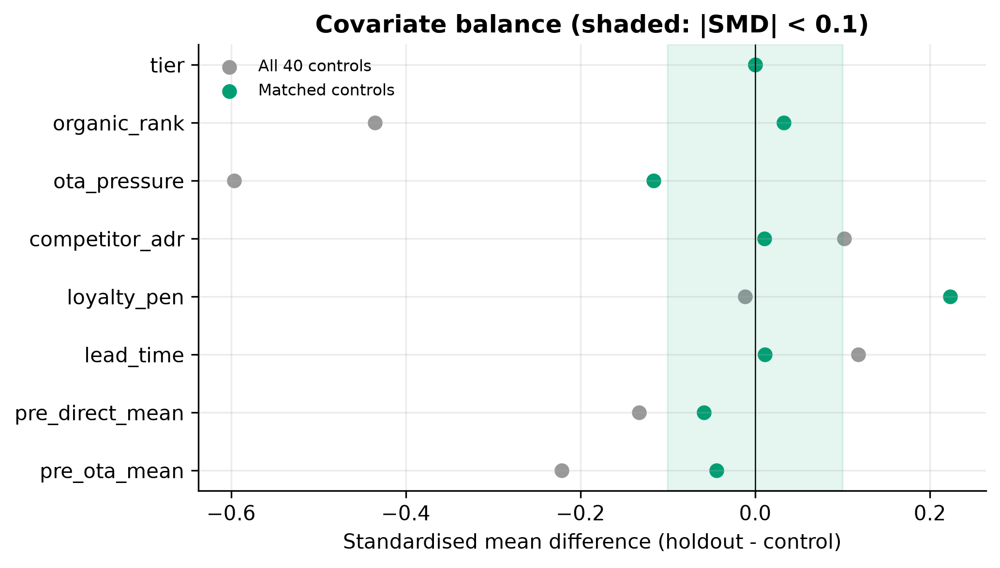

## Economics (4-week holdout programme, 10 DMAs)

| metric | MMT | SDID | BSTS | Truth |
|---|---|---|---|---|
| Last-click ROAS | 5.83 | 5.83 | 5.83 | 5.83 |
| Incremental ROAS (iROAS) | 2.58 | 2.23 | 0.63 | 1.96 |
| Cannibalization rate | 0.56 | 0.62 | 0.89 | 0.66 |
| Incremental direct bookings from keeping SEM | 910.11 | 788.27 | 222.70 | 691.70 |
| OTA leakage bookings when paused | 442.09 | 445.81 | 924.49 | 458.43 |
| OTA commission leakage ($) | 45,843.53 | 46,228.91 | 95,867.73 | 47,537.77 |
| Branded spend avoided ($) | 204,920.32 | 204,920.32 | 204,920.32 | 204,920.32 |
| Net margin change if paused ($) | -118,598.75 | -46,139.19 | 504,001.39 | 15,771.47 |

## CATE meta-learners: 9 algorithms, GPU-accelerated

Learners target the **relative lift in bookings** (outcome / DMA pre-period mean) because the net-margin effect nets a large direct
loss against an OTA gain and is far too noisy to learn from 10 treated DMAs; the economics layer composes the two booking effects into dollars.
All cross-fitting and evaluation folds are **grouped by DMA** (treatment is DMA-level, so rows of one DMA are not independent); the
propensity is the known 0.2 of the stratified design. Base learners: XGBoost `device="cuda"` (S, T, R, DR, DML nuisances), CatBoost
`task_type="GPU"` (X); EconML LinearDML / CausalForestDML; custom PyTorch CUDA TARNet and DragonNet (targeted regularisation).

Direct-booking lift (truth: average -10.1% of baseline). PEHE is in lift units (0.05 = 5 points); `pehe_norm` = PEHE / sd(true CATE), where 1.0 means "as bad as knowing nothing about heterogeneity":

| model | pehe | pehe_norm | auuc | qini | qini_ratio | rank_corr | ate_hat | ate_true |
|---|---|---|---|---|---|---|---|---|
| Constant ATE (DiD) | 0.046 | 1.074 |  |  |  |  | -0.084 | -0.101 |
| S-Learner | 0.058 | 1.339 | -11.869 | -0.054 | -0.015 | 0.394 | -0.070 | -0.101 |
| CausalForestDML | 0.060 | 1.404 | -8.834 | 2.980 | 0.820 | 0.485 | -0.073 | -0.101 |
| X-Learner | 0.079 | 1.832 | -10.656 | 1.159 | 0.319 | 0.360 | -0.104 | -0.101 |
| LinearDML | 0.089 | 2.063 | -13.535 | -1.720 | -0.473 | 0.397 | -0.081 | -0.101 |
| R-Learner | 0.090 | 2.088 | -15.132 | -3.317 | -0.912 | 0.488 | -0.099 | -0.101 |
| TARNet | 0.096 | 2.225 | -9.182 | 2.632 | 0.724 | 0.557 | -0.097 | -0.101 |
| DragonNet | 0.101 | 2.349 | -6.532 | 5.283 | 1.453 | 0.485 | -0.118 | -0.101 |
| DR-Learner | 0.117 | 2.726 | -13.066 | -1.251 | -0.344 | 0.185 | -0.122 | -0.101 |
| T-Learner | 0.162 | 3.780 | -13.264 | -1.449 | -0.399 | 0.231 | -0.088 | -0.101 |

OTA-booking lift:

| model | pehe | pehe_norm | auuc | qini | qini_ratio | rank_corr | ate_hat | ate_true |
|---|---|---|---|---|---|---|---|---|
| Constant ATE (DiD) | 0.033 | 1.019 |  |  |  |  | 0.113 | 0.107 |
| CausalForestDML | 0.049 | 1.529 | 21.065 | 5.205 | -3.204 | 0.251 | 0.086 | 0.107 |
| S-Learner | 0.063 | 1.946 | 21.185 | 5.324 | -3.278 | 0.244 | 0.091 | 0.107 |
| TARNet | 0.069 | 2.157 | 14.555 | -1.305 | 0.804 | 0.121 | 0.115 | 0.107 |
| DragonNet | 0.107 | 3.336 | 17.846 | 1.985 | -1.222 | 0.121 | 0.137 | 0.107 |
| X-Learner | 0.118 | 3.659 | 16.864 | 1.004 | -0.618 | 0.393 | 0.119 | 0.107 |
| R-Learner | 0.121 | 3.777 | 19.592 | 3.732 | -2.298 | 0.098 | 0.119 | 0.107 |
| LinearDML | 0.135 | 4.207 | 14.798 | -1.063 | 0.654 | -0.017 | 0.108 | 0.107 |
| DR-Learner | 0.154 | 4.799 | 16.610 | 0.749 | -0.461 | 0.462 | 0.134 | 0.107 |
| T-Learner | 0.241 | 7.484 | 17.701 | 1.841 | -1.133 | 0.242 | 0.136 | 0.107 |

Honest reading: ATEs are recovered well, the *ranking* of DMAs is only modestly better than chance (rank correlation ~0.2-0.55) and no learner beats the
constant-effect reference on PEHE. That is the real information content of a 10-treated-DMA experiment, not a modelling bug: effective sample size is 50 DMAs.

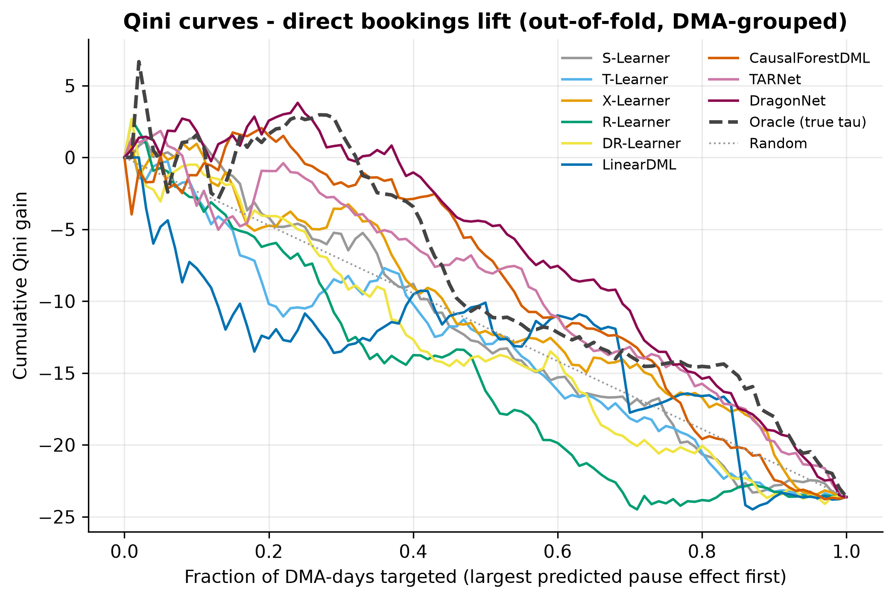
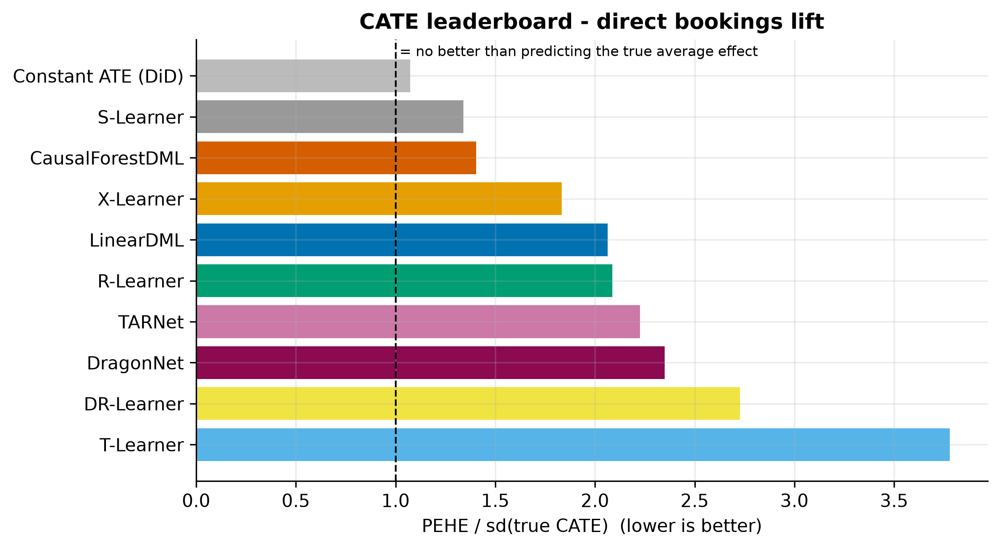
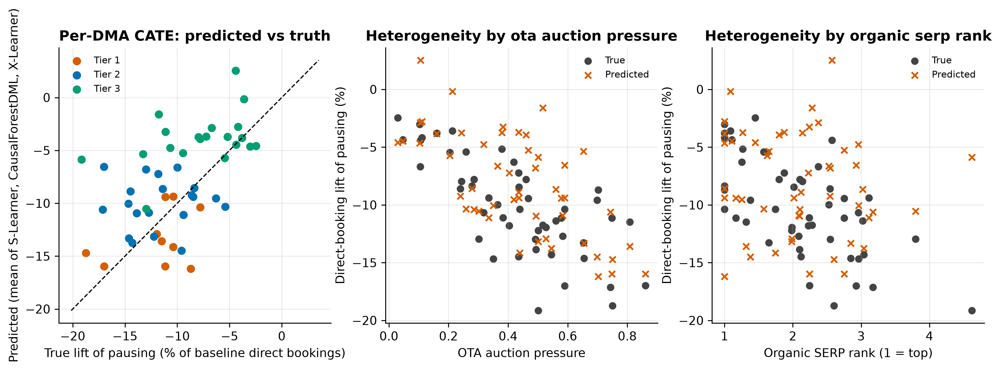

## Optimal bidding policy

`pi*(x) = Pause` iff predicted change in net contribution margin from pausing exceeds an evidence margin (k x disagreement between the nine learners, k=1 fixed in advance), else `Keep`.
Realised value (4 weeks, scored against ground truth that a real experiment would not have):

| rule | n_pause | value_usd | decision_accuracy |
|---|---|---|---|
| Always keep | 0 | 0.00 | 0.60 |
| Always pause | 50 | -220267.22 | 0.40 |
| Oracle (true effects) | 20 | 56202.44 | 1.00 |
| CATE mean - 0 x learner SD | 30 | -32889.88 | 0.64 |
| CATE mean - 0.5 x learner SD | 22 | -5670.06 | 0.64 |
| CATE mean - 1 x learner SD | 11 | -9371.26 | 0.62 |
| CATE mean - 1.5 x learner SD | 5 | 6158.09 | 0.70 |
| CATE mean - 2 x learner SD | 1 | 1367.16 | 0.62 |
| CATE mean - 3 x learner SD | 0 | 0.00 | 0.60 |

True value of pausing by tier (negative = pausing loses money):

| tier | true_value_of_pausing_usd | predicted_usd |
|---|---|---|
| 1 | -140,447 | -624,110 |
| 2 | -72,876 | 71,184 |
| 3 | -6,944 | 90,648 |

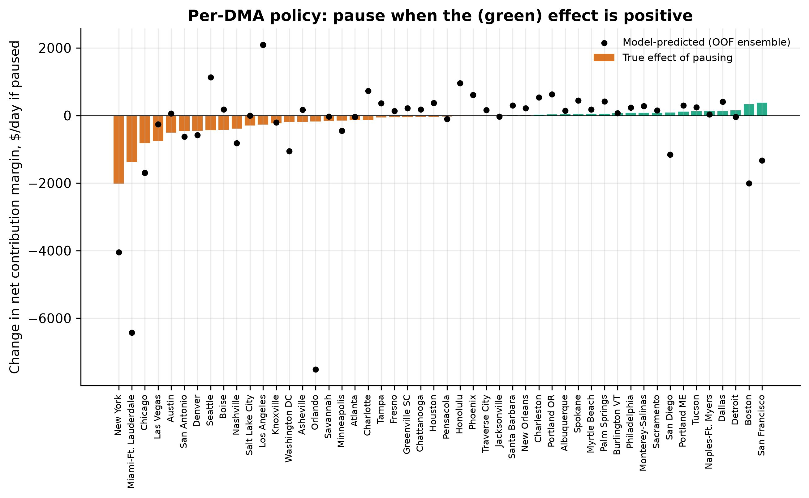

## Interfaces

* **FastAPI** (`make serve`, Swagger at `/docs`): `GET /health`, `POST /predict/dma-cate`, `POST /simulate/holdout-policy`, `GET /metrics/summary`.
* **Streamlit** (`make app`): Tab 1 geo-lift & cannibalization (DMA selector, counterfactual bands, last-click ROAS vs iROAS); Tab 2 leaderboard, interactive Qini and importance; Tab 3 policy simulator with 3 one-click presets (Miami Beach Tier 1 / Nashville Tier 2 / Asheville Tier 3); Tab 4 policy table and refutations.
* Dashboard and API call the same functions (`src/api/service.py`); the Playwright test asserts the UI equals the API for every preset.

**01_fastapi_swagger**

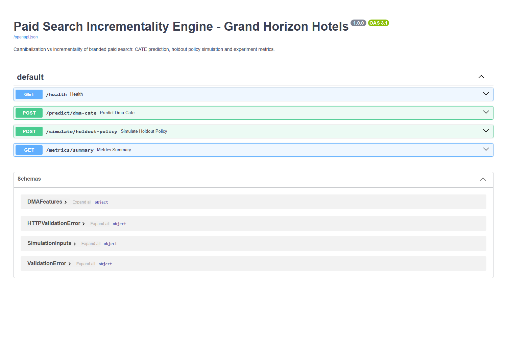

**02_fastapi_simulate_executed**

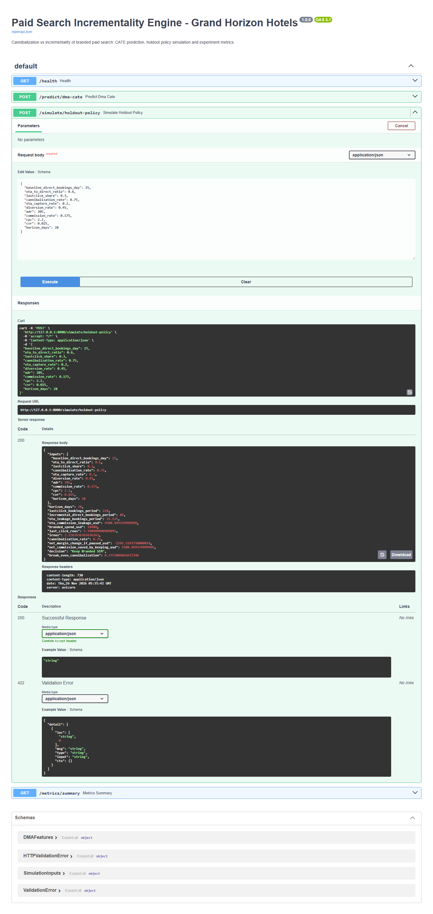

**03_streamlit_tab1_geolift**

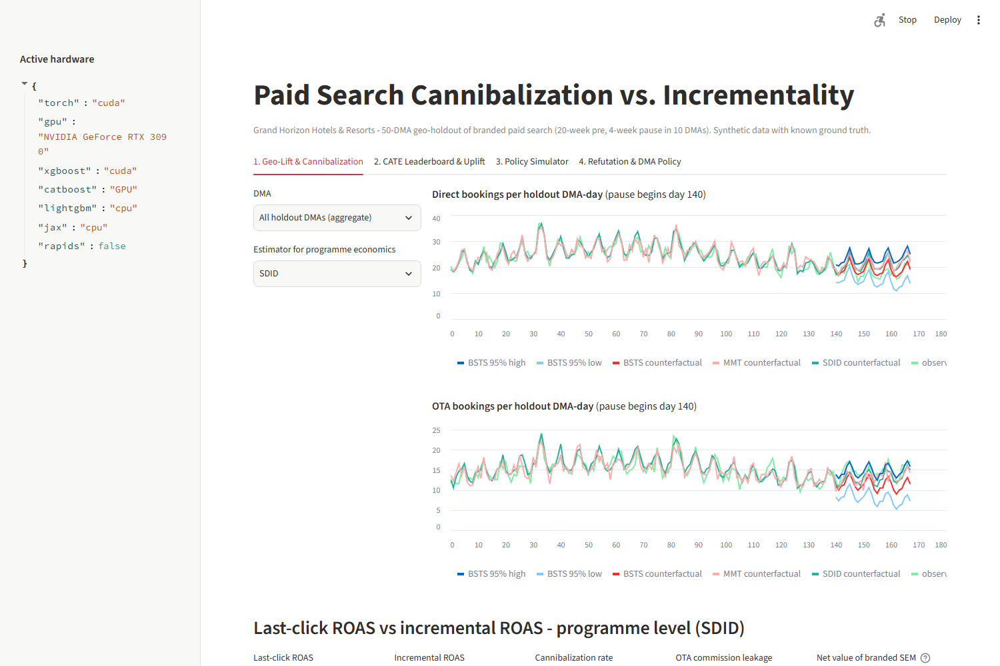

**04_streamlit_tab2_leaderboard**

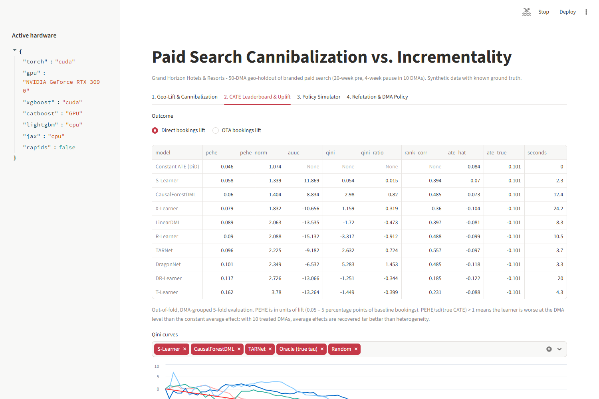

**05_streamlit_tab3_preset_A**

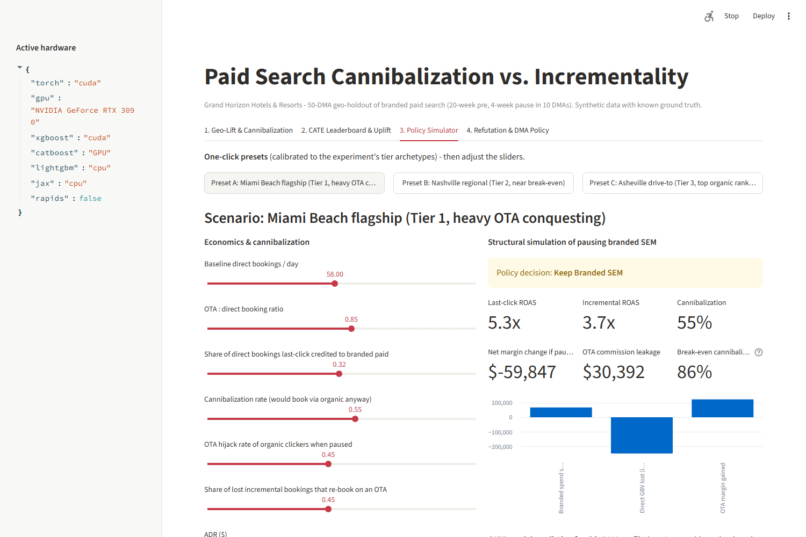

**06_streamlit_tab3_preset_B**

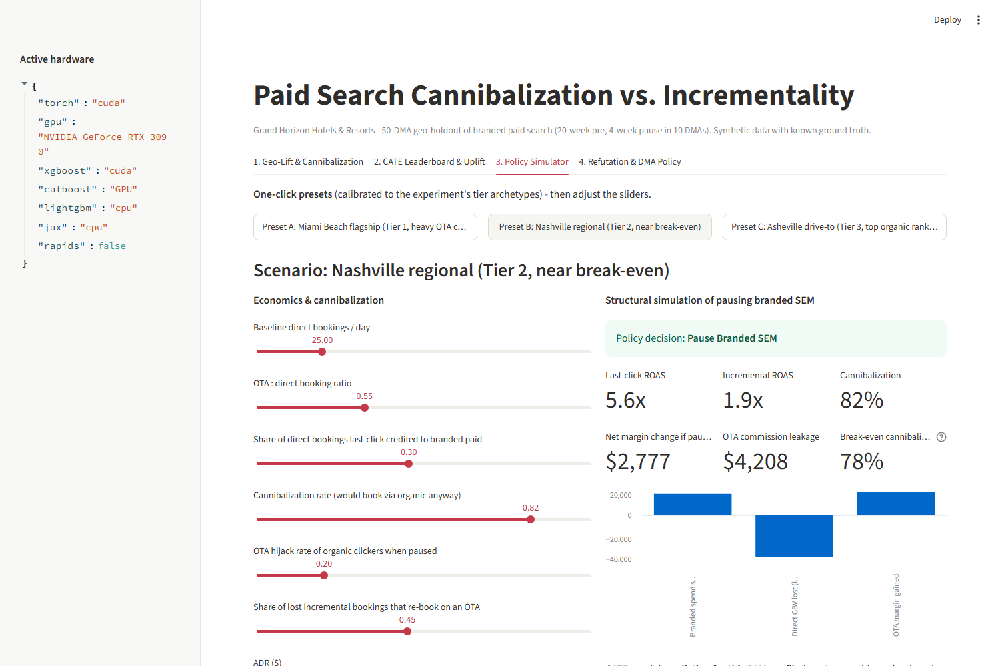

**07_streamlit_tab3_preset_C**

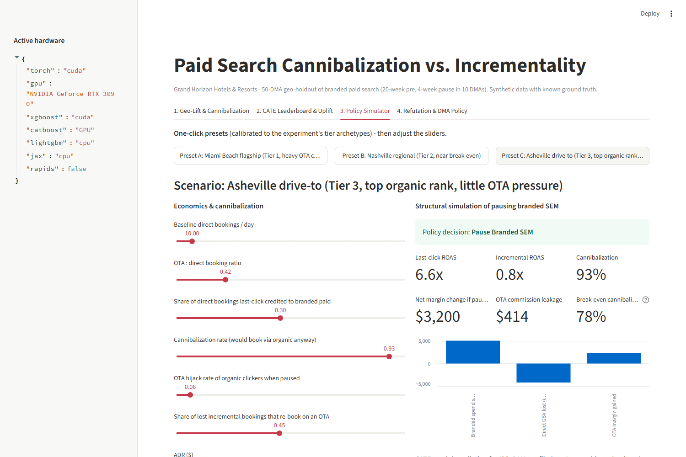

**08_streamlit_tab4_policy_refutation**

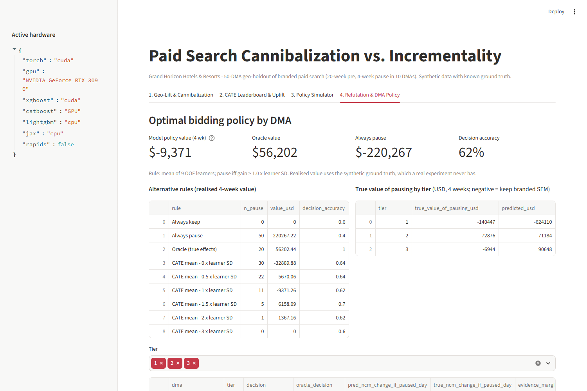

## Reproduce

```bash
make setup      # pip install -r requirements.txt && playwright install chromium
make train      # scripts/run_full_pipeline.py: panel -> macro -> cate -> econ -> plots   (~15 min on an RTX 3090)
make test       # unit tests
make verify     # Playwright e2e (API + Streamlit screenshots) + artefact checks
make readme     # regenerate this file
```

Use the `causal-gpu` conda interpreter (`PY=` in the Makefile). Hardware is auto-detected and logged; without CUDA everything falls back to CPU.

## Limitations (read before using the numbers)

* **Synthetic data.** Real branded-search effects will not follow this DGP; the value of the repo is the method, the diagnostics and the honesty checks.
* **JAX/NumPyro runs on CPU** on native Windows (no JAX CUDA wheels), so BSTS is CPU. **RAPIDS cuDF/cuML are not available on native Windows**; DTW runs on PyTorch CUDA instead and the code falls back to pandas/scikit-learn when RAPIDS is absent. LightGBM uses CPU (GPU build not installed).
* **CausalPy is not installed**, so BSTS is implemented directly in NumPyro.
* **Only 50 DMAs / 10 treated**: confidence intervals from DMA-day rows would be far too narrow; macro estimators use DMA-level inference and CATE metrics are DMA-grouped out-of-fold.
* **Policy value is evaluated with ground truth**; in a real test use cross-fitted doubly robust policy value estimates and a follow-up holdout.
* Constant 2.4-night stays and a 2.5% branded-click conversion rate are simplifications.
