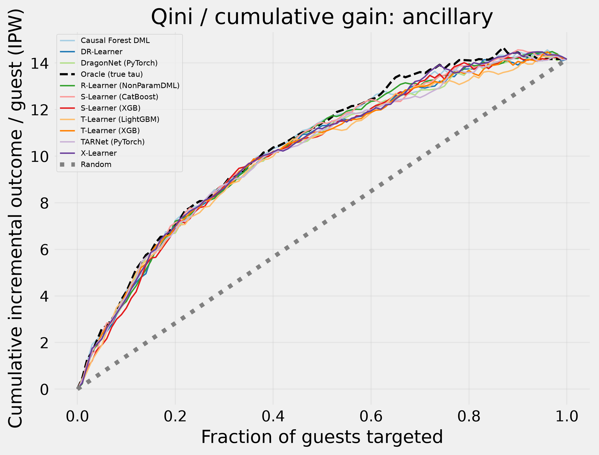
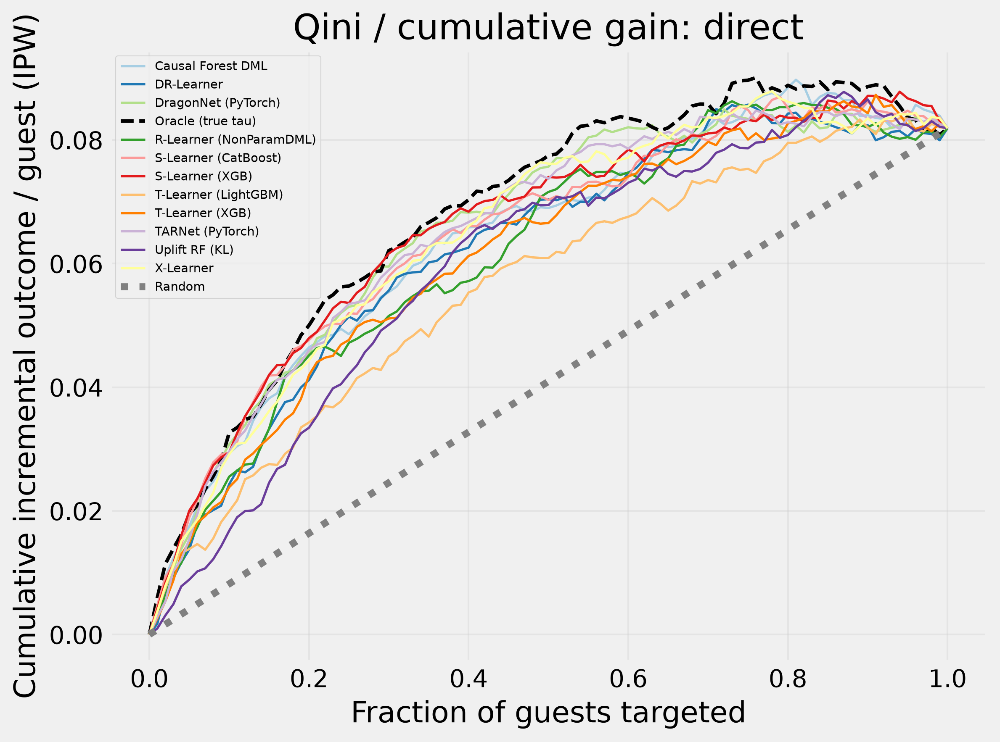
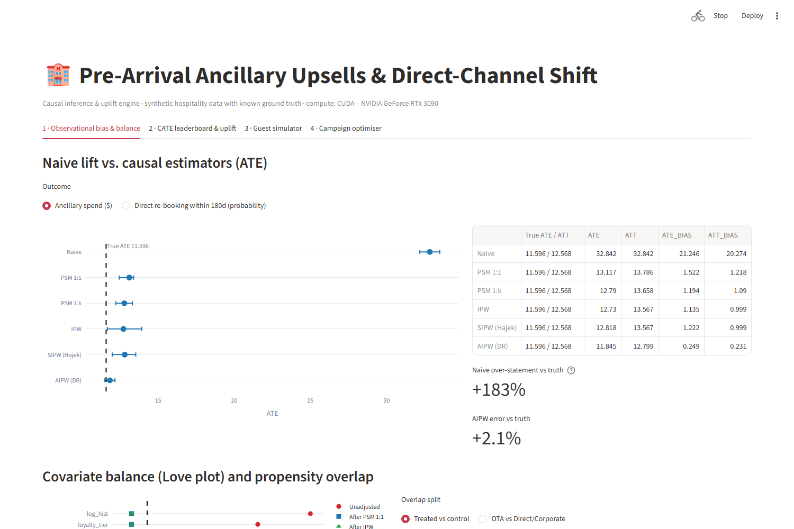
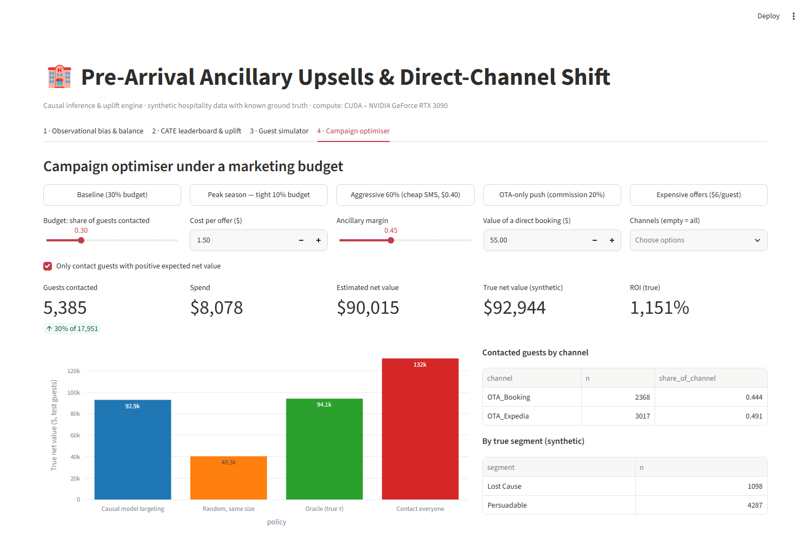

# Pre-Arrival Ancillary Upsells & Direct-Channel Shift — Causal / Uplift Engine

End-to-end, GPU-accelerated causal inference for a hospitality case study: estimate the effect of a pre-arrival app-download & upsell campaign on
**ancillary spend ($)** and **direct re-booking within 180 days** from confounded campaign logs, then target the guests whose behaviour the
campaign actually changes. Data is synthetic with a known structural truth, so every estimator can be scored against the real τ(x).

> Generated from `outputs/metrics/*` by `scripts/build_readme.py`. Compute used: **CUDA – NVIDIA GeForce RTX 3090**
> (XGBoost `cuda`, PyTorch `cuda`, CatBoost `GPU`, LightGBM `cpu`, RAPIDS cuML: not available → scikit-learn kNN fallback).

## 1. Problem
OTA guests cost 15–20% commission and rarely buy upgrades. Guests who engage with a pre-arrival offer are more tech-savvy, affluent and book earlier,
so a naive treated-vs-untreated comparison is badly inflated. N = 60,000 stays (37% treated).
Confounders: channel, room tier, lead time, party size, device, historical spend, loyalty tier, LOS, resort.

## 2. Observational ATE / ATT (propensity-based)
Naive lift over-states the ancillary effect by **+183%**.

### Ancillary spend ($)
True ATE = **11.596**, true ATT = 12.568

| Estimator | ATE | 95% CI | ATE bias | ATT |
|---|---|---|---|---|
| Naive | 32.842 | [32.185, 33.498] | +21.246 | 32.842 |
| PSM 1:1 | 13.117 | [12.456, 13.407] | +1.522 | 13.786 |
| PSM 1:k | 12.790 | [12.230, 13.316] | +1.194 | 13.658 |
| IPW | 12.730 | [11.675, 13.942] | +1.135 | 13.567 |
| SIPW (Hajek) | 12.818 | [11.994, 13.541] | +1.222 | 13.567 |
| AIPW (DR) | 11.845 | [11.515, 12.174] | +0.249 | 12.799 |

### Direct re-booking (probability)
True ATE = **0.066**, true ATT = 0.095

| Estimator | ATE | 95% CI | ATE bias | ATT |
|---|---|---|---|---|
| Naive | 0.234 | [0.224, 0.243] | +0.168 | 0.234 |
| PSM 1:1 | 0.085 | [0.073, 0.090] | +0.019 | 0.104 |
| PSM 1:k | 0.081 | [0.071, 0.090] | +0.015 | 0.106 |
| IPW | 0.083 | [0.071, 0.092] | +0.017 | 0.104 |
| SIPW (Hajek) | 0.083 | [0.073, 0.091] | +0.017 | 0.104 |
| AIPW (DR) | 0.079 | [0.069, 0.088] | +0.013 | 0.100 |

Balance (|SMD|<0.10): before **45%** of covariates → after PSM **100%**, after IPW **100%**
(max |SMD| 0.87 → 0.028). Common support keeps 99.9% of stays.

Honest note: PSM/IPW/SIPW retain a small positive bias (~+1 $ on ancillary spend); AIPW (doubly robust, cross-fitted) is closest to truth. CIs for IPW/PSM
use a bootstrap with the propensity fixed, so they are somewhat narrow.


**Refutation** (AIPW, ancillary): baseline 11.13; random common cause → 11.14;
placebo treatment → -0.05; data subset → 11.32.
DoWhy (backdoor linear regression): available — random_common_cause: 11.915, placebo_treatment_refuter: 0.096, data_subset_refuter: 11.921.
Details in `outputs/metrics/refutation.json`. These refuters only probe the *observed*-confounder model; they cannot rule out unmeasured confounding
(here none exists by construction).

## 3. CATE leaderboard
Qini/AUUC are computed from observed outcomes with IPW weights (no truth). PEHE, correlation and "policy value (true)" use the synthetic ground truth.
Policy value = net $ per guest when contacting the top 30% (margin × incremental outcome − offer cost). The oracle row ranks by the true τ.

### Ancillary spend
| Model | Qini | AUUC | PEHE | corr(τ̂,τ) | Policy value (IPW) | Policy value (true) | Fit s | ms/1k |
|---|---|---|---|---|---|---|---|---|
| Oracle (true tau) | 3.3417 | 10.422 | 0.000 | 1.000 | 3.506 | 2.947 | – | – |
| Causal Forest DML | 3.2222 | 10.303 | 2.139 | 0.982 | 3.467 | 2.916 | 13.8 | 41.6 |
| S-Learner (CatBoost) | 3.1650 | 10.246 | 2.310 | 0.982 | 3.499 | 2.926 | 2.9 | 4.4 |
| R-Learner (NonParamDML) | 3.1487 | 10.229 | 2.535 | 0.973 | 3.400 | 2.922 | 4.4 | 2.5 |
| X-Learner | 3.1362 | 10.217 | 2.147 | 0.981 | 3.429 | 2.927 | 4.1 | 3.7 |
| DR-Learner | 3.0411 | 10.122 | 2.946 | 0.963 | 3.393 | 2.912 | 4.8 | 2.1 |
| T-Learner (XGB) | 3.0411 | 10.122 | 3.045 | 0.961 | 3.438 | 2.910 | 1.9 | 3.1 |
| DragonNet (PyTorch) | 3.0219 | 10.103 | 2.592 | 0.975 | 3.443 | 2.917 | 10.1 | 1.0 |
| S-Learner (XGB) | 3.0204 | 10.101 | 3.603 | 0.956 | 3.475 | 2.914 | 1.1 | 4.6 |
| TARNet (PyTorch) | 3.0167 | 10.097 | 2.507 | 0.976 | 3.497 | 2.916 | 8.3 | 0.8 |
| T-Learner (LightGBM) | 2.9173 | 9.998 | 3.623 | 0.945 | 3.371 | 2.892 | 2.4 | 8.2 |

### Direct re-booking
| Model | Qini | AUUC | PEHE | corr(τ̂,τ) | Policy value (IPW) | Policy value (true) | Fit s | ms/1k |
|---|---|---|---|---|---|---|---|---|
| Oracle (true tau) | 0.0272 | 0.068 | 0.000 | 1.000 | 2.965 | 2.368 | – | – |
| S-Learner (XGB) | 0.0247 | 0.066 | 0.041 | 0.922 | 2.940 | 2.309 | 0.9 | 4.5 |
| DragonNet (PyTorch) | 0.0245 | 0.065 | 0.042 | 0.901 | 2.823 | 2.297 | 10.3 | 1.1 |
| TARNet (PyTorch) | 0.0241 | 0.065 | 0.042 | 0.896 | 2.792 | 2.269 | 6.8 | 0.9 |
| X-Learner | 0.0238 | 0.065 | 0.057 | 0.811 | 2.693 | 2.065 | 4.7 | 4.1 |
| S-Learner (CatBoost) | 0.0236 | 0.065 | 0.043 | 0.899 | 2.735 | 2.240 | 3.5 | 2.8 |
| Causal Forest DML | 0.0230 | 0.064 | 0.046 | 0.885 | 2.596 | 2.211 | 14.9 | 44.7 |
| DR-Learner | 0.0210 | 0.062 | 0.086 | 0.649 | 2.609 | 1.948 | 5.0 | 2.7 |
| R-Learner (NonParamDML) | 0.0208 | 0.062 | 0.074 | 0.711 | 2.384 | 1.946 | 4.2 | 2.6 |
| T-Learner (XGB) | 0.0202 | 0.061 | 0.069 | 0.750 | 2.361 | 1.973 | 1.9 | 2.4 |
| Uplift RF (KL) | 0.0184 | 0.059 | 0.181 | 0.699 | 2.306 | 1.656 | 2.8 | 27.4 |
| T-Learner (LightGBM) | 0.0153 | 0.056 | 0.094 | 0.629 | 2.024 | 1.756 | 2.3 | 8.1 |

Qini differences between the top models are small relative to the sampling noise of IPW-based curves on 18,000 test stays; PEHE and
policy-value-true are the more reliable ranking. Uplift RF (KL) is only defined for the binary outcome. LightGBM ran on CPU (GPU build absent).




## 4. Campaign policy
Best models by Qini: ancillary **Causal Forest DML**, direct **S-Learner (XGB)**.
Contacting the top 30% yields true net value $92,956 vs oracle $94,142
(estimated $90,027); contacting everyone yields $131,685. With these cost assumptions most guests have positive
expected value, so a 30% budget leaves money on the table — the optimiser is most valuable when offers are expensive or budgets are tight (see the scenarios in tab 4).

## 5. Screenshots







## 6. Run it
Use an environment with CUDA PyTorch (tested: Python 3.12, RTX 3090). `pip install -r requirements.txt`, `playwright install chromium`.
```bash
python scripts/run_pipeline.py            # data -> propensity -> CATE -> evaluate -> score (~4 min on GPU); --fast for a smoke run
uvicorn src.api.main:app --port 8000      # /health /predict/cate /optimize/campaign /models/metrics  (docs at /docs)
streamlit run src/app/streamlit_app.py    # 4-tab dashboard
python scripts/capture_screenshots.py     # regenerates docs/screenshots
python scripts/build_readme.py            # regenerates this README
pytest tests -q
```
Set `CAUSAL_OUT=<dir>` to redirect outputs. Config (seeds, N, hyper-parameters, margins, budget) lives in `config/config.yaml`.

## 7. Layout
`src/data` DGP · `src/models` propensity/ATE, CATE learners, TARNet/DragonNet · `src/evaluation` metrics & plots · `src/serving.py` shared scoring/optimiser
(used by both API and UI) · `src/api` FastAPI · `src/app` Streamlit · `scripts` orchestration · `tests`.

## 8. Limitations
- Synthetic data; unconfoundedness holds by construction. Real logs need sensitivity analysis for unmeasured confounding.
- Selection of "best model" by Qini on one test split is noisy; no repeated-seed Monte-Carlo was run.
- DragonNet's targeted regularisation is applied on the probability scale for the binary outcome (an approximation).
- Predicted segments are action rules on τ̂ (Persuadable / Sleeping Dog / …); Always-Taker vs Lost Cause cannot be separated without a baseline-response model.
- cuML is not installable on native Windows; kNN matching used scikit-learn here.
