# Pre-Arrival Ancillary Upsells & Direct-Channel Shift — Causal / Uplift Engine

End-to-end, GPU-accelerated causal inference for a hospitality case study: estimate the effect of a pre-arrival app-download & upsell campaign on
**ancillary spend ($)** and **direct re-booking within 180 days** from confounded campaign logs, then target the guests whose behaviour the
campaign actually changes. Data is synthetic with a known structural truth, so every estimator can be scored against the real τ(x).

> Generated from `outputs/metrics/*` by `scripts/build_readme.py`. Compute used: **CUDA – NVIDIA GeForce RTX 3090**
> (XGBoost `cuda`, PyTorch `cuda`, CatBoost `GPU`, LightGBM `cpu`, RAPIDS cuML: not available → scikit-learn kNN fallback).

## 1. Problem
OTA guests cost 15–20% commission and rarely buy upgrades. Guests who engage with a pre-arrival offer are more tech-savvy, affluent and book earlier,
so a naive treated-vs-untreated comparison is badly inflated. N = 60,000 stays (37% treated).
Confounders: channel, room tier, lead time, party size, device, historical spend, loyalty tier, LOS, resort.

## 2. Observational ATE / ATT (propensity-based)
Naive lift over-states the ancillary effect by **+183%**.

### Ancillary spend ($)
True ATE = **11.596**, true ATT = 12.568

| Estimator | ATE | 95% CI | ATE bias | ATT |
|---|---|---|---|---|
| Naive | 32.842 | [32.185, 33.498] | +21.246 | 32.842 |
| PSM 1:1 | 13.117 | [12.456, 13.407] | +1.522 | 13.786 |
| PSM 1:k | 12.790 | [12.230, 13.316] | +1.194 | 13.658 |
| IPW | 12.730 | [11.675, 13.942] | +1.135 | 13.567 |
| SIPW (Hajek) | 12.818 | [11.994, 13.541] | +1.222 | 13.567 |
| AIPW (DR) | 11.845 | [11.515, 12.174] | +0.249 | 12.799 |

### Direct re-booking (probability)
True ATE = **0.066**, true ATT = 0.095

| Estimator | ATE | 95% CI | ATE bias | ATT |
|---|---|---|---|---|
| Naive | 0.234 | [0.224, 0.243] | +0.168 | 0.234 |
| PSM 1:1 | 0.085 | [0.073, 0.090] | +0.019 | 0.104 |
| PSM 1:k | 0.081 | [0.071, 0.090] | +0.015 | 0.106 |
| IPW | 0.083 | [0.071, 0.092] | +0.017 | 0.104 |
| SIPW (Hajek) | 0.083 | [0.073, 0.091] | +0.017 | 0.104 |
| AIPW (DR) | 0.079 | [0.069, 0.088] | +0.013 | 0.100 |

Balance (|SMD|<0.10): before **45%** of covariates → after PSM **100%**, after IPW **100%**
(max |SMD| 0.87 → 0.028). Common support keeps 99.9% of stays.

Honest note: PSM/IPW/SIPW retain a small positive bias (~+1 $ on ancillary spend); AIPW (doubly robust, cross-fitted) is closest to truth. CIs for IPW/PSM
use a bootstrap with the propensity fixed, so they are somewhat narrow.

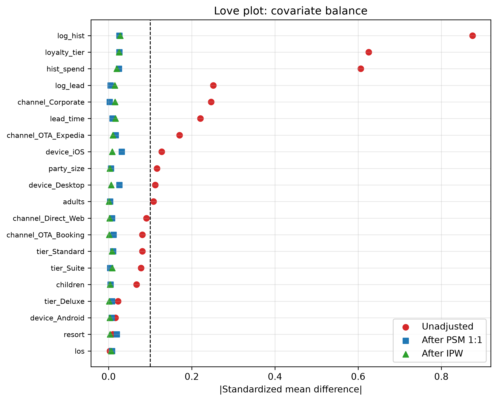
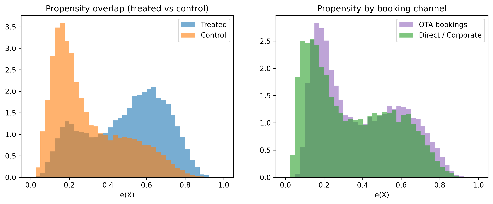
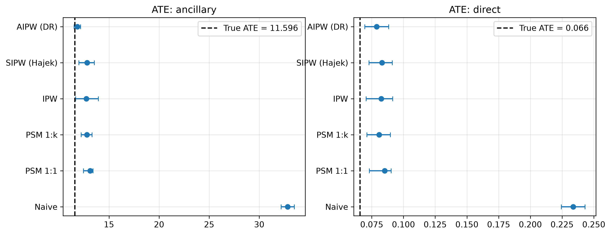

**Refutation** (AIPW, ancillary): baseline 11.13; random common cause → 11.14;
placebo treatment → -0.05; data subset → 11.32.
DoWhy (backdoor linear regression): available — random_common_cause: 11.915, placebo_treatment_refuter: 0.096, data_subset_refuter: 11.921.
Details in `outputs/metrics/refutation.json`. These refuters only probe the *observed*-confounder model; they cannot rule out unmeasured confounding
(here none exists by construction).

## 3. CATE leaderboard
Qini/AUUC are computed from observed outcomes with IPW weights (no truth). PEHE, correlation and "policy value (true)" use the synthetic ground truth.
Policy value = net $ per guest when contacting the top 30% (margin × incremental outcome − offer cost). The oracle row ranks by the true τ.

### Ancillary spend
| Model | Qini | AUUC | PEHE | corr(τ̂,τ) | Policy value (IPW) | Policy value (true) | Fit s | ms/1k |
|---|---|---|---|---|---|---|---|---|
| Oracle (true tau) | 3.3417 | 10.422 | 0.000 | 1.000 | 3.506 | 2.947 | – | – |
| Causal Forest DML | 3.2222 | 10.303 | 2.139 | 0.982 | 3.467 | 2.916 | 13.8 | 41.6 |
| S-Learner (CatBoost) | 3.1650 | 10.246 | 2.310 | 0.982 | 3.499 | 2.926 | 2.9 | 4.4 |
| R-Learner (NonParamDML) | 3.1487 | 10.229 | 2.535 | 0.973 | 3.400 | 2.922 | 4.4 | 2.5 |
| X-Learner | 3.1362 | 10.217 | 2.147 | 0.981 | 3.429 | 2.927 | 4.1 | 3.7 |
| DR-Learner | 3.0411 | 10.122 | 2.946 | 0.963 | 3.393 | 2.912 | 4.8 | 2.1 |
| T-Learner (XGB) | 3.0411 | 10.122 | 3.045 | 0.961 | 3.438 | 2.910 | 1.9 | 3.1 |
| DragonNet (PyTorch) | 3.0219 | 10.103 | 2.592 | 0.975 | 3.443 | 2.917 | 10.1 | 1.0 |
| S-Learner (XGB) | 3.0204 | 10.101 | 3.603 | 0.956 | 3.475 | 2.914 | 1.1 | 4.6 |
| TARNet (PyTorch) | 3.0167 | 10.097 | 2.507 | 0.976 | 3.497 | 2.916 | 8.3 | 0.8 |
| T-Learner (LightGBM) | 2.9173 | 9.998 | 3.623 | 0.945 | 3.371 | 2.892 | 2.4 | 8.2 |

### Direct re-booking
| Model | Qini | AUUC | PEHE | corr(τ̂,τ) | Policy value (IPW) | Policy value (true) | Fit s | ms/1k |
|---|---|---|---|---|---|---|---|---|
| Oracle (true tau) | 0.0272 | 0.068 | 0.000 | 1.000 | 2.965 | 2.368 | – | – |
| S-Learner (XGB) | 0.0247 | 0.066 | 0.041 | 0.922 | 2.940 | 2.309 | 0.9 | 4.5 |
| DragonNet (PyTorch) | 0.0245 | 0.065 | 0.042 | 0.901 | 2.823 | 2.297 | 10.3 | 1.1 |
| TARNet (PyTorch) | 0.0241 | 0.065 | 0.042 | 0.896 | 2.792 | 2.269 | 6.8 | 0.9 |
| X-Learner | 0.0238 | 0.065 | 0.057 | 0.811 | 2.693 | 2.065 | 4.7 | 4.1 |
| S-Learner (CatBoost) | 0.0236 | 0.065 | 0.043 | 0.899 | 2.735 | 2.240 | 3.5 | 2.8 |
| Causal Forest DML | 0.0230 | 0.064 | 0.046 | 0.885 | 2.596 | 2.211 | 14.9 | 44.7 |
| DR-Learner | 0.0210 | 0.062 | 0.086 | 0.649 | 2.609 | 1.948 | 5.0 | 2.7 |
| R-Learner (NonParamDML) | 0.0208 | 0.062 | 0.074 | 0.711 | 2.384 | 1.946 | 4.2 | 2.6 |
| T-Learner (XGB) | 0.0202 | 0.061 | 0.069 | 0.750 | 2.361 | 1.973 | 1.9 | 2.4 |
| Uplift RF (KL) | 0.0184 | 0.059 | 0.181 | 0.699 | 2.306 | 1.656 | 2.8 | 27.4 |
| T-Learner (LightGBM) | 0.0153 | 0.056 | 0.094 | 0.629 | 2.024 | 1.756 | 2.3 | 8.1 |

Qini differences between the top models are small relative to the sampling noise of IPW-based curves on 18,000 test stays; PEHE and
policy-value-true are the more reliable ranking. Uplift RF (KL) is only defined for the binary outcome. LightGBM ran on CPU (GPU build absent).


## 4. Campaign policy
Best models by Qini: ancillary **Causal Forest DML**, direct **S-Learner (XGB)**.
Contacting the top 30% yields true net value $92,956 vs oracle $94,142
(estimated $90,027); contacting everyone yields $131,685. With these cost assumptions most guests have positive
expected value, so a 30% budget leaves money on the table — the optimiser is most valuable when offers are expensive or budgets are tight (see the scenarios in tab 4).

## 5. End-to-end flows (dashboard tab 5)
Open the dashboard's **tab 5 · End-to-end flows**. Pipeline: Data → Propensity → Balance → ATE/ATT → Refutation → CATE models → Policy. Four flow types × two examples; each flow walks through 5–6 stages and every stage shows its own metrics (full-page shots in `outputs/screenshots/flows/`).

**Programme-level metrics (shared by all flows)**

| Metric | Value |
|---|---|
| Stays simulated | 60,000 |
| Treated share | 37% |
| Propensity AUC (cross-fit) | 0.761 |
| Common support kept | 99.9% |
| Max |SMD| before → after IPW | 0.87 → 0.028 |
| Naive ancillary lift ($) | 32.84 |
| AIPW ancillary lift ($) | 11.84 |
| True ancillary ATE ($) | 11.6 |
| Naive direct lift (pp) | 23.4 |
| AIPW direct lift (pp) | 7.9 |
| True direct ATE (pp) | 6.6 |
| Best ancillary CATE model | Causal Forest DML |
| Ancillary PEHE ($) | 2.14 |
| Best direct CATE model | S-Learner (XGB) |
| Direct PEHE (pp) | 4.1 |
| Refuters passed | 6/6 |
| Targeted value (true $) | 92956 |
| Oracle value (true $) | 94142 |
| Oracle capture | 98.7% |
| Learners fitted | 21 |
| Total fit time (s) | 111.2 |

### A1 · Guest decision: Expedia family on a Suite

_A family of four booked a Suite through Expedia 6+ weeks out and uses an iPhone. Should we send the pre-arrival upsell / app offer?_

| Stage | Key metrics |
|---|---|
| 1 · Guest profile | Channel: OTA_Expedia; Room tier: Suite; Lead (days): 55; Device: iOS; Loyalty tier: 0 |
| 2 · Selection-bias check | P(contacted | x) estimated: 0.323; Average over all guests: 0.369; Ratio vs average: 0.87; True P(contacted) (synthetic): 0.317; Was actually contacted: no |
| 3 · CATE from every model | True τ ancillary ($): 45.08; Best-model τ̂ ($): 41.13; Median across models ($): 40.99; Model spread (std, $): 2.15; True τ direct (pp): 8.51 |
| 4 · Decision | Expected net value ($): 21.92; Decision: SEND; Predicted segment: Persuadable; Rank (top x% of guests): 3%; Inside top-30% budget: yes |
| 5 · Counterfactual check (synthetic truth) | True net value of sending ($): 23.46; Decision correct: yes; True segment: Persuadable; Est. − true value ($): -1.54; Observed ancillary spend ($): 42.87 |
| 6 · Cohort context | Guests in same channel: 6144; Mean best-model τ̂ ($): 17.67; Mean true τ ($): 17.65; Share SEND in channel: 100% |

**Result:** Decision = SEND, Net value ($) = 21.92, Correct = yes

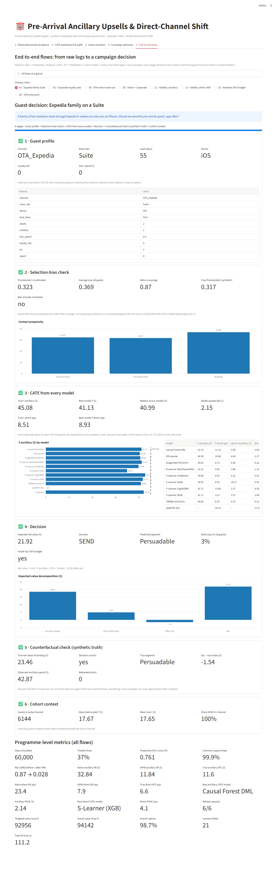

### A2 · Guest decision: Corporate loyalty-member solo traveller

_A Gold/Platinum business traveller on a short lead time. Already loyal and direct-leaning: does an upsell nudge help or annoy?_

| Stage | Key metrics |
|---|---|
| 1 · Guest profile | Channel: Corporate; Room tier: Deluxe; Lead (days): 8; Device: Desktop; Loyalty tier: 2 |
| 2 · Selection-bias check | P(contacted | x) estimated: 0.37; Average over all guests: 0.369; Ratio vs average: 1.0; True P(contacted) (synthetic): 0.407; Was actually contacted: yes |
| 3 · CATE from every model | True τ ancillary ($): -2.52; Best-model τ̂ ($): -2.13; Median across models ($): -1.1; Model spread (std, $): 2.24; True τ direct (pp): -10.5 |
| 4 · Decision | Expected net value ($): -8.45; Decision: SUPPRESS; Predicted segment: Sleeping Dog; Rank (top x% of guests): 100%; Inside top-30% budget: no |
| 5 · Counterfactual check (synthetic truth) | True net value of sending ($): -8.41; Decision correct: yes; True segment: Sleeping Dog; Est. − true value ($): -0.04; Observed ancillary spend ($): 76.59 |
| 6 · Cohort context | Guests in same channel: 2512; Mean best-model τ̂ ($): -1.33; Mean true τ ($): -2.85; Share SEND in channel: 7% |

**Result:** Decision = SUPPRESS, Net value ($) = -8.45, Correct = yes

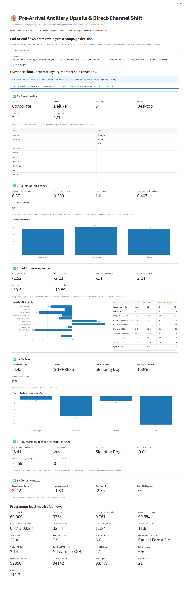

### B1 · Cohort read-out: OTA bookings (Expedia + Booking.com)

_Does the campaign work for the commission-heavy OTA book of business? Remove selection bias and read the lift for this cohort._

| Stage | Key metrics |
|---|---|
| 1 · Cohort | Stays (train): 26838; Treated share: 39%; Mean P(contacted): 0.388; Share of all stays: 64%; True ancillary ATE ($): 17.42 |
| 2 · Selection bias | Naive ancillary lift ($): 37.7; Bias vs truth ($): 20.28; Naive direct lift (pp): 25.61; Bias vs truth (pp): 14.15 |
| 3a · Adjusted estimate: ancillary | Naive ($): 37.7; IPW ($): 18.56; SIPW ($): 18.41; AIPW ($): 17.47; True ($): 17.42 |
| 3b · Adjusted estimate: direct | Naive (pp): 25.61; IPW (pp): 12.32; SIPW (pp): 12.25; AIPW (pp): 11.81; True (pp): 11.47 |
| 4 · Covariate balance in cohort | Max |SMD| before: 0.878; Max |SMD| after IPW: 0.029; Covariates |SMD|<0.1 before: 50%; after IPW: 100% |
| 5 · CATE models for the cohort (held-out) | Mean best τ̂ ancillary ($): 17.57; Mean true τ ancillary ($): 17.56; Mean best τ̂ direct (pp): 11.08; Mean true τ direct (pp): 11.36; Share SEND: 100% |

**Result:** True ancillary ATE ($) = 17.42, AIPW ($) = 17.47, Naive ($) = 37.7

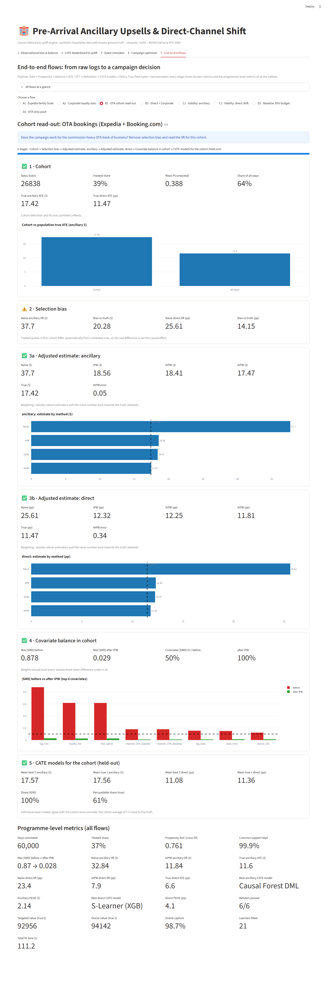

### B2 · Cohort read-out: Direct web + Corporate

_Direct and corporate guests already book with us. The campaign should add little: check that the estimators agree._

| Stage | Key metrics |
|---|---|
| 1 · Cohort | Stays (train): 15211; Treated share: 34%; Mean P(contacted): 0.345; Share of all stays: 36%; True ancillary ATE ($): 1.28 |
| 2 · Selection bias | Naive ancillary lift ($): 24.73; Bias vs truth ($): 23.45; Naive direct lift (pp): 22.48; Bias vs truth (pp): 24.56 |
| 3a · Adjusted estimate: ancillary | Naive ($): 24.73; IPW ($): 2.4; SIPW ($): 2.97; AIPW ($): 1.96; True ($): 1.28 |
| 3b · Adjusted estimate: direct | Naive (pp): 22.48; IPW (pp): 1.05; SIPW (pp): 1.54; AIPW (pp): 0.66; True (pp): -2.08 |
| 4 · Covariate balance in cohort | Max |SMD| before: 0.902; Max |SMD| after IPW: 0.031; Covariates |SMD|<0.1 before: 40%; after IPW: 100% |
| 5 · CATE models for the cohort (held-out) | Mean best τ̂ ancillary ($): 1.96; Mean true τ ancillary ($): 1.26; Mean best τ̂ direct (pp): 1.74; Mean true τ direct (pp): -2.09; Share SEND: 63% |

**Result:** True ancillary ATE ($) = 1.28, AIPW ($) = 1.96, Naive ($) = 24.73

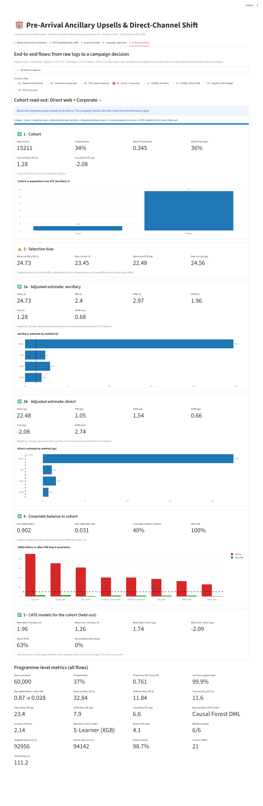

### C1 · Validity checks: ancillary-spend ATE

_Before trusting the $ lift: overlap, trimming sensitivity, balance and refutation tests._

| Stage | Key metrics |
|---|---|
| 1 · Overlap & trimming sensitivity | Propensity AUC: 0.761; e(x) range: 0.031 – 0.948; Common support kept: 99.9%; AIPW range over windows ($): 11.86 – 12.93 |
| 2 · Covariate balance | Max |SMD| before: 0.875; after PSM: 0.031; after IPW: 0.028; Covariates < 0.10 after IPW: 100% |
| 3 · Built-in refuters (AIPW) | Baseline ATE: 11.134; Random common cause: 11.138; Placebo treatment: -0.048; Data subset (80%): 11.316; All passed: yes |
| 4 · DoWhy cross-check | Estimate (OLS backdoor): 11.911; random_common_cause: 11.915; placebo_treatment_refuter: 0.096; data_subset_refuter: 11.921 |
| 5 · Verdict | True ATE: 11.596; Naive: 32.842; IPW: 12.73; AIPW: 11.845; AIPW error: +2.1% |

**Result:** Refuters passed = 3/3, AIPW error = +2.1%

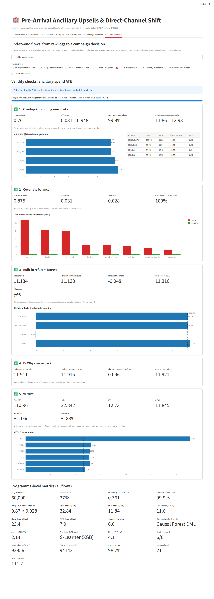

### C2 · Validity checks: direct-channel-shift ATE

_Same battery for the binary direct re-booking outcome._

| Stage | Key metrics |
|---|---|
| 1 · Overlap & trimming sensitivity | Propensity AUC: 0.761; e(x) range: 0.031 – 0.948; Common support kept: 99.9%; AIPW range over windows (pp): 7.77 – 9.07 |
| 2 · Covariate balance | Max |SMD| before: 0.875; after PSM: 0.031; after IPW: 0.028; Covariates < 0.10 after IPW: 100% |
| 3 · Built-in refuters (AIPW) | Baseline ATE: 7.344; Random common cause: 7.187; Placebo treatment: -0.046; Data subset (80%): 6.829; All passed: yes |
| 4 · DoWhy cross-check | Estimate (OLS backdoor): 7.764; random_common_cause: 7.751; placebo_treatment_refuter: -0.518; data_subset_refuter: 7.564 |
| 5 · Verdict | True ATE: 6.577; Naive: 23.374; IPW: 8.252; AIPW: 7.888; AIPW error: +19.9% |

**Result:** Refuters passed = 3/3, AIPW error = +19.9%

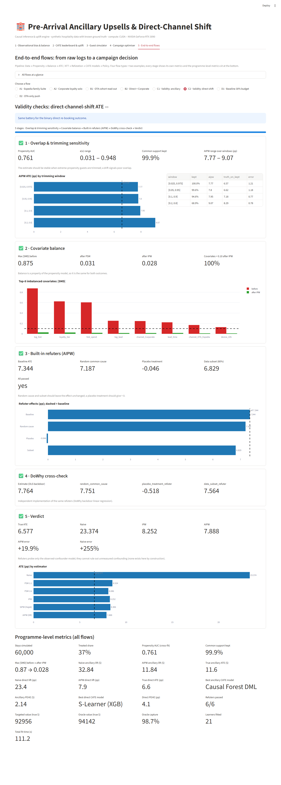

### D1 · Campaign policy: baseline, contact the top 30%

_Marketing can contact 30% of arrivals at $1.50 each. Score everyone, pick the best 30%, compare with random and oracle._

| Stage | Key metrics |
|---|---|
| 1 · Scoring | Ancillary model: Causal Forest DML; Direct model: S-Learner (XGB); Ancillary Qini: 3.222; Direct Qini: 0.0247; Ancillary PEHE ($): 2.14 |
| 2 · Economics & budget | Budget share: 30%; Cost / offer ($): 1.5; Ancillary margin: 0.45; Value of a direct booking ($): 55.0; Eligible channels: all |
| 3 · Selection | Guests contacted: 5385; Share of eligible: 30%; Spend ($): 8078; Mean τ̂ ancillary of selected ($): 23.23; Mean τ̂ direct of selected (pp): 14.11 |
| 4 · Policy comparison (true $) | Causal targeting: 92944; Random, same size: 40297; Oracle (true τ): 94142; Contact everyone: 131685; Capture of oracle: 98.7% |
| 5 · ROI & risk | True ROI: 1,151%; Estimated net value ($): 90015; True net value ($): 92944; Estimation error: -3.2%; Contacted with negative true value: 0 |

**Result:** True net value ($) = 92944, Capture of oracle = 98.7%, ROI = 1,151%

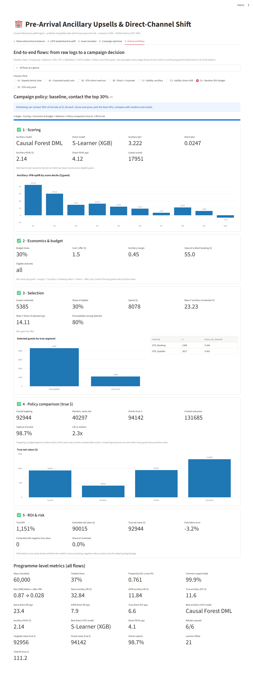

### D2 · Campaign policy: OTA-only push at 20% commission

_Revenue management wants to shift OTA guests direct: a booking is worth $75, only OTA channels are eligible, 30% budget._

| Stage | Key metrics |
|---|---|
| 1 · Scoring | Ancillary model: Causal Forest DML; Direct model: S-Learner (XGB); Ancillary Qini: 3.222; Direct Qini: 0.0247; Ancillary PEHE ($): 2.14 |
| 2 · Economics & budget | Budget share: 30%; Cost / offer ($): 1.5; Ancillary margin: 0.45; Value of a direct booking ($): 75.0; Eligible channels: OTA_Expedia, OTA_Booking |
| 3 · Selection | Guests contacted: 3442; Share of eligible: 30%; Spend ($): 5163; Mean τ̂ ancillary of selected ($): 24.27; Mean τ̂ direct of selected (pp): 16.26 |
| 4 · Policy comparison (true $) | Causal targeting: 78001; Random, same size: 51304; Oracle (true τ): 79940; Contact everyone: 171221; Capture of oracle: 97.6% |
| 5 · ROI & risk | True ROI: 1,511%; Estimated net value ($): 74406; True net value ($): 78001; Estimation error: -4.6%; Contacted with negative true value: 0 |

**Result:** True net value ($) = 78001, Capture of oracle = 97.6%, ROI = 1,511%

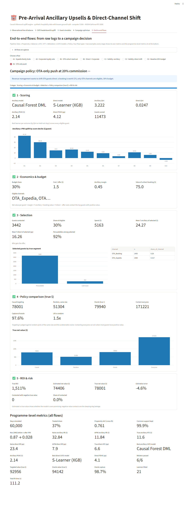

## 6. Screenshots
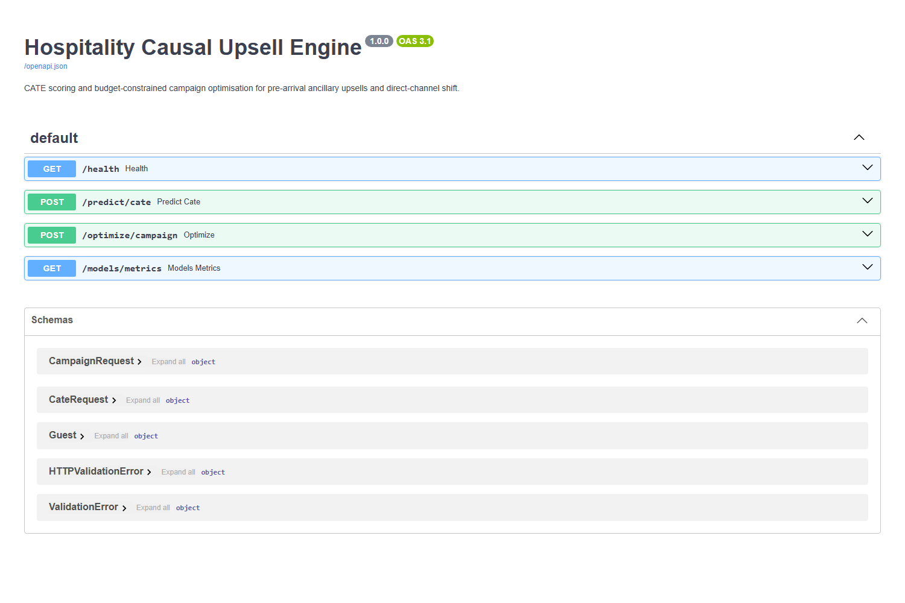
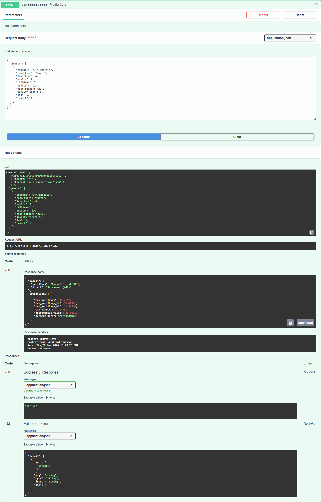

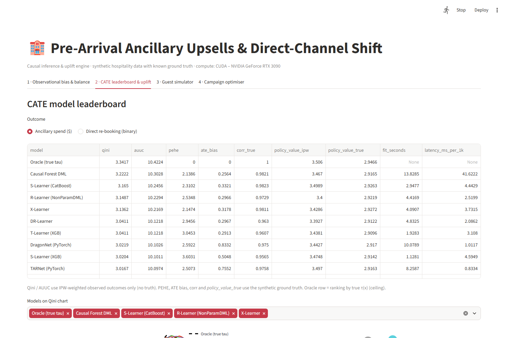
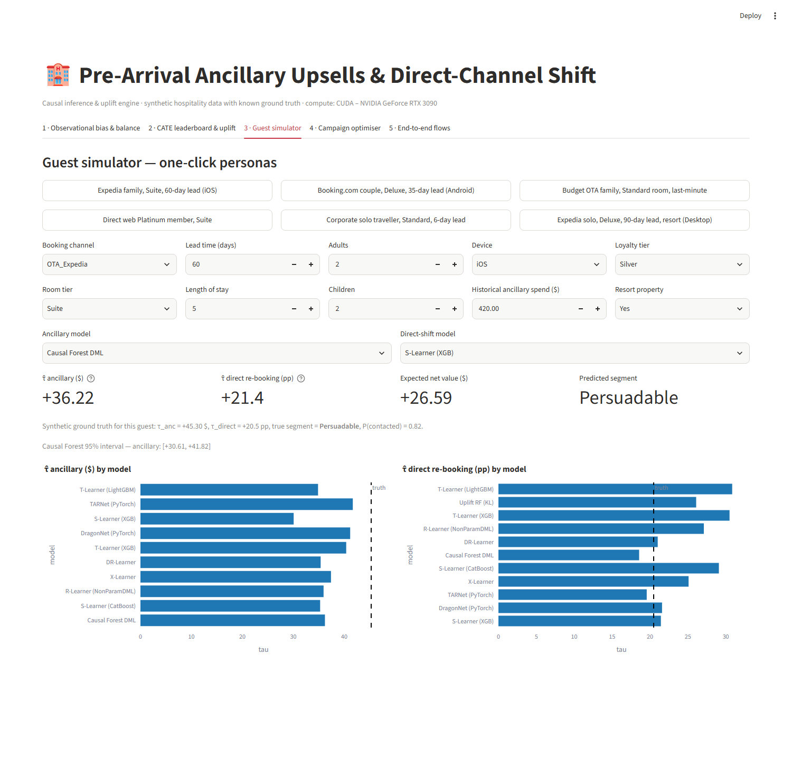


All dashboard screenshots are also written to `outputs/screenshots/`.

## 7. Run it
Use an environment with CUDA PyTorch (tested: Python 3.12, RTX 3090). `pip install -r requirements.txt`, `playwright install chromium`.
```bash
python scripts/run_pipeline.py            # data -> propensity -> CATE -> evaluate -> score (~4 min on GPU); --fast for a smoke run
uvicorn src.api.main:app --port 8000      # /health /predict/cate /optimize/campaign /models/metrics  (docs at /docs)
streamlit run src/app/streamlit_app.py    # 5-tab dashboard
python scripts/capture_screenshots.py     # regenerates docs/screenshots + outputs/screenshots (+ flows)
python scripts/run_pipeline.py --stage flows   # rebuild outputs/metrics/flows.json only
python scripts/build_readme.py            # regenerates this README
python presentation/build_deck.py         # rebuilds presentation/Pre_Arrival_Upsell_Uplift_End_to_End.pptx (78 slides)
pytest tests -q
```
Set `CAUSAL_OUT=<dir>` to redirect outputs. Config (seeds, N, hyper-parameters, margins, budget) lives in `config/config.yaml`.

## 8. Layout
`src/data` DGP · `src/models` propensity/ATE, CATE learners, TARNet/DragonNet · `src/evaluation` metrics & plots · `src/serving.py` shared scoring/optimiser
(used by both API and UI) · `src/api` FastAPI · `src/flows.py` end-to-end flows · `src/app` Streamlit · `presentation` 78-slide deck + builder · `scripts` orchestration · `tests`.

## 9. Limitations
- Synthetic data; unconfoundedness holds by construction. Real logs need sensitivity analysis for unmeasured confounding.
- Selection of "best model" by Qini on one test split is noisy; no repeated-seed Monte-Carlo was run.
- DragonNet's targeted regularisation is applied on the probability scale for the binary outcome (an approximation).
- Predicted segments are action rules on τ̂ (Persuadable / Sleeping Dog / …); Always-Taker vs Lost Cause cannot be separated without a baseline-response model.
- cuML is not installable on native Windows; kNN matching used scikit-learn here.
