# Hospitality Promotional Incrementality - Uplift / CATE Modeling

GPU-accelerated estimation of individual treatment effects tau(x) = E[Y(1) - Y(0) | X = x] for hospitality
offers ("20% off weekend stay", "2,000 bonus points"), so the CRM team mails **Persuadables** and suppresses
**Always-Takers, Lost Causes and Sleeping Dogs**. 11 CATE estimators, an observational-bias-aware evaluation,
policy simulation, a FastAPI scoring service and a Streamlit simulator.

> All data is **synthetic** (50,000 guests, known ground-truth counterfactuals). Every number below was produced by
> `python main.py --stage all` on an RTX 3090 and is read from `outputs/logs/`. Results are one seed on one
> synthetic DGP - they show the pipeline works, not that any estimator wins in general.

## Pipeline

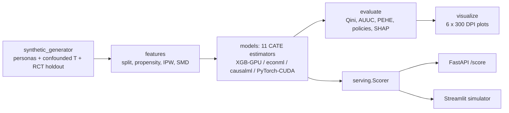

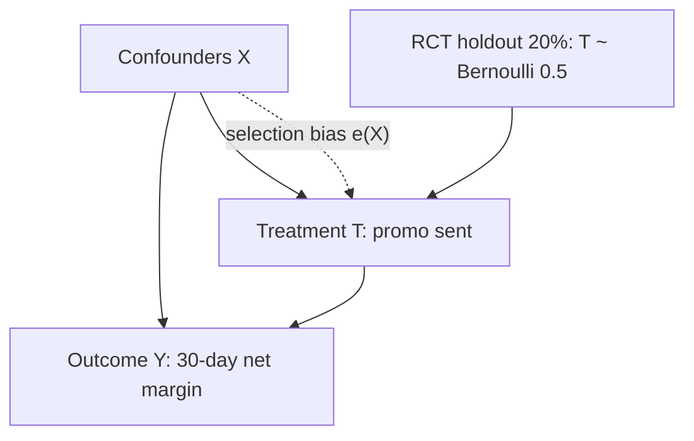

## Quick start

```bash
pip install -r requirements.txt
python main.py --stage all            # data -> train(+ablation) -> evaluate -> plots -> screenshots (incl. flows)
python scripts/capture_screenshots.py flows   # re-capture only the end-to-end flow screenshots
python main.py --stage all --quick    # fast smoke run
python main.py --stage serve-api      # http://localhost:8000/docs
python main.py --stage serve-ui       # http://localhost:8501
python main.py --stage test           # metric unit tests
```

## Data-generating process
Five latent personas (Persuadable, Always-Taker, Lost Cause, Sleeping Dog, Neutral) drive both the covariates and the
heterogeneous effect. Potential conversions share one uniform draw so Y(1), Y(0) are coherent. Margin per booking is
`R*(margin_rate - discount)` under the offer versus `R*margin_rate` without it, so a discount on a guest who would have booked
anyway *loses* margin. Treatment is confounded by engagement, tier, price sensitivity and recency; 20% of guests are a
randomized holdout. `persona` is stored for evaluation only and is never a model feature.

## Estimators (`src/models.py`)
S, T, X, R learners (hand-written, XGBoost-GPU base), DR-Learner, LinearDML, NonParamDML, CausalForestDML (econml),
UpliftRandomForest (causalml, CTS; conversion effect converted to margin scale with a plug-in baseline-conversion model),
TARNet and DragonNet (PyTorch, CUDA + AMP, T-Reg). LightGBM and CatBoost base learners are benchmarked in an ablation.
CPU fallback is automatic. LightGBM's pip wheel has no CUDA build so it always runs on CPU; UpliftRF is CPU-only.

## Results (25% test set, 12,501 guests)

Metrics use observed outcomes with IPW weights; PEHE compares to the true conditional effect (in $ of 30-day margin).

| Model | Norm. Qini (IPW) | AUUC | PEHE ($) | Uplift@20% ($) | Latency ms/1k | Fit s | Device | 95% CI cover. of true tau |
|---|---|---|---|---|---|---|---|---|
| S-Learner | 0.94 | -0.518 | 16.151 | 10.663 | 2.287 | 3.037 | GPU | 0.134 |
| T-Learner | 0.942 | -0.506 | 15.622 | 10.712 | 2.5 | 6.031 | GPU | 0.389 |
| X-Learner | 0.951 | -0.441 | 15.199 | 11.533 | 3.413 | 13.668 | GPU | 0.245 |
| R-Learner | 0.944 | -0.495 | 15.574 | 11.497 | 1.374 | 17.582 | GPU | 0.386 |
| DR-Learner | 0.934 | -0.561 | 15.785 | 11.786 | 2.384 | 8.305 | GPU | 0.31 |
| LinearDML | 0.93 | -0.597 | 15.745 | 9.784 | 2.079 | 1.925 | CPU | 0.707 |
| NonParamDML | 0.942 | -0.503 | 15.774 | 11.338 | 2.99 | 7.99 | GPU | 0.345 |
| CausalForestDML | 0.952 | -0.43 | 14.941 | 11.384 | 31.498 | 2.648 | GPU | 0.46 |
| UpliftRF | 0.907 | -0.76 | 17.488 | 5.53 | 34.127 | 6.093 | CPU | 0.084 |
| TARNet | 0.94 | -0.521 | 15.143 | 12.25 | 1.369 | 8.667 | GPU | 0.505 |
| DragonNet | 0.941 | -0.515 | 15.18 | 11.908 | 1.495 | 6.829 | GPU | 0.459 |

*How to read this:* the Qini scores sit in a narrow 0.91-0.95 band, and with a single seed the gaps between
S/T/X/R/DR/DML/TARNet/DragonNet are small and I did not test them for significance. CausalForestDML has the best PEHE and
Qini here; UpliftRF is clearly worst on margin. **The reported 95% intervals badly under-cover the true effect** (coverage
column, nominal 95%): native econml intervals and the subsample-replica intervals used for the other models capture sampling
variance but not regularization bias, so treat them as relative uncertainty, not calibrated intervals.

Base-learner ablation (X/S/T-learners, `outputs/logs/benchmark_base_learner_ablation.csv`):

| base | model | pehe | qini_norm_ipw |
|---|---|---|---|
| xgboost | S-Learner | 16.151 | 0.94 |
| xgboost | T-Learner | 15.622 | 0.942 |
| xgboost | X-Learner | 15.199 | 0.951 |
| lightgbm | S-Learner | 15.753 | 0.941 |
| lightgbm | T-Learner | 19.456 | 0.915 |
| lightgbm | X-Learner | 17.878 | 0.926 |
| catboost | S-Learner | 15.156 | 0.942 |
| catboost | T-Learner | 16.742 | 0.935 |
| catboost | X-Learner | 15.796 | 0.947 |

## CRM policy simulation (test set, ground-truth counterfactuals)

Targeting uses the best estimator by PEHE+Qini rank. The propensity baseline is given the same mail budget as the causal policy.
Send cost is $0.05 per mail; threshold is tau-hat > $0.05 + send cost.

| Policy | Targeted | Net incr. margin ($, test set) | Discount cannibalization ($) | Incr. bookings |
|---|---|---|---|---|
| Mass Blast | 1.0 | -165699.9 | 224858.7 | 888.2 |
| No Promo | 0.0 | 0.0 | 0.0 | 0.0 |
| Propensity Targeting | 0.2 | -127405.1 | 152647.8 | 290.4 |
| Causal Uplift (CausalForestDML) | 0.2 | 28925.2 | 28927.5 | 824.6 |

Mass-blasting a 20% discount destroys margin because most guests (Always-Takers, Sleeping Dogs) would book anyway or are
harmed. Propensity targeting is *worse than random* here: it selects high-baseline-conversion guests, exactly the ones for
whom the discount is pure cannibalization. The 2,000-point arm is **modelled** from estimated conversion uplift (assumed 80%
of the discount lift), not observed in the data.

Persona recovery from (tau_conv-hat, tau_margin-hat, baseline conversion) - row-normalised, best model:

| persona | Always-Taker | Lost Cause | Persuadable | Sleeping Dog |
|---|---|---|---|---|
| Always-Taker | 0.96 | 0.0 | 0.0 | 0.03 |
| Lost Cause | 0.0 | 0.94 | 0.06 | 0.0 |
| Neutral | 0.0 | 0.96 | 0.04 | 0.0 |
| Persuadable | 0.0 | 0.04 | 0.96 | 0.0 |
| Sleeping Dog | 0.0 | 0.02 | 0.0 | 0.98 |

(Neutral guests have no dedicated quadrant and mostly land in Lost Cause.)

## Plots (`outputs/plots`, 300 DPI)
| | |
|---|---|
| 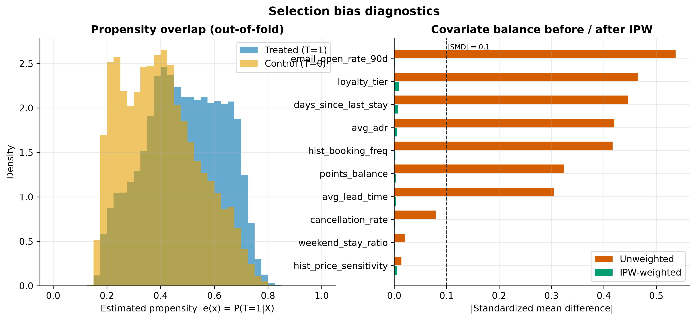 | 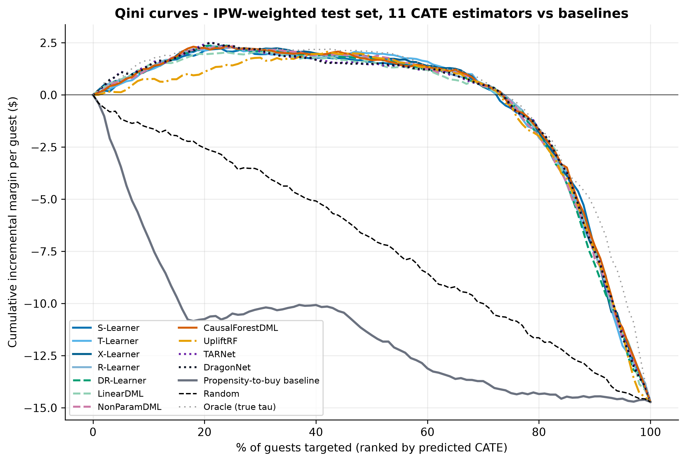 |
| 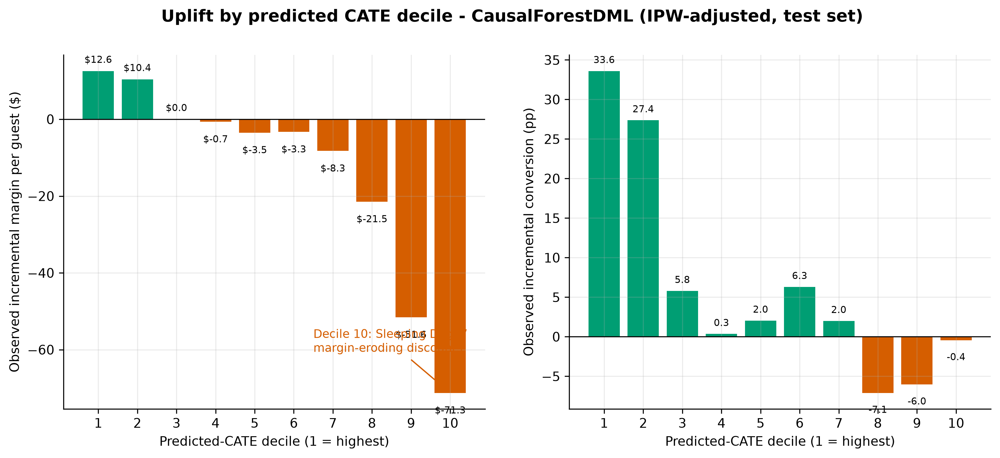 | 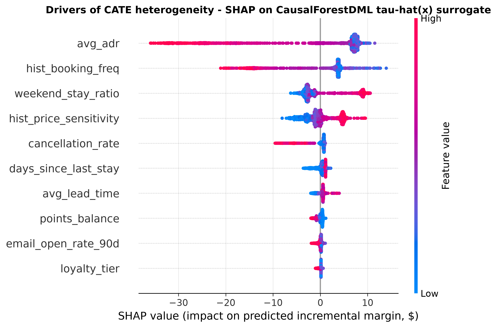 |
| 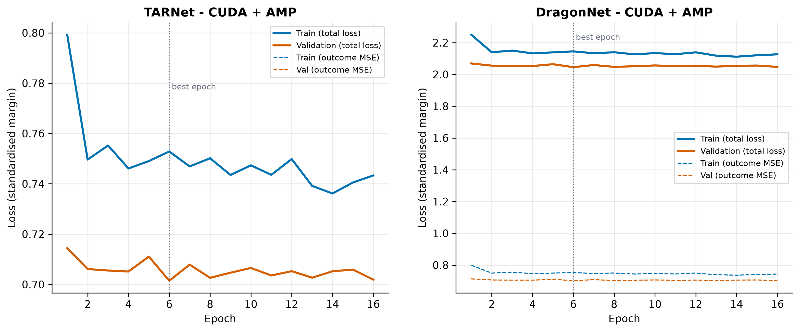 | 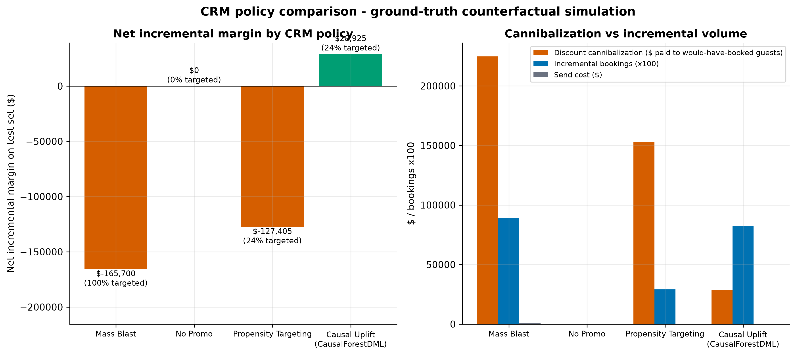 |

## API (`api/app.py`)
`GET /health`, `/models`, `/presets`; `POST /score` (single guest, optional `estimator`, `offer`, `explain`);
`POST /score/batch`. Decisions: `SEND 20% OFF`, `SEND 2,000 POINTS`, `SUPPRESS`.

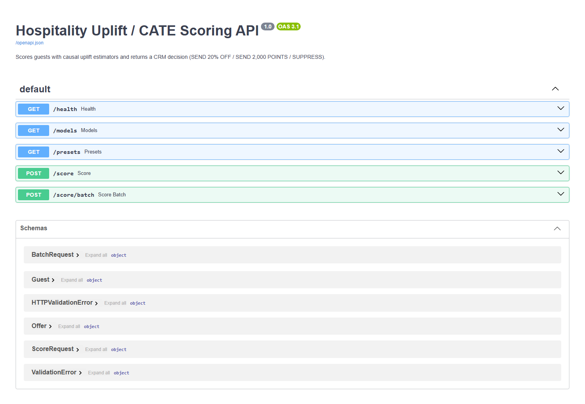
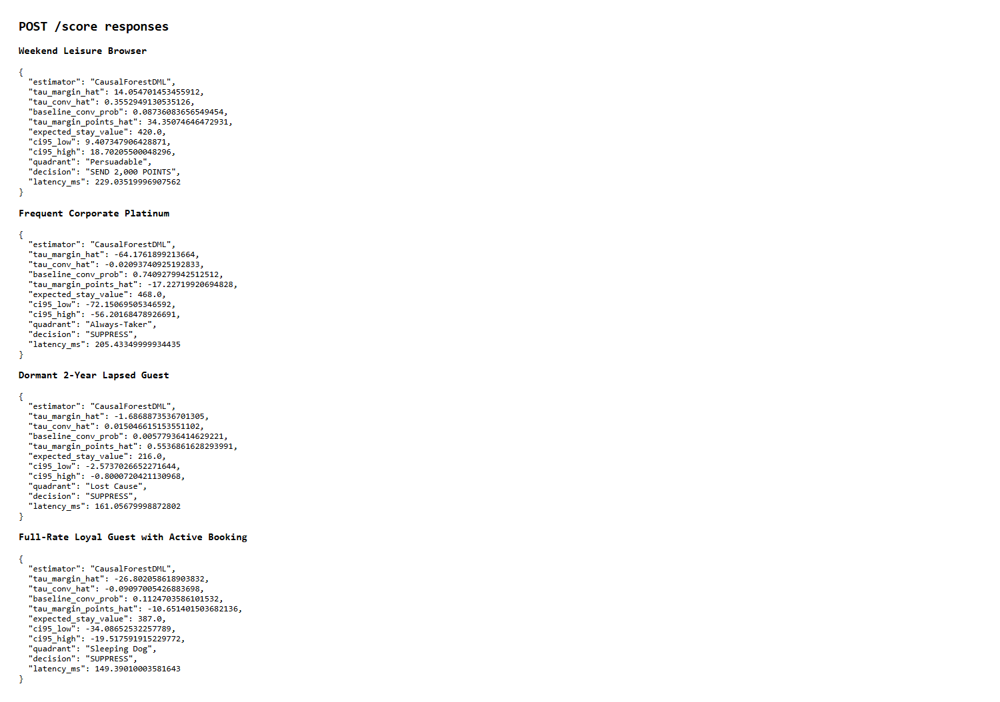

## Streamlit simulator (`ui/streamlit_app.py`)
Four tabs. Tab 1: four one-click presets, sliders, estimator selector, tau-hat + CI, persona badge, CRM decision, local SHAP.
Tab 2: benchmark table + Qini / decile / overlap plots. Tab 3: ROI simulator (discount %, points cost, database size, CATE threshold).
Tab 4: five guided end-to-end flows (below).

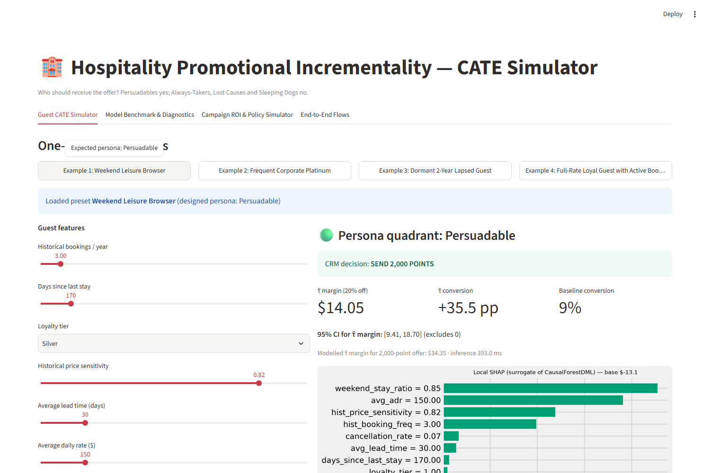
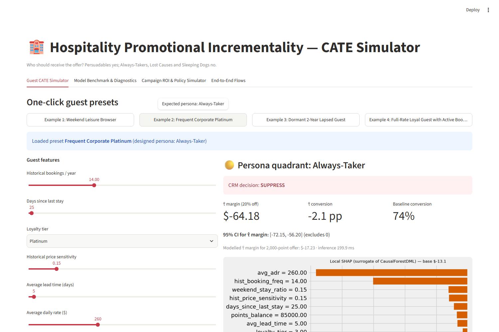
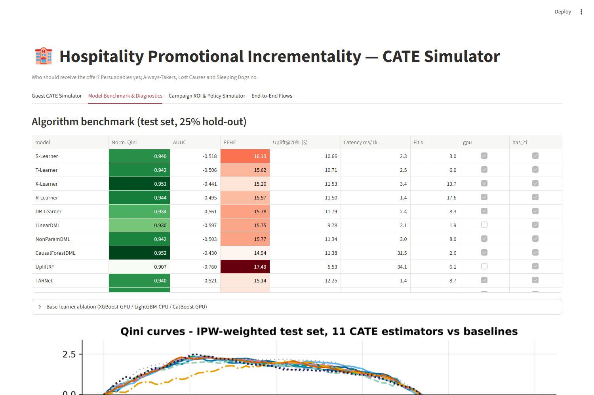
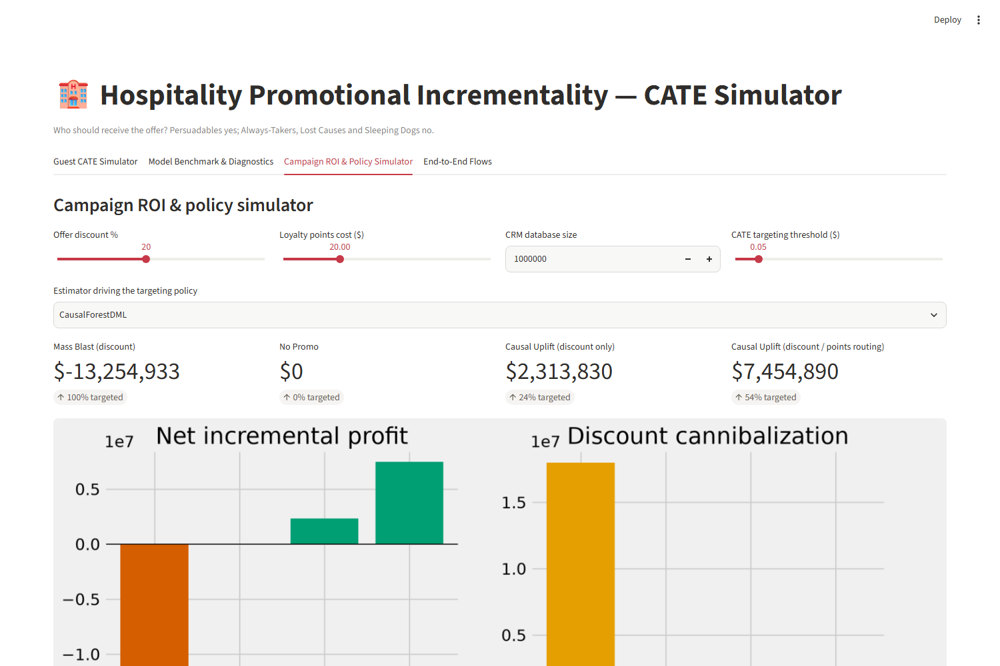

## End-to-end flows (Streamlit tab 4: *End-to-End Flows*)

Five worked scenarios run on **real held-out guests** (the most typical guest of each persona, picked automatically) and
a whole CRM list. Each flow has the same five steps, every number is computed live by the same `Scorer` code the API uses,
and `scripts/capture_screenshots.py` re-checks that the decision shown in the UI equals the `POST /score` response
(`outputs/screenshots/flows/flow_api_vs_ui_check.json`, 4/4 match).

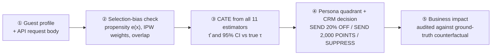

### Flow 1 — Weekend Leisure Browser (Persuadable)
A price-sensitive guest who books mostly weekend stays, moderately recent, opens emails. A genuine promo responder: she books because of the offer.

| Step | What the flow shows | Result |
|---|---|---|
| ① Profile | test-set guest #2512 | Silver, 2.3 bookings/yr, 158 days since last stay, price sensitivity 0.79 |
| ② Selection bias | historical mailing propensity | e(x) = 0.49 (CRM average 0.44) |
| ③ CATE | 20%-off effect on 30-day margin | headline CausalForestDML τ̂ = $14.6 (95% CI [11.8, 17.3]); true τ = $9.1; 11/11 estimators say "mail" |
| ④ Decision | persona + action | **Persuadable → SEND 2,000 POINTS** |
| ⑤ Impact | vs mass-blasting the 20% discount | $13,055 per 1,000 look-alikes (margin protected); persona matches ground truth |

| Step 3 — estimators | Step 4 — decision | Step 5 — impact |
|---|---|---|
| 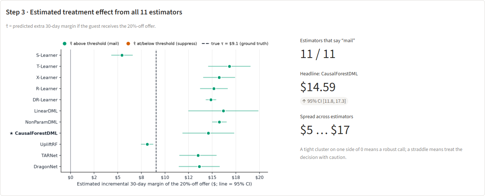 | 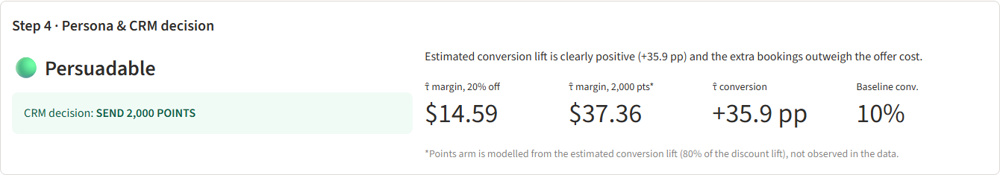 | 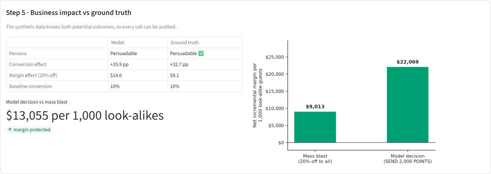 |

<details><summary>Full flow (all five steps)</summary>

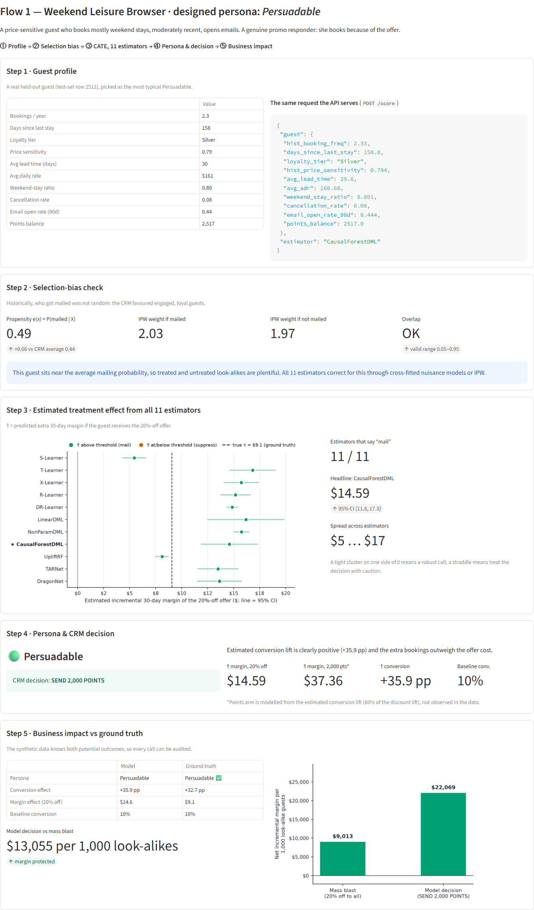

</details>

### Flow 2 — Frequent Corporate Platinum (Always-Taker)
A Platinum road warrior with short lead times who books many times a year at full rate. He will book anyway, so a discount is pure margin leakage.

| Step | What the flow shows | Result |
|---|---|---|
| ① Profile | test-set guest #3839 | Platinum, 11.5 bookings/yr, 32 days since last stay, price sensitivity 0.12 |
| ② Selection bias | historical mailing propensity | e(x) = 0.64 (CRM average 0.44) |
| ③ CATE | 20%-off effect on 30-day margin | headline CausalForestDML τ̂ = -$65.9 (95% CI [-76.8, -55.0]); true τ = -$76.4; 0/11 estimators say "mail" |
| ④ Decision | persona + action | **Always-Taker → SUPPRESS** |
| ⑤ Impact | vs mass-blasting the 20% discount | $76,459 per 1,000 look-alikes (margin protected); persona matches ground truth |

| Step 3 — estimators | Step 4 — decision | Step 5 — impact |
|---|---|---|
| 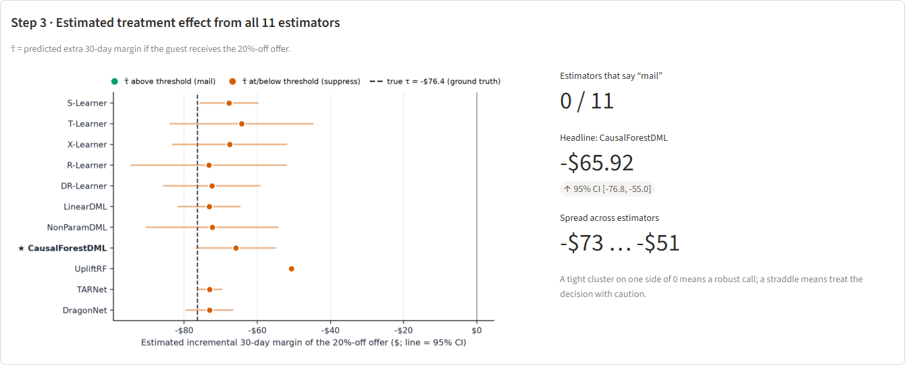 | 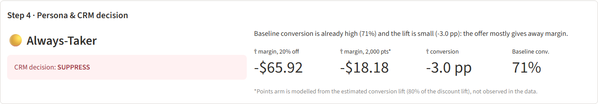 | 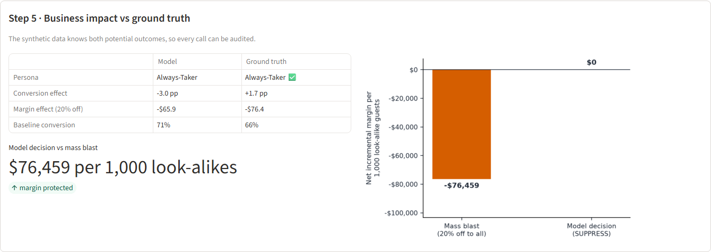 |

<details><summary>Full flow (all five steps)</summary>


</details>

### Flow 3 — Dormant 2-Year Lapsed Guest (Lost Cause)
A non-member who has not stayed in well over a year and ignores emails. No offer will move this guest; mailing only adds cost.

| Step | What the flow shows | Result |
|---|---|---|
| ① Profile | test-set guest #4063 | Non-Member, 0.8 bookings/yr, 869 days since last stay, price sensitivity 0.43 |
| ② Selection bias | historical mailing propensity | e(x) = 0.19 (CRM average 0.44) |
| ③ CATE | 20%-off effect on 30-day margin | headline CausalForestDML τ̂ = -$1.7 (95% CI [-2.6, -0.8]); true τ = -$0.7; 3/11 estimators say "mail" |
| ④ Decision | persona + action | **Lost Cause → SUPPRESS** |
| ⑤ Impact | vs mass-blasting the 20% discount | $745 per 1,000 look-alikes (margin protected); persona matches ground truth |

| Step 3 — estimators | Step 4 — decision | Step 5 — impact |
|---|---|---|
| 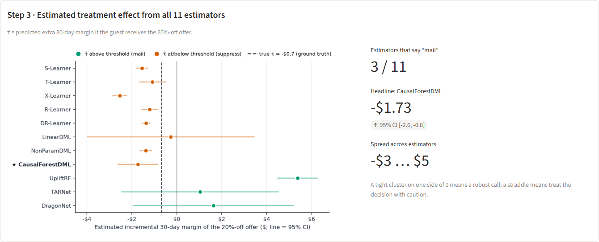 | 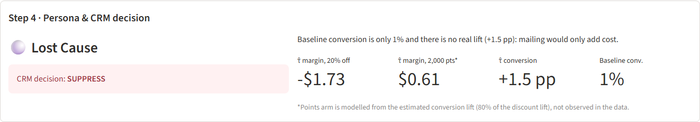 | 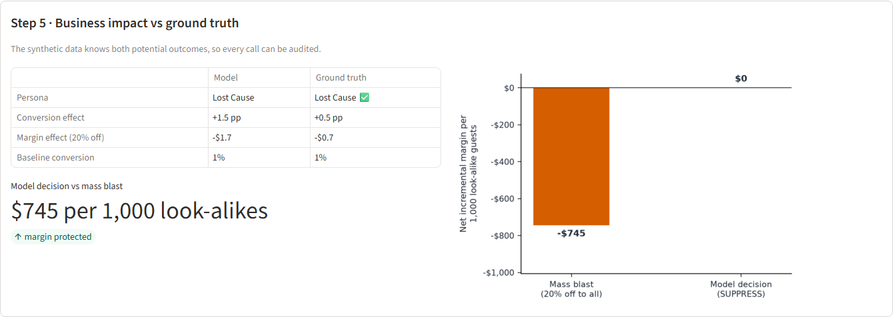 |

<details><summary>Full flow (all five steps)</summary>

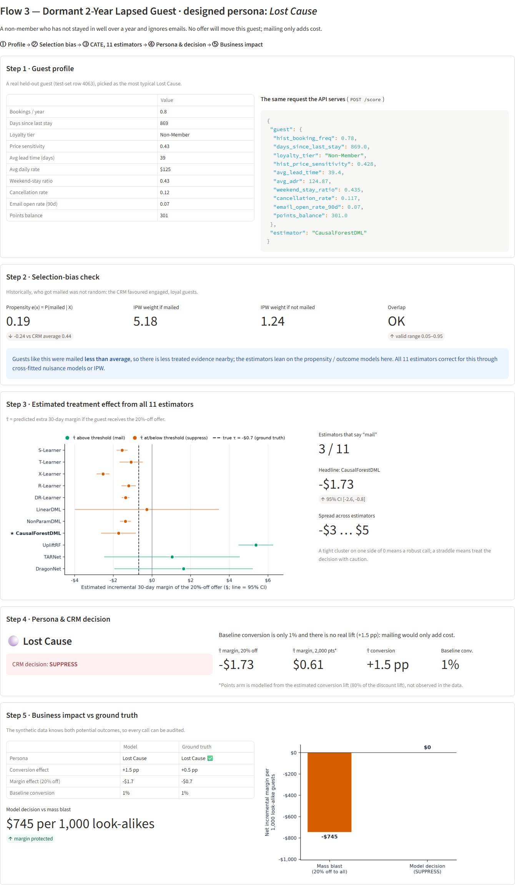

</details>

### Flow 4 — Full-Rate Loyal Guest with Active Booking (Sleeping Dog)
A loyal, rate-insensitive guest with a high cancellation rate and a booking already in place. A promo invites cancel-and-rebook at 20% off, or an unsubscribe.

| Step | What the flow shows | Result |
|---|---|---|
| ① Profile | test-set guest #9573 | Gold, 4.7 bookings/yr, 108 days since last stay, price sensitivity 0.07 |
| ② Selection bias | historical mailing propensity | e(x) = 0.44 (CRM average 0.44) |
| ③ CATE | 20%-off effect on 30-day margin | headline CausalForestDML τ̂ = -$29.4 (95% CI [-36.7, -22.1]); true τ = -$16.1; 0/11 estimators say "mail" |
| ④ Decision | persona + action | **Sleeping Dog → SUPPRESS** |
| ⑤ Impact | vs mass-blasting the 20% discount | $16,151 per 1,000 look-alikes (margin protected); persona matches ground truth |

| Step 3 — estimators | Step 4 — decision | Step 5 — impact |
|---|---|---|
| 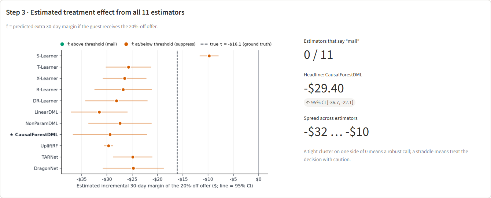 | 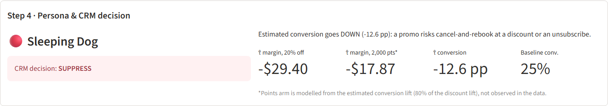 | 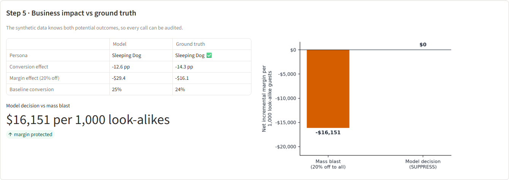 |

<details><summary>Full flow (all five steps)</summary>

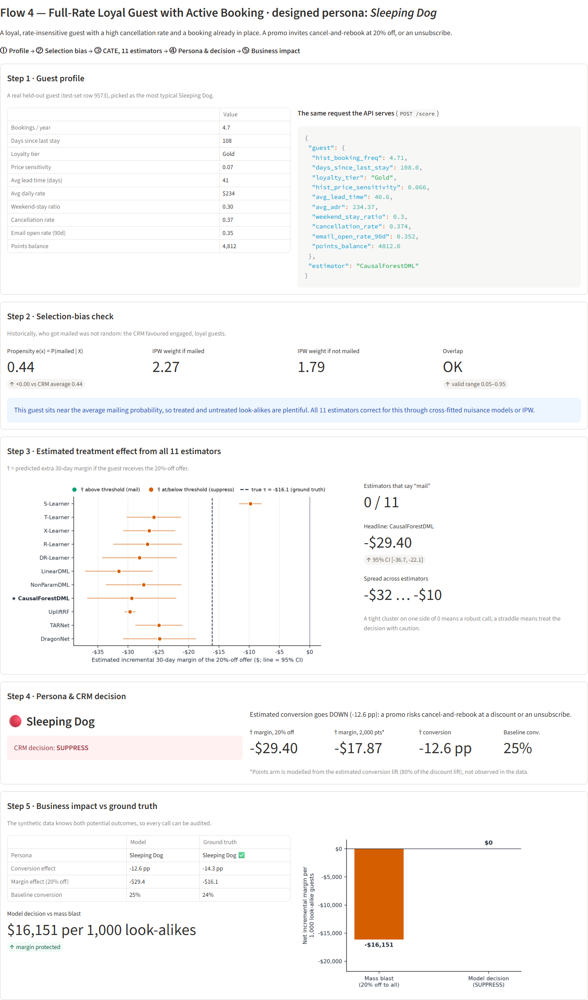

</details>

### Flow 5 — Score a CRM list, target, and measure ROI
Run the whole pipeline on a CRM list: batch-score guests, turn CATEs into SEND / SUPPRESS decisions, and compare the causal policy with mass blast and propensity targeting using the ground-truth counterfactuals.

| Step | What the flow shows | Result |
|---|---|---|
| ① CRM list | 2,000 randomly sampled held-out guests, threshold $0.05 | sliders for list size and threshold |
| ② Batch scoring | same code path as `POST /score/batch` | 136 ms total on CPU; 1,036 suppressed, 956 points, 8 discount |
| ③ Targeting quality | assigned persona vs true persona | 97% of Always-Takers + Sleeping Dogs left alone; mailed list is 44% Persuadable, 38% Neutral |
| ④ Policies | ground-truth margin, same budget for propensity targeting | mass blast -$29,907, propensity -$23,436, **causal $14,197** |
| ⑤ Scale | 1,000,000-guest database | mass blast -$14,953,619 vs causal $7,098,310 |

Most mailed guests get the points offer because the modelled points arm costs about $20 per booking versus roughly $90 for a
20% discount on a typical stay; that comparison rests on the assumed points cost and the assumed 80% conversion lift,
not on observed data.

| Step 2 — scoring | Step 3 — targeting quality | Step 4 — policies |
|---|---|---|
| 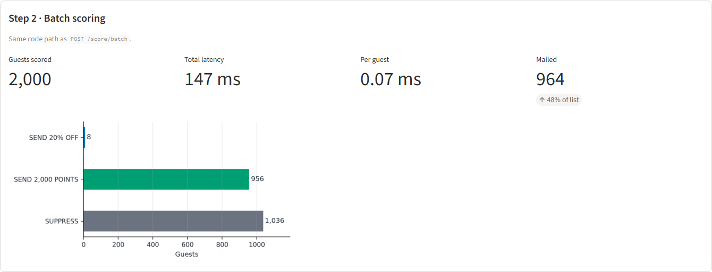 | 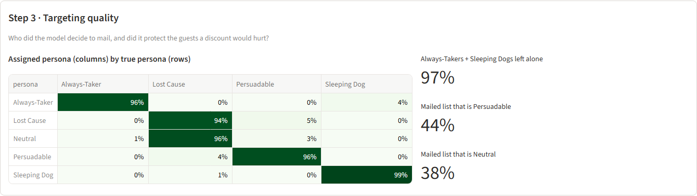 | 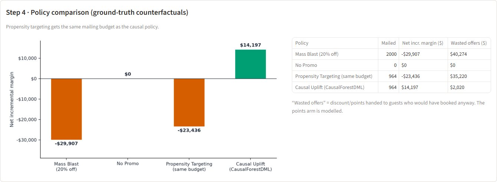 |

<details><summary>Full flow (all five steps)</summary>

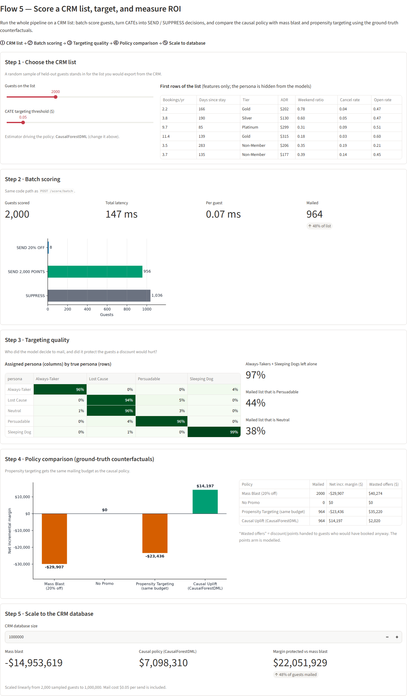

</details>

## Limitations
- Synthetic data and one seed; no confidence bands on the benchmark ranking.
- Persona assignment thresholds (`config.yaml`) were tuned on this DGP; the 0.06 sleeping-dog threshold was set after
  seeing the first confusion matrix.
- The ROI tab re-prices the discount analytically from the DGP formula; the model-side re-pricing is approximate.
- Local SHAP explains an XGBoost *surrogate* fit to each estimator's predictions, not the estimator itself.
- Serving runs on CPU (GPU inference from multiple server threads crashed Streamlit during development).
- Flow guests are the held-out guests nearest each persona's median, so they are clean examples by construction; the
  campaign flow (and the confusion matrix) show how often the model gets less typical guests right.
