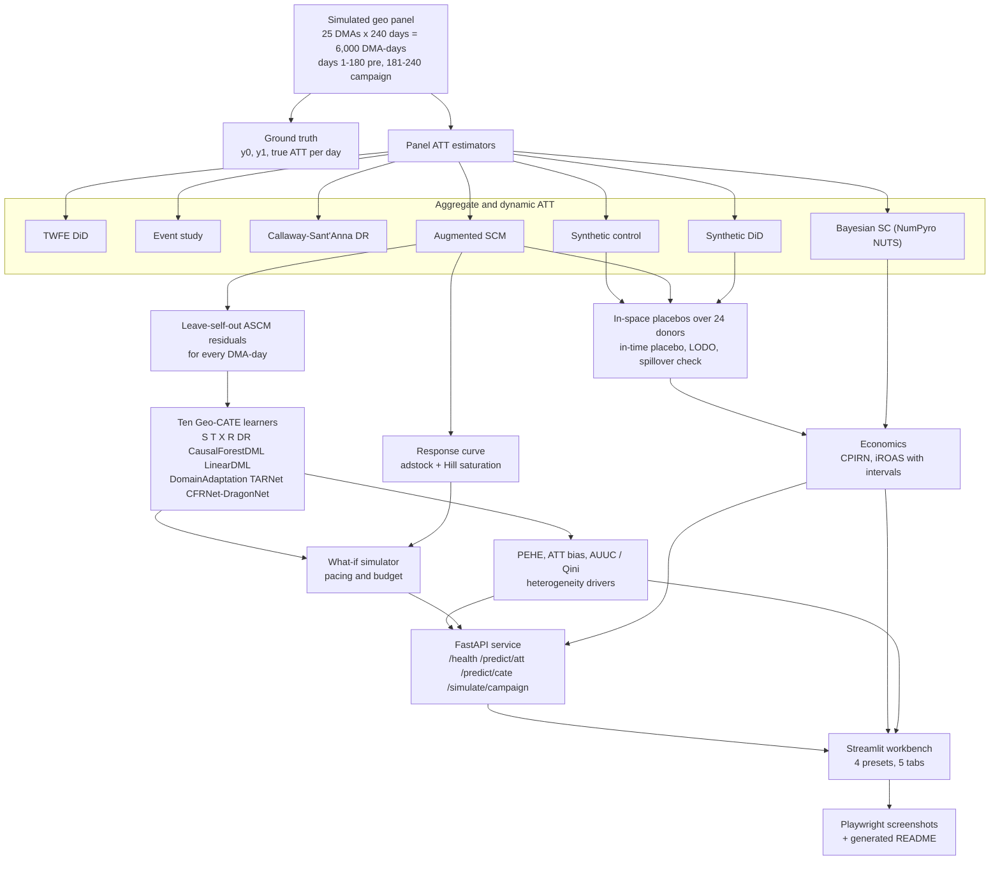

# Regional Brand & Out-of-Home Incrementality Engine

**Aurelia Hotels & Resorts - Miami (MIA) CTV + airport + billboard campaign**

A GPU-accelerated geo-experiment engine that measures what a regional brand campaign actually added when
user-level holdouts are impossible. It runs seven panel causal estimators (DiD, event study, Callaway-Sant'Anna,
synthetic control, augmented SCM, synthetic DiD, Bayesian SCM), ten heterogeneous-effect learners, placebo
diagnostics, a FastAPI service and a Streamlit workbench - all on a simulated 25-DMA x 240-day panel where the
true counterfactual is known, so every estimate can be checked against the truth.

> This README is generated by `scripts/build_readme.py` from the files in `outputs/metrics/`; every number below is
> traceable to a saved artifact. The data are simulated, so the "truth" columns are possible *only* here - in a real
> engagement you would have the estimates and the diagnostics, not the truth.

---

## 1. Executive overview

### The business problem

Aurelia, a luxury and upper-upscale resort brand, runs a high-budget regional brand campaign in **Miami** for 60 days
(Dec 28 2025 - Feb 25 2026, the winter peak) after a 180-day baseline. Connected TV, airport digital spectaculars and
regional billboards reach an entire Designated Market Area at once, so there is no randomised user-level control group.
The question is: **how many incremental room nights, direct web sessions and branded searches did the campaign
create, what did each incremental room night cost, and on which days (weekends, holidays, weather, rival rate cuts,
flight-search surges) does media work hardest?**

### What the engine says (headline analysis: Miami vs. all 24 control DMAs)

| Question | Answer | Truth (simulation) |
|---|---|---|
| Average incremental room nights per day (ASCM) | **@@ASCM@@** (95% interval @@ASCM_LO@@ to @@ASCM_HI@@) | @@TRUTH@@ |
| Total incremental room nights over 60 days | **@@ASCM_TOTAL@@** | @@TOTAL_TRUE@@ |
| iROAS (incremental net revenue / spend) | **@@IROAS@@x** (@@IROAS_LO@@ to @@IROAS_HI@@) | @@TRUE_IROAS@@x |
| Cost per incremental room night (CPIRN) | **$@@CPIRN@@** | $@@TRUE_CPIRN@@ |
| Is the effect distinguishable from placebo markets? | Miami ranks first of 25; exact p = @@PSMALL@@, the smallest attainable | - |
| A plain TWFE DiD against all donors | @@TWFE@@ room nights / day (bias @@TWFE_BIAS@@) | @@TRUTH@@ |

The last row is the point of the exercise: Miami's winter ramp is steeper than the average control DMA, so parallel
trends fail and a naive DiD hands the campaign credit for seasonality. The synthetic-control family re-weights the
donors to track Miami's own pre-period path and stays close to the truth.

One panel is one draw, though. Across @@N_MC@@ freshly simulated panels (section 6.1) TWFE's mean bias is **@@TWFE_MC@@** (RMSE @@TWFE_MC_RMSE@@ room nights/day), so the single-panel figure above is a
worse-than-typical draw, while ASCM's mean bias is **@@ASCM_MC@@** (RMSE @@ASCM_MC_RMSE@@). The ranking is stable; the exact size of the DiD error is not.

---

## 2. End-to-end architecture and causal pipeline



### Repository layout

```
configs/experiment_config.yaml      every tunable (DGP, estimators, CATE, GPU, ports)
data/hospitality_geo_panel.{parquet,csv}   the 6,000-row panel (scenario panels in data/scenarios/)
src/utils/        device.py (GPU/CPU backends, telemetry), logger.py, config.py
src/data/         generate_panel.py          factor-model DGP with planted donor mix and known counterfactuals
src/models/       panel_att.py               the seven panel estimators + in-space placebo inference
                  cate_learners.py           the ten CATE learners (XGBoost/CatBoost GPU, LightGBM, PyTorch CUDA, econml)
                  response_curve.py          adstock + Hill fit and pacing optimiser
                  _solvers.py                simplex-constrained least squares (OSQP, polished)
src/evaluation/   diagnostics.py             placebos, LODO, PEHE, AUUC/Qini, CPIRN, iROAS, Monte-Carlo, artifact writing
                  visualizations.py          the eight 300-DPI figures
src/serving.py    engine shared by the API and the UI (so their numbers always agree)
src/api/main.py   FastAPI service            src/app/streamlit_app.py   Streamlit workbench
scripts/          run_full_pipeline.py, capture_screenshots.py, build_readme.py
tests/            pytest suite (data invariants, estimator recovery, CATE, API contract)
outputs/          models/ metrics/ figures/ logs/ screenshots/
```

---

## 3. The simulated panel

* **25 DMAs x 240 days.** Demand follows a three-factor model in levels (national trend, Sunbelt winter peak, urban/business
  cycle) plus DMA-specific slow drift and AR(1) noise, and the ten observed covariates (competitor ADR, flight-search index,
  temperature, precipitation, weather severity, weekend, holiday window, seasonality sin/cos, OTA promo pressure).
* **Miami is built as a planted convex combination of donor demand** (FLL .30, TPA .20, ORL .15, HNL .12, PHX .08, SAN .08,
  MSY .07, plus a 1.5% level shift), so a synthetic control exists in principle - but its own weather, flight-search and
  competitor shocks stay idiosyncratic, and its winter ramp is much steeper than the donor average.
* **Campaign effect.** Daily spend (pulsed flights, a holiday airport burst, a launch ramp) -> geometric adstock -> Hill
  saturation -> multiplicative modifiers: weekends and holidays and flight-search surges raise lift; OTA pressure, rival rate
  cuts and bad weather lower it. Outcomes: room nights (primary), direct web sessions, branded search index, net revenue.
* **Ground truth** for every row: `y0_true`, `y1_true`, `true_att_it` (plus `true_att_*` for the other outcomes).
* **Four scenario panels** share the same latent no-campaign outcomes but expose a different market (Miami, Las Vegas, New
  York, and a Tampa placebo with true effect 0), which is what the four Streamlit presets run on.

---

## 4. Mathematical formulations

Notation: unit $i$ (DMA), day $t$, first campaign day $T_0+1 = 181$, exposed unit $i=1$ (Miami), donors $j=2..N$, outcome $Y_{it}$,
treatment indicator $D_{it}=\mathbf 1[i=1,\ t>T_0]$, covariates $X_{it}$, $\tau_t$ the daily effect on Miami.

**Two-way fixed-effects DiD.**
$$Y_{it}=\alpha_i+\lambda_t+\tau\,D_{it}+X_{it}'\gamma+\varepsilon_{it},\qquad \widehat{\mathrm{Var}}(\hat\tau)\ \text{clustered by DMA (CR1)}$$
Identification needs parallel trends: $\mathbb E[Y_{1t}(0)-Y_{jt}(0)]$ constant over $t$.

**Event study / dynamic DiD.** Event time $k=t-(T_0+1)$ (so $k=0$ is the first campaign day), reference period $k=-1$:
$$Y_{it}=\alpha_i+\lambda_t+\sum_{k\ne -1}\beta_k\,\mathbf 1[i=1]\,\mathbf 1[t-T_0-1=k]+X_{it}'\gamma+\varepsilon_{it}$$
Leads $k\in[-14,-2]$ test parallel trends; lags $k\in[0,59]$ trace the dynamic effect. The panel has 60 campaign days, so the
last lag is $k=59$.

**Callaway & Sant'Anna doubly robust ATT(g,t)** (never-treated controls $C$, base period $g-1$):
$$\mathrm{ATT}(g,t)=\mathbb E\!\left[\left(\frac{G_g}{\mathbb E[G_g]}-\frac{\frac{p(X)\,C}{1-p(X)}}{\mathbb E\!\left[\frac{p(X)\,C}{1-p(X)}\right]}\right)\big(Y_t-Y_{g-1}-m_{0,g,t}(X)\big)\right]$$
With one treated unit there is a single cohort, so this reduces to a regression-adjusted DiD.

**Synthetic control (Abadie et al.).**
$$\hat w=\arg\min_{w\in\Delta}\ \|y_{1,\mathrm{pre}}-Y_{\mathrm{pre}}\,w\|^2,\quad \Delta=\{w\ge 0,\ \textstyle\sum_j w_j=1\},\qquad \hat\tau_t=y_{1t}-\sum_j\hat w_j\,y_{jt}$$

**Augmented SCM (Ben-Michael, Feller, Rothstein).** Ridge bias correction on the pre-period imbalance:
$$\hat y_{1t}(0)=\sum_j\hat w_j\,y_{jt}+\Big(x_1-X_c'\hat w\Big)'\hat\beta_t,\qquad \hat\beta_t=\arg\min_\beta \|Y_{c,t}-\tilde X_c\beta\|^2+\lambda\|\beta\|^2$$
which is equivalent to re-weighting: $w^{\mathrm{aug}}=\hat w+(\tilde X\tilde X'+\lambda I)^{-1}\tilde X\,(x_1-X_c'\hat w)$ with $\sum_j w^{\mathrm{aug}}_j=1$ but weights allowed to be
negative. $\lambda$ is chosen by rolling-origin validation on the last 30 pre-days; an elastic-net outcome model is also reported.

**Synthetic DiD (Arkhangelsky et al.).** Unit weights $\hat\omega$ and time weights $\hat\lambda$ on the simplex, then a weighted TWFE:
$$(\hat\tau,\hat\mu,\hat\alpha,\hat\beta)=\arg\min\sum_{i,t}\big(Y_{it}-\mu-\alpha_i-\beta_t-\tau D_{it}\big)^2\,\hat\omega_i\hat\lambda_t$$
$$\hat\omega=\arg\min_{\omega_0,\ \omega\in\Delta}\sum_{t\le T_0}\Big(\omega_0+\textstyle\sum_j\omega_jY_{jt}-Y_{1t}\Big)^2+\zeta^2T_0\|\omega\|^2,\qquad \zeta=(T_1)^{1/4}\hat\sigma_{\Delta Y}$$

**Bayesian synthetic control.** Likelihood on the pre-period with AR(1) errors, a sparsity-inducing Dirichlet prior on weights
and a free level shift; the counterfactual is the posterior predictive, so credible intervals reflect weight and noise uncertainty:
$$y_{1t}=\mu_0+\sum_j w_jy_{jt}+u_t,\quad u_t=\rho u_{t-1}+e_t,\ e_t\sim\mathcal N(0,\sigma^2),\quad w\sim\mathrm{Dir}(0.5\cdot\mathbf 1),\ \mu_0\sim\mathcal N(0,0.05^2)$$
Sampled with NUTS (NumPyro / JAX): 4 chains x 600 draws after 600 warm-up.

**Heterogeneous effects.** With $\tilde Y_{it}=(y_{it}-\hat y_{it}(0))/\bar y_{i,\mathrm{pre}}$ the leave-self-out ASCM residual (a placebo
residual for donors, campaign effect for Miami), the target is the conditional lift $\tau(x)=\mathbb E[\tilde Y\mid D=1,x]-\mathbb E[\tilde Y\mid D=0,x]$.

* **S-learner:** $\hat\tau(x)=\hat\mu(x,1)-\hat\mu(x,0)$ from a single model on $[X,D,X\!\cdot\!D]$.
* **T-learner:** $\hat\tau(x)=\hat\mu_1(x)-\hat\mu_0(x)$, one model per arm.
* **X-learner:** impute $\tilde D_i^1=Y_i-\hat\mu_0(X_i)$ (treated), $\tilde D_i^0=\hat\mu_1(X_i)-Y_i$ (controls), fit $\hat\tau_1,\hat\tau_0$, then
  $\hat\tau(x)=g(x)\hat\tau_0(x)+(1-g(x))\hat\tau_1(x)$ with $g=\hat e$.
* **R-learner (Robinson):** $\hat\tau=\arg\min_\tau\sum_i\big[(Y_i-\hat m(X_i))-\tau(X_i)(D_i-\hat e(X_i))\big]^2$ with cross-fitted $\hat m,\hat e$.
* **DR-learner:** $\psi_i=\hat\mu_1-\hat\mu_0+\frac{D_i(Y_i-\hat\mu_1)}{\hat e}-\frac{(1-D_i)(Y_i-\hat\mu_0)}{1-\hat e}$, then regress $\psi_i$ on $X_i$ (propensity trimmed to [0.10, 0.90]).
* **Causal Forest DML / Linear DML:** orthogonalise $Y$ and $D$ on the features (cross-fitted gradient-boosting nuisances), then fit an honest causal forest, or a linear
  CATE $\tau(x)=\theta_0+\theta'x$ on the named effect modifiers (weekend, holiday, flight search, competitor ADR, weather, OTA pressure) with every other feature as a nuisance control.
* **Domain-adaptation learner:** reweights controls toward the treated covariate distribution (Miami vs. donor shift).
* **TARNet:** shared representation $\Phi(x)$ with outcome heads $h_0,h_1$; loss $\sum_i w_i\big(y_i-h_{D_i}(\Phi(x_i))\big)^2$ with $w_i=\frac{D_i}{2p}+\frac{1-D_i}{2(1-p)}$.
* **CFRNet + DragonNet:** adds an integral-probability-metric balance term and a propensity head with targeted regularisation:
$$\mathcal L=\mathcal L_y+\alpha\,\mathrm{MMD}^2\big(\Phi_{D=1},\Phi_{D=0}\big)+\beta\,\mathrm{BCE}\big(e(\Phi),D\big)+\gamma\sum_i\big(y_i-q_i-\epsilon\,h_i\big)^2,\quad h_i=\tfrac{D_i}{\hat e_i}-\tfrac{1-D_i}{1-\hat e_i}$$

**Media response.** $A_t=s_t/1000+\theta A_{t-1}$, $\ \tau_t=c\,\dfrac{A_t^{s}}{A_t^{s}+K^{s}}\,\bar y_t\,m_t$ - adstock carry-over, Hill diminishing returns, and a
market-condition multiplier $m_t$ from the CATE learner.
Fitted on the *estimated* daily effect (never on the truth) with the Hill shape fixed at 1 and $\theta\le 0.9$ as a prior: $\hat\theta=$ @@CRV_THETA@@ (simulation truth @@DGP_THETA@@; it sits on the bound), $\hat K=$ @@CRV_K@@k (truth @@DGP_K@@k), $R^2=$ @@CRV_R2@@ - so treat it as a rough guide, see section 6.5.

---

## 5. GPU acceleration: setup and benchmark

**Hardware used:** @@GNAME@@ (`outputs/logs/hardware_telemetry.json` holds nvidia-smi snapshots through the run; peak total GPU memory in use across all processes: @@PEAK@@ MB). `src/utils/device.py` detects CUDA once and
falls back to CPU automatically if CUDA is missing or `--no-gpu` is given.

| Backend | GPU path | Fallback |
|---|---|---|
| XGBoost | `device="cuda"`, `tree_method="hist"` | `device="cpu"` |
| CatBoost | `task_type="GPU"` | `task_type="CPU"` |
| LightGBM | **CPU only** - the pip wheel is built without CUDA | - |
| PyTorch (TARNet, CFRNet-DragonNet) | `torch.device("cuda")` | `torch.device("cpu")` |
| JAX / NumPyro (Bayesian SC) | JAX backend: `@@JAXBE@@` (devices: @@JAXDEV@@). **Native Windows has no CUDA wheels for JAX**, so the sampler runs on CPU here; on Linux with `jax[cuda12]` it would use the GPU automatically. | CPU |

**Setup**

```bash
conda create -n causal-gpu python=3.12 && conda activate causal-gpu
pip install -r requirements.txt            # torch with a CUDA build: https://pytorch.org/get-started/locally/
python -m playwright install chromium       # only for the screenshots
```

**Measured CPU vs. GPU timings** (`outputs/metrics/gpu_benchmark.csv`, 200 trees / 3 epochs, synthetic 12-feature regression, tiled to size):

@@T_GPU@@

@@GPU_TEXT@@ This is a real finding, not a defect: the panel itself is small, so the GPU matters for scaling the engine (many markets, many
outcomes, large bootstraps), not for the 6,000-row demo.

**The ten CATE learners on the campaign-window panel** (1,500 market-days, `outputs/metrics/gpu_benchmark_cate.csv`):

@@T_GPUC@@

@@GPUC_NOTE@@

---

## 6. Results

All results below are produced by `python scripts/run_full_pipeline.py`.

### 6.1 Panel ATT: Miami vs. all 24 control DMAs (room nights per day)

@@T_HEAD@@

* The synthetic-control family (SCM, ASCM, SDID) tracks the truth; ASCM's ridge correction and SDID's intercepts absorb Miami's level shift.
* TWFE assumes parallel trends, and Miami's winter ramp violates them. The event-study leads are noisy, though: their RMS is @@ES_RMS@@ room nights with a slope of @@ES_SLOPE@@ per day, and the
  permutation pre-trend test against the 24 placebo markets gives p = @@ES_P@@. With one treated unit a pre-trend test has little power, so a clean-looking pre-period does **not** prove parallel
  trends - the Monte-Carlo table below, not the pre-trend p-value, is what shows the DiD family's error.
* With a single treated unit, cluster-robust standard errors are unreliable, so the intervals for every estimator except the Bayesian one are calibrated by **in-space placebos**
  (each donor is re-run as if it had been exposed; the spread of those fake effects sets the standard error).
* Bayesian SC (NUTS, @@BAY_BACKEND@@): max R-hat @@BAY_RHAT@@, min ESS @@BAY_ESS@@, @@BAY_DIV@@ divergences, pre-period posterior-predictive coverage @@BAY_PPC@@.

**Other outcomes (same panel, same estimators):**

@@T_OUT@@

**Monte-Carlo check across @@N_MC@@ freshly simulated panels** (so bias and coverage are not artefacts of one lucky draw):

@@T_MC@@

### 6.2 Placebo and robustness tests

**In-space placebo permutation** (Miami vs. the 24 control DMAs treated as if exposed; exact p-value = share of the 25 units with a post/pre RMSPE ratio at least as large as Miami's):

@@T_PV@@

**In-time placebo** (campaign back-dated to day 120, inside the pre-period; a credible estimator finds roughly zero):

@@T_IT@@

@@IT_NOTE@@

**Leave-one-donor-out and spillover sensitivity** (ATT per day; Fort Lauderdale is adjacent to Miami and may receive spillover):

@@T_LODO@@

Dropping any influential donor moves the ASCM estimate between @@LODO_MIN@@ and @@LODO_MAX@@ room nights per day; excluding the adjacent Fort Lauderdale market gives @@FLL@@. By contrast, @@LODO_SCM@@.

**The four presets (Streamlit one-click scenarios):**

@@T_PRE@@

The Las Vegas and New York presets use 4 and 3 donors, so the placebo distribution has only 5 and 4 members: the smallest attainable p-value is 0.20 and 0.25 and the
placebo-calibrated intervals are very wide. That is the honest price of a thin donor pool, not a bug. The Tampa preset is a genuine negative control (true effect 0). @@TPA_NOTE@@

### 6.3 Economics

@@T_ECON@@

Truth: @@TOTAL_TRUE@@ incremental room nights, CPIRN $@@TRUE_CPIRN@@, iROAS @@TRUE_IROAS@@x. iROAS = incremental net revenue (room revenue x ancillary uplift x (1 - distribution cost)) / spend.

### 6.4 Heterogeneous Geo-CATE: ten learners

PEHE is the RMSE of the predicted vs. true daily effect on Miami's 60 campaign days (room nights); mean +/- sd over @@NSEEDS@@ independently simulated panels.
The two reference rows bound what is achievable: a constant effect (PEHE @@CONST@@) and an oracle regression of the true effect on the features (PEHE @@ORACLE@@).
Qini = 0 means a random ordering of campaign days, 1 means perfect ordering; "observed" scores the ranking against the synthetic-control gap, which needs no ground truth.

@@T_CATE@@

* @@NBEAT@@ of the ten learners beat the constant-effect baseline on PEHE; the lowest is **@@BEST@@** at @@BEST_PEHE@@.
  Every learner ranks campaign days better than random (oracle Qini @@QINI_RANGE@@), which is what matters for **flighting**: knowing *which* days work hardest is easier than the exact room-night count.
* Heterogeneity the best learner recovers (room nights per day, estimated / true): weekend @@WK_E@@ / @@WK_T@@ vs. weekday @@WD_E@@ / @@WD_T@@; holiday window @@HO_E@@ / @@HO_T@@ vs. other days @@NH_E@@ / @@NH_T@@.
  Largest Linear-DML coefficients (room nights per +1 sd): @@COEF_TOP@@.
* Only 60 rows are treated. Treat the learner ranking as indicative: standard deviations across seeds are large relative to many of the gaps.
* Read the Linear-DML coefficients as a descriptive CATE surface, not as causal elasticities: with one treated market a feature's level is partly a proxy for "being Miami" (e.g. competitor ADR is higher there), so a coefficient mixes within-Miami effect modification with cross-market level differences.

### 6.5 Flighting and pacing: does the projection survive the truth?

The what-if simulator scores a budget plan with the fitted response curve (adstock + saturation, multiplied by the best CATE learner's day-by-day market multiplier).
Because the data are simulated, every plan can also be scored with the *true* response function, which is the only way to grade a recommendation. Same $ budget in every row:

@@T_PACE@@

* The curve correctly flags the one gross mistake: back-loading the budget is **@@BACK_PROJ@@** projected and **@@BACK_TRUE@@** true.
* It cannot rank the reasonable plans. The constrained "optimised" plan is projected at **@@OPT_PROJ@@** but is **@@OPT_TRUE@@** under the truth; the gains it projects for front-loading and the optimiser are not real.
  The fit is only moderate (R^2 @@CRV_R2_RAW@@) and the carry-over parameter sits on its prior bound, so a 60-day window cannot separate long carry-over from slow demand drift.
* Practical reading: avoid back-loading and 7-on/7-off pulsing, otherwise even, weekend-weighted or CATE-weighted pacing are indistinguishable within the noise. The optimiser keeps every day between 30% and 250% of even spend
  precisely because an unconstrained search on this curve just front-loads everything.

---

## 7. Visual walkthrough

### Figures (`outputs/figures/`, 300 DPI)

@@VIS@@

### Live API and workbench screenshots (`outputs/screenshots/`, captured with Playwright against the running services)

@@SHOTS@@

---

## 8. Running it

```bash
python scripts/run_full_pipeline.py              # data -> panel ATT -> CATE -> Monte-Carlo -> GPU benchmark -> figures -> verify
python scripts/run_full_pipeline.py --quick      # fast smoke run
python scripts/run_full_pipeline.py --no-gpu     # force CPU
python -m uvicorn src.api.main:app --port 8000   # Swagger UI at http://127.0.0.1:8000/docs
python -m streamlit run src/app/streamlit_app.py --server.port 8501
python scripts/capture_screenshots.py            # starts both services, screenshots, shuts them down
python scripts/build_readme.py                   # regenerate this file from outputs/metrics
python -m pytest tests -q
```

`make all`, `make api`, `make ui`, `make test`, ... mirror these when GNU make is available.

### API

| Endpoint | Purpose |
|---|---|
| `GET /health` | liveness, loaded models, best learner, fitted response curve |
| `POST /predict/att` | ATT for a preset or a custom treated market / donor pool; cached or re-run live |
| `POST /predict/cate` | conditional lift for market-day conditions from any of the ten learners (CIs for the DML learners) |
| `POST /simulate/campaign` | budget and pacing what-if: incremental room nights, CPIRN, iROAS for eight pacing strategies incl. an optimiser |

```bash
curl -s -X POST http://127.0.0.1:8000/simulate/campaign -H "Content-Type: application/json" \
     -d '{"budget_usd": 3000000, "strategy": "optimized"}'
```

### Streamlit workbench

Sidebar presets: **1** Miami flagship (winter-peak CTV + airport vs. coastal/Sunbelt donors), **2** Las Vegas (convention and billboard blitz vs. ORL, SAN, PHX, AUS),
**3** New York (spring-break awareness push vs. BOS, CHI, DCA), **4** negative/placebo control (TPA). Tabs: executive summary and iROAS calculator; DiD and event study;
synthetic control and donor lab (live re-run with a custom donor pool); Geo-CATE studio with a what-if simulator and pacing optimiser; live FastAPI integration and batch scoring.

---

## 9. Limitations and honest caveats

* **One treated market.** Staggered-adoption machinery (Callaway-Sant'Anna) collapses to a single cohort, and cluster-robust SEs are unreliable; inference rests on placebo permutation and the Bayesian posterior.
* **The event study ends at k = 59.** The spec's "+60" cannot exist: the panel has 60 campaign days (k = 0..59).
* **Linear DML needs the driver restriction.** Fitted on all 12 features its coefficients exploded (seasonality and days-since-launch are near-collinear inside a 60-day window), so the linear stage uses only the named drivers.
* **Thin treated sample for CATE.** 60 treated rows; the CATE outcome is a synthetic-control residual, so CATE inherits any counterfactual error of the panel estimator.
  The DR-learner is the least stable (AIPW weights with ~4% treated); we trim its propensity rather than hide that.
* **Bayesian SC is not automatically better.** Its intervals are the narrowest and, in the Monte-Carlo table, its bias is larger than ASCM's: posterior averaging over weakly identified donor weights
  smooths towards donors that extrapolate worse in the winter ramp. A sparsity prior and a higher target-accept were chosen on separate validation seeds (not the reporting seed).
* **Small donor pools give weak inference.** Presets 2 and 3 cannot reach a p-value below 0.20 / 0.25 whatever the data say.
* **Spillover.** Fort Lauderdale neighbours Miami; the LODO table shows the sensitivity, but the simulation itself has no spillover.
* **Simulated data.** All "truth" columns exist only because the data are generated; real data would not have them. The DGP's factor structure was designed so a synthetic control exists.
* **GPU gains depend on workload and size.** The boosted-tree learners lose on the GPU at this panel's size and win only at much larger sizes; the PyTorch networks gain at every size (see the measured tables). JAX runs on CPU on native Windows.
